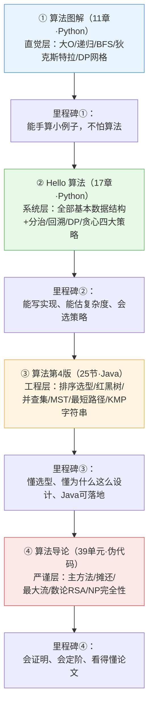

# 四本算法书 · 跨书总览

> 这是一套把四本算法经典「点化」成零基础可自学课程之后的**总导航**。
> 四本书不是让你都从头读到尾，而是一级一级往上爬的台阶：先建立直觉，再系统建模，再工程选型，最后数学严谨化。
> 本目录只做「跨书串联」，每本书自己的章节正文、术语表、测验、抽认卡都在各自目录里。

---

## 一、四本书一句话定位对比

| | 算法图解 | Hello 算法 | 算法（第4版） | 算法导论（CLRS） |
|---|---|---|---|---|
| **作者** | Aditya Bhargava（袁国忠 译） | 靳宇栋 Krahets | Sedgewick & Wayne（谢路云 译） | Cormen / Leiserson / Rivest / Stein |
| **演示语言** | Python | Python | Java | 伪代码 |
| **章节数** | 11 章 | 17 章（含第0章导读） | 25 节（按原书 6 章拆小节） | 39 单元（35 章 + 4 附录） |
| **风格** | 生活类比 + 一页图 + 一段代码，最薄最暖 | 系统课：复杂度→数据结构→四大策略，代码可跑 | 实现→分析→比较→改进，讲工程选型 | 最严谨：定理、证明、渐近记号全套 |
| **它回答的问题** | "算法这东西大概是怎么回事？" | "数据结构和算法到底有哪几类？怎么写？" | "这个场景到底该选哪个？为什么？" | "凭什么说它是对的、是快的？快到什么量级？" |
| **适合谁** | 完全没碰过算法、想先不怕它的人 | 想系统过一遍数据结构+算法策略的人 | 想写出工程上能用的代码、懂选型的人 | 考研/读论文/想懂证明与复杂度下界的人 |

**一句话**：图解给你「感觉」，Hello 给你「骨架」，第四版给你「工程手感」，导论给你「数学底座」。

---

## 二、推荐学习顺序

> 推荐顺序：**算法图解 → Hello 算法 → 算法（第4版） → 算法导论**
> 这个顺序是拿四本书 manifest 里的真实难度与覆盖面核对过的，结论成立，下面说明为什么。

### 为什么是这个顺序（三条依据）

**依据 1：难度曲线由浅入深，每一级都踩在上一级的肩膀上**
- 图解 11 章里难度标 1~2 的占绝大多数（manifest 难度字段：ch01/ch02/ch10/ch11 都是 1），它只讲「直觉」，不要求你会写完整工程代码。
- Hello 算法把图解里「点到为止」的东西系统展开：图解第3章讲递归，Hello 用整整 ch02/ch07/ch12/ch14 反复打磨；图解 ch05 讲散列表，Hello 有独立 ch06。
- 第四版突然切到 Java、强调 ADT（抽象数据类型，即「只露操作接口、藏内部实现」）和排序选型，这是「工程化」的一跳，必须先有 Hello 的 Python 骨架才接得住。
- 导论要求你读 Θ/O/Ω 三套渐近记号、主方法（给递归式 T(n)=aT(n/b)+f(n) 定阶的工具）、循环不变式证明，这是「数学化」的最后一跳。

**依据 2：覆盖面是「补盲」关系，不重复也不打架**
- 图解**没讲**的：堆、平衡树、最小生成树、并查集、字符串匹配、回溯。这些空缺由 Hello（补堆 ch08、回溯 ch13）和第四版（补并查集 ch01e、最小生成树 ch04c、红黑树 ch03c、字符串 ch05a~e）逐一补上。
- Hello**没讲透**的：红黑树只在 ch07 提了一嘴 AVL，最小生成树、并查集、KMP 字符串匹配完全没有——这些正是第四版的主场。
- 第四版**没有单独成章**的：动态规划、回溯（散见各章）——这两块的「系统课」其实在 Hello（ch14/ch13）和导论（ch15）里。
- 导论独有、前三本都不碰的：摊还分析 ch17、B 树 ch18、斐波那契堆 ch19、最大流 ch26、数论与 RSA ch31、FFT ch30、NP 完全性 ch34。这些是「进阶弹药库」。

**依据 3：语言与讲解风格逐级加码**
- Python 直觉（图解）→ Python 可运行代码（Hello）→ Java 工程实现（第四版）→ 伪代码 + 数学（导论）。
- 先在最熟悉的 Python 里建立「复杂度手感」，再换成 Java 理解「为什么工程上要封装 ADT」，最后读伪代码时你已经知道它在描述什么，不会被语法绊住。

### 每一步读完的「能力里程碑」

| 阶段 | 读完后你应该能 |
|---|---|
| ① 图解 | 能口算 log₂n、分清 O(n)/O(n²)/O(n!)；能手算 BFS 和狄克斯特拉的小例子；知道背包问题大概怎么填表 |
| ② Hello | 能独立写出数组/链表/栈/队列/哈希表/二叉树/堆的 Python 实现；能判断一个题该用分治、回溯还是动态规划；能给一段代码估时间+空间复杂度 |
| ③ 第四版 | 能在「要排序」时按数据量/稳定性/内存约束选出插入/归并/快排/堆排；能讲清 BST 为什么会退化、红黑树怎么救；能读懂邻接表上的 Dijkstra/Prim/Kruskal |
| ④ 导论 | 能用主方法解递归式；能讲清 P/NP/NPC 的区别；能证明「基于比较的排序最快就是 O(n log n)」；看得懂论文里的复杂度声明 |

### 何时可以跳过 / 直接进阶

- **已经会 Python、上过一门数据结构课**：图解可以只看 ch01（大O手感）和 ch07/ch09（Dijkstra、DP 直觉），其余跳，直接进 Hello。
- **Hello 觉得简单**：ch04~ch09（基本数据结构）可快速过，把时间留给 ch12~ch15（分治/回溯/DP/贪心），然后直接进第四版。
- **第四版里 Java 语法是障碍**：ch01a/ch01b 的编程模型部分可对照 Hello 的 Python 版理解，重点抓 ch01d（复杂度）、ch01e（并查集）、ch03c（红黑树）、ch04（图）。
- **目标是考研/理论**：第四版可略读工程选型（ch02e、ch03e），把时间压给导论；但第四版 ch04c（MST）和 ch04d（最短路径）是导论 ch23/ch24 的直觉前置，别整段跳。
- **导论里的高级专题**（ch18 B树、ch19 斐波那契堆、ch20 vEB、ch27 多线程、ch28 矩阵、ch29 线性规划）属于「知道有这回事即可」，核心主线是 ch01~ch17 + ch21~ch26 + ch34/ch35。

---

## 三、跨书学习路线图（Mermaid）

读法：四个色块就是四个台阶，箭头表示「读完前一本再读后一本」。每本书内部的章节顺序，遵照各自目录下 `SKILL.md` 里的拓扑序即可。

---

## 四、每本书的入口指引

> 四本书都长成同一套骨架：`chapters/`（章节正文）、`concepts/`（跨章概念页）、`glossary.md`（术语表）、`quiz.md`（测验）、`flashcards.md`（抽认卡）、`cheatsheet.md`（速查表）、`patterns.md`（模式库）。
> 每本书还配一个可直接在浏览器打开的 **HTML 学习伴侣**，用来交互刷题/看可视化。

| 书 | 目录 | HTML 学习伴侣 | Markdown 知识库入口 |
|---|---|---|---|
| 算法图解 | `../02-算法图解/` | `02-算法图解/算法图解学习伴侣.html` | `SKILL.md`（学习总纲）→ `chapters/ch01~ch11` → `glossary.md` |
| Hello 算法 | `../01-hello算法/` | `01-hello算法/hello算法学习伴侣.html` | `SKILL.md` → `chapters/ch00~ch16` → `concepts/`（7 个跨章概念页） |
| 算法第4版 | `../03-算法第四版/` | `03-算法第四版/算法第四版学习伴侣.html` | `SKILL.md` → `chapters/ch01a~ch06` → `concepts/`（10 个概念页） |
| 算法导论 | `../04-算法导论/` | `04-算法导论/算法导论学习伴侣.html` | `SKILL.md` → `chapters/ch01~ch39` → `concepts/`（12 个概念页） |

**怎么用这套总览**：
1. 先在本目录看 `跨书概念映射表.md`——同一个概念在四本书里分别在哪一章、谁讲得最直觉、谁讲得最严谨，一查就知道。
2. 学完四本后，用 `综合检验建议.md` 做跨书整合题，并按间隔重复节奏复习。
