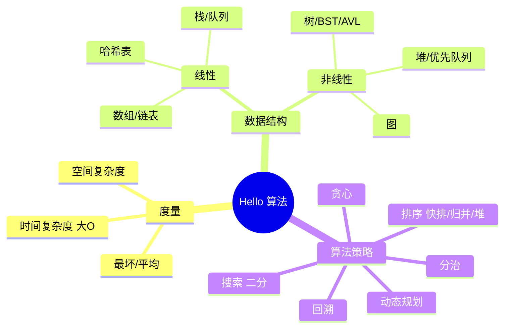

# Hello 算法 点化学习系统

## 这本书在讲什么
本书回答一个核心问题：**面对一个问题，怎么设计出又正确又高效的程序？** 作者的主张是：算法与数据结构是一体两面——先建立"复杂度"这把衡量快慢的尺子，再认识各类数据结构如何摆数据，最后学搜索、排序、分治、回溯、动态规划、贪心这套算法策略。全书用 Python 演示，代码可直接运行。

## 全书心智模型

## 学习路径（推荐顺序，拓扑序）
| 步骤 | 章节 | 主题 | 前置 | 检查点 |
|---|---|---|---|---|
| 01 | ch00 | 前言与导读 | 无 | 通过 ch00 自测 |
| 02 | ch01 | 初识算法 | ch00 | 通过 ch01 自测 |
| 03 | ch02 | 复杂度分析 | ch01 | 通过 ch02 自测 |
| 04 | ch03 | 数据结构 | ch02 | 通过 ch03 自测 |
| 05 | ch04 | 数组与链表 | ch03 | 通过 ch04 自测 |
| 06 | ch05 | 栈与队列 | ch04 | 通过 ch05 自测 |
| 07 | ch06 | 哈希表 | ch04 | 通过 ch06 自测 |
| 08 | ch07 | 树（二叉树） | ch04,ch05 | 通过 ch07 自测 |
| 09 | ch08 | 堆 | ch07 | 通过 ch08 自测 |
| 10 | ch09 | 图 | ch05,ch07 | 通过 ch09 自测 |
| 11 | ch10 | 搜索（二分） | ch02,ch04 | 通过 ch10 自测 |
| 12 | ch11 | 排序 | ch04,ch08,ch10 | 通过 ch11 自测 |
| 13 | ch12 | 分治 | ch02,ch07,ch11 | 通过 ch12 自测 |
| 14 | ch13 | 回溯 | ch05,ch07,ch12 | 通过 ch13 自测 |
| 15 | ch14 | 动态规划 | ch02,ch12,ch13 | 通过 ch14 自测 |
| 16 | ch15 | 贪心 | ch14 | 通过 ch15 自测 |
| 17 | ch16 | 附录 | 全书 | 术语表过一遍 |

## 章节索引
- 第 0 章 前言与导读（难度 ★☆☆）→ chapters/ch00-前言与导读.md
- 第 1 章 初识算法（难度 ★☆☆）→ chapters/ch01-初识算法.md
- 第 2 章 复杂度分析（难度 ★★☆）→ chapters/ch02-复杂度分析.md
- 第 3 章 数据结构（难度 ★☆☆）→ chapters/ch03-数据结构.md
- 第 4 章 数组与链表（难度 ★★☆）→ chapters/ch04-数组与链表.md
- 第 5 章 栈与队列（难度 ★☆☆）→ chapters/ch05-栈与队列.md
- 第 6 章 哈希表（难度 ★★☆）→ chapters/ch06-哈希表.md
- 第 7 章 树（难度 ★★★）→ chapters/ch07-树.md
- 第 8 章 堆（难度 ★★☆）→ chapters/ch08-堆.md
- 第 9 章 图（难度 ★★☆）→ chapters/ch09-图.md
- 第 10 章 搜索（难度 ★★☆）→ chapters/ch10-搜索.md
- 第 11 章 排序（难度 ★★★）→ chapters/ch11-排序.md
- 第 12 章 分治（难度 ★★☆）→ chapters/ch12-分治.md
- 第 13 章 回溯（难度 ★★★）→ chapters/ch13-回溯.md
- 第 14 章 动态规划（难度 ★★★）→ chapters/ch14-动态规划.md
- 第 15 章 贪心（难度 ★★☆）→ chapters/ch15-贪心.md
- 第 16 章 附录（难度 ★☆☆）→ chapters/ch16-附录.md

## 前置知识（零基础缺口补讲）
| 缺口 | 对应补讲位置 | 学完标志 |
|---|---|---|
| 不会 Python 基本语法（list/函数/循环） | ch00 学法建议 + ch04 代码实例 | 能跑通 ch04 的 list 示例 |
| 不懂"递归"为何物 | concepts/递归.md + ch02 | 能写出求阶乘的递归函数 |
| 没听过"大 O" | ch02 概念 2-3 + concepts/复杂度度量.md | 能给一段代码估复杂度 |
| 不熟悉对数/指数增长直觉 | ch02 阶序口诀 + 图示 | 记住 7 个阶序排序 |

## 术语表 / 模式库 / 速查表 入口
- 术语表：glossary.md
- 模式与反模式：patterns.md
- 速查表：cheatsheet.md
- 测验：quiz.md
- 抽认卡：flashcards.md
