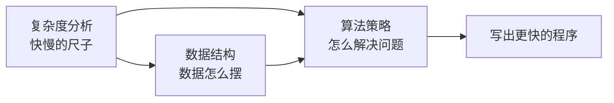

# 第 0 章：前言与导读

- **难度**：★☆☆ | **预估学时**：0.5 小时 | **前置**：无

## 学习目标
学完本章，你能：
- 说清这本书在教什么、按什么顺序学；
- 说出本书推荐的学习路径和每类读者该怎么读；
- 知道学习算法时"多写代码、多画图"的理由。

## 一句话核心
学算法不是背代码，而是学会"用数据结构装数据、用复杂度选方法"的一整套思维方式。

## 零基础讲解
### 概念 1：这本书的定位（难度：基础）
《Hello 算法》是一本面向零基础的**算法与数据结构**入门书。它的目标不是让你背面试题，而是带你建立两件事：

1. **数据结构**——数据在计算机里是怎么"摆"的（数组、链表、栈、队列、哈希表、树、堆、图）；
2. **算法效率分析**——给定一个问题，怎么判断哪种解法快、快多少（时间/空间复杂度）。

全书用 Python 代码演示，代码都可以直接复制运行。

### 概念 2：推荐学习路径（难度：基础）
本书章节本身就是按认知顺序排好的，这就是一条推荐学习路径：

1. 先学**复杂度分析**（第 2 章），建立"快慢"的尺子；
2. 再学**基本数据结构**（数组链表 → 栈队列 → 哈希表 → 树 → 堆 → 图）；
3. 然后学**算法策略**（搜索 → 排序 → 分治 → 回溯 → 动态规划 → 贪心）。

本书特别强调：算法和数据结构是"一体两面"——很多算法快，是因为用了合适的数据结构。

### 概念 3：怎么用这本书（难度：基础）
- **动手跑代码**：每段代码都亲手敲一遍、改一遍。看懂和写出来是两回事。
- **画图**：树怎么遍历、递归怎么展开，光看文字容易晕，自己画一遍就通了。
- **联系生活**：本书大量用"摞盘子""排队找零"这类日常类比，别把它当废话，类比是帮你记牢概念的钩子。

## 图示

**看图说明**：这张图说明全书三大块的关系——复杂度是尺子，数据结构是地基，算法策略是盖楼；三者合起来，目标是"写出更快的程序"。

## 类比与实例
- 类比：学算法像学做菜。数据结构是厨具（锅、刀、砧板），算法是菜谱步骤，复杂度分析是评估"这道菜几分钟能做好"。**失效边界**：做菜可以凭感觉，算法必须靠公式算复杂度。
- 实例：想从 100 万条用户记录里找一个人——遍历找要看 100 万次（O(n)）；如果事先按名字建了哈希表，平均看 1 次就找到（O(1)）。这就是数据结构带来的效率差距。

## 常见误解
- 别以为"会写代码就等于会算法"——实际上能跑和跑得快是两回事。同样的需求，O(n²) 的程序处理大数据量时会慢几百倍，工程上这就是事故。
- 别以为"算法只对程序员有用"——实际上复杂度思维能帮你判断任何"规模翻倍后成本怎么涨"的问题，包括日常排流程、做预算。

## 自测题（答案）
1. （单选）本书推荐的学习起点是？ A. 动态规划 B. 复杂度分析 C. 红黑树 D. 面试题刷题（答案：B；解析：先建立"快慢的尺子"，后面学数据结构和算法时才有判断依据。）
2. （判断）数据结构和算法是互相独立、可以完全分开学习的两块内容。（答案：错误；解析：本书强调二者是一体两面，很多算法之所以快，正因为借助了合适的数据结构。）
3. （填空）评估一个算法快不快的量化工具是____分析。（答案：复杂度（时间/空间复杂度）。）

## 复习锚点
- 全书三件套：复杂度（尺子）、数据结构（地基）、算法策略（盖楼）。
- 学习路径：复杂度 → 基本数据结构 → 搜索/排序 → 分治/回溯/DP/贪心。
- 学法：亲手跑代码 + 画图 + 借助类比。
