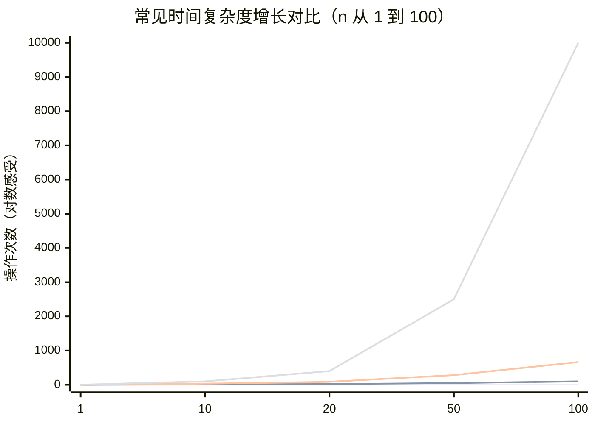

# 第 2 章：复杂度分析

- **难度**：★★☆ | **预估学时**：2.5 小时 | **前置**：第 1 章

## 学习目标
学完本章，你能：
- 区分时间复杂度与空间复杂度，并用大 O 记号表示；
- 看懂迭代与递归代码，估算它们的复杂度；
- 记住常见复杂度的大小排序，并据此比较算法快慢；
- 理解最坏/最好/平均时间复杂度的区别。

## 一句话核心
复杂度是算法效率的"度量衡"：大 O 记号描述输入规模 n 变大时，运行时间或内存占用大致涨多快。

## 零基础讲解
### 概念 1：为什么要复杂度分析（难度：基础）
同一问题可以写多个程序。直接拿秒表测时间不公平——换台电脑结果就变了。复杂度分析**不看具体秒数，只看"随输入规模 n 增长"的趋势**：当数据量从 1 万涨到 1 亿，时间是涨 1 万倍还是涨 1 亿倍？这个趋势与机器快慢无关，是算法本身的属性。

### 概念 2：时间复杂度（time complexity）（难度：基础）
统计代码里基本操作（一次赋值、一次比较）的执行次数，把它写成 n 的函数，然后**只保留最高阶项、丢掉系数**，就是大 O 时间复杂度。

```python
def sum_n(n):
    s = 0
    for i in range(1, n + 1):   # 循环 n 次
        s += i                  # 每次 1 次加法
    return s
```
基本操作 ≈ n 次 → 时间复杂度 **O(n)**。

```python
def sum_n2(n):
    s = 0
    for i in range(1, n + 1):
        for j in range(1, n + 1):  # 外层 n 次 × 内层 n 次
            s += 1
    return s
```
基本操作 ≈ n×n = n² 次 → 时间复杂度 **O(n²)**。

### 概念 3：大 O / 大 Ω / 大 Θ（难度：进阶）
- **大 O（渐近上界）**：当 n 很大时，运行时间"不超过"某个量级。它描述**最差情况下**增长得有多快，是最常用的。
- **大 Ω（渐近下界）**：运行时间"至少"达到某个量级。
- **大 Θ（渐近紧界）**：运行时间"恰好是"这个量级，上下界一致。

日常分析里默认用大 O。

### 概念 4：常见时间复杂度排序（难度：基础，必须背）
从快到慢：

**O(1) 常数 < O(log n) 对数 < O(n) 线性 < O(n log n) < O(n²) 平方 < O(2ⁿ) 指数 < O(n!) 阶乘**

记忆锚点：n=10 亿时，O(n) 要算 10 亿次，O(log n) 只要约 30 次，O(n²) 要算 10¹⁸ 次——指数阶在 n 稍大时就完全不可行。

### 概念 5：迭代 vs 递归（难度：进阶）
- **迭代（iteration）**：用循环一步步推进。
- **递归（recursion）**：函数自己调用自己，必须有一个**终止条件**，否则无限调用下去栈溢出。
- **调用栈**：每一层未返回的递归函数都占一块内存；递归越深，栈占用越大。
- **尾递归**：把递归调用放在函数最后一步，理论上可被优化；Python 默认不做尾递归优化，所以递归深度受栈大小限制。

斐波那契递归 `fib(n)=fib(n-1)+fib(n-2)` 展开成一棵重复子问题极多的递归树 → **O(2ⁿ)**；改成从 1 递推到 n 的循环 → **O(n)**。

### 概念 6：空间复杂度（space complexity）（难度：基础）
统计算法运行中额外占用的内存（数组大小、递归栈深度）随 n 的增长：

```python
def array(n):
    nums = [0] * n     # 开了 n 个元素的数组
    return nums
```
→ 空间复杂度 **O(n)**。若只用几个变量，不开数组、不深递归 → **O(1)**（原地/常数空间）。

常见空间复杂度排序：O(1) < O(log n) < O(n) < O(n²) < O(2ⁿ)。

### 概念 7：最坏 / 最好 / 平均时间复杂度（难度：进阶）
- **最坏**：输入最不利时（比如要找的数正好在数组末尾），复杂度上界——最关心。
- **最好**：输入最有利时。
- **平均**：所有可能输入的期望。
大多数工程问题默认按最坏情况做复杂度分析，这样性能才有保证。

## 图示

**看图说明**：同样输入规模 n，O(n²) 的操作数随 n 暴涨，O(log n) 几乎是平的。这就是"选对算法"的价值。

## 类比与实例
- 类比：复杂度像"打车计价的增长规律"。O(n) 是按公里线性跳表；O(n²) 是公里数翻倍、钱翻四倍；O(2ⁿ) 是公里数翻倍、钱翻一倍再乘自己——这种表你根本不敢上。**失效边界**：大 O 只管大 n 的趋势，数据量极小时 O(n²) 可能因为代码简单反而比 O(n log n) 快（常数项胜出）。
- 实例：在 100 万条记录里查一条。顺序查找 O(n)≈100 万次；二分查找 O(log n)≈20 次；斐波那契暴力递归 O(2ⁿ) 则完全跑不动。

## 常见误解
- 别以为"代码短就快"——实际上递归版斐波那契只有两行，却是 O(2ⁿ) 的灾难；递推版多写几行，却是 O(n)。
- 别以为大 O 是精确运行时间——实际上它只保留最高阶、丢系数，O(2n) 和 O(n) 都是 O(n)。
- 别以为递归一定优雅高效——实际上每一层都占调用栈内存，且没有尾递归优化时深度大了会栈溢出。

## 自测题（答案）
1. （单选）双重循环各执行 n 次的代码，时间复杂度是？ A. O(n) B. O(2n) C. O(n²) D. O(n³)（答案：C；解析：n×n=n²，大 O 丢系数后为 O(n²)。）
2. （排序）把下列复杂度按从快到慢排列：O(n!)、O(log n)、O(2ⁿ)、O(n)、O(1)。（答案：O(1) < O(log n) < O(n) < O(2ⁿ) < O(n!)；解析：这是必须背熟的复杂度阶序。）
3. （单选）分析算法复杂度时最常默认看哪种情况？ A. 最好 B. 最坏 C. 平均 D. 随机（答案：B；解析：按最坏情况分析，性能才有保证。）
4. （填空）递归函数必须有______条件，否则会无限调用导致栈溢出。（答案：终止/基线；解析：这是递归成立的前提。）

## 复习锚点
- 大 O 只留最高阶、丢系数，描述 n 很大时的增长趋势。
- 阶序口诀：常数 < 对数 < 线性 < n log n < 平方 < 指数 < 阶乘。
- 递归 = 自己调自己 + 终止条件；每层占调用栈。
- 默认按最坏情况分析复杂度。
