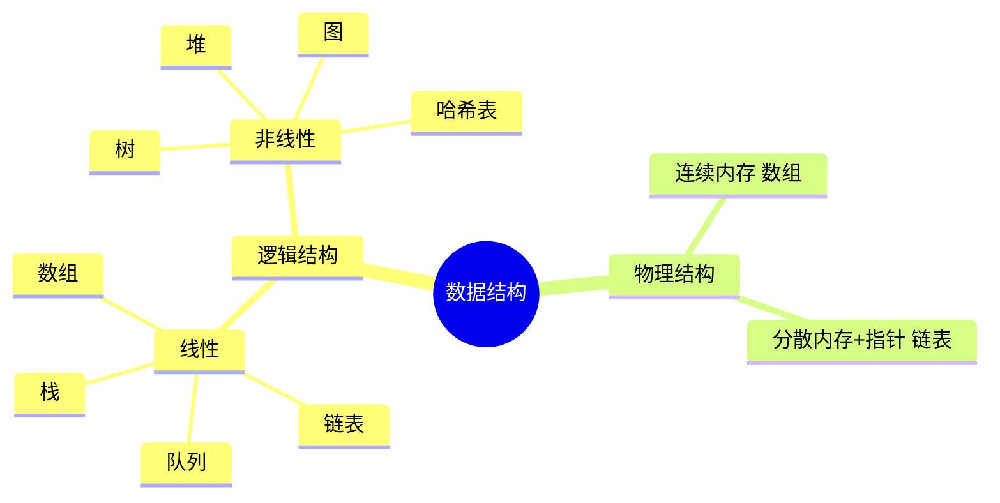

# 第 3 章：数据结构

- **难度**：★☆☆ | **预估学时**：1.5 小时 | **前置**：第 2 章

## 学习目标
学完本章，你能：
- 说出数据结构的两大类及其区别；
- 认识计算机最基本的数据类型；
- 理解为什么要区分"数据结构"这个概念本身。

## 一句话核心
数据结构是数据在计算机里的"摆放方式"——不同摆法决定了增删查改各自的快慢。

## 零基础讲解
### 概念 1：数据结构的两大分类（难度：基础）
**数据结构**指一组数据的组织与存储方式。本书把它分为两大类：

1. **逻辑结构**：数据之间"逻辑上"的关系，与具体存储无关。包括：
   - 线性结构（数组、链表、栈、队列）：数据排成一条线；
   - 非线性结构（树、图、堆、哈希表）：数据是层次或网状关系。
2. **物理结构（存储结构）**：数据在内存里"实际怎么放"，分两种：
   - **连续内存**（如数组）：元素紧挨在一起，靠下标直接算位置；
   - **分散内存 + 指针串联**（如链表）：元素各处存放，每个元素记着下一个在哪。

同一种逻辑结构可以用不同物理方式存。

### 概念 2：基本数据类型（难度：基础）
程序里最底层的数据单位：整数 int、浮点数 float、字符 char、布尔 bool。它们由编程语言直接提供，占固定字节数。理解它们是理解"编码"（数字怎么转二进制、字符怎么编码）的起点。

### 概念 3：数字编码与字符编码（难度：进阶）
- 整数在计算机里以**补码**存储（负数用补码表示），这样加减法统一。
- 字符用编码表映射成数字：英文字符用 ASCII，中文用 Unicode/UTF-8。
这些是"懂底层"的加分项，但不是本书主线——主线是用这些基本类型去搭更复杂的数据结构。

## 图示

**看图说明**：左半边是"数据之间什么关系"（逻辑），右半边是"在内存里怎么放"（物理）。后面每章学的都是一个具体成员。

## 类比与实例
- 类比：数据结构像整理衣柜。叠好竖放进格（连续内存）拿一件快但不好塞新的；一件件挂起来（链表）增减灵活但找一件要从头顺着挂钩摸。**失效边界**：真实衣柜可以随手塞，计算机内存分配必须规整。
- 实例：全班成绩——要快速按学号第 37 名找人，用数组（连续存储、下标直达）最合适；要频繁在中间插入新同学名单，链表更省事。

## 常见误解
- 别以为"数据结构就是数组和链表"——实际上数组链表只是线性存储，树、图、哈希表都属于数据结构大家族。
- 别以为逻辑结构和存储结构是一回事——实际上"一条线"这个逻辑可以用连续内存存，也可以用指针串起来存。

## 自测题（答案）
1. （单选）下列哪种属于非线性数据结构？ A. 数组 B. 链表 C. 树 D. 队列（答案：C；解析：树是层次关系，其余三者都是线性结构。）
2. （填空）数组在内存中用______内存存储，链表用分散内存加______串联。（答案：连续；指针；解析：这是两种物理结构的典型代表。）
3. （判断）同一种逻辑结构只能用一种物理结构存储。（答案：错误；解析：逻辑结构与物理结构是两个维度，可自由组合。）

## 复习锚点
- 数据结构 = 逻辑结构（线性/非线性）× 物理结构（连续/指针）。
- 基本数据类型是搭一切的积木。
- 选数据结构 = 选"哪种操作快"。
