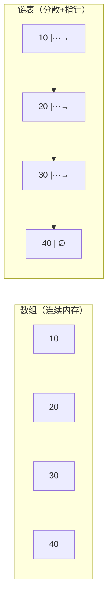

# 第 4 章：数组与链表

- **难度**：★★☆ | **预估学时**：2.5 小时 | **前置**：第 3 章

## 学习目标
学完本章，你能：
- 说出数组和链表各自的增删查改复杂度；
- 解释为什么数组随机访问快、插入删除慢；
- 理解动态数组（列表）是怎么"自动扩容"的；
- 了解缓存为什么让连续内存更快。

## 一句话核心
数组靠下标直达、查找快但插入慢；链表靠指针串联、插入快但查找慢——两者用空间布局的差异换来了不同操作的快慢。

## 零基础讲解
### 概念 1：数组（array）（难度：基础）
**数组**是连续内存中存放的一组相同类型元素。因为连续，计算机只要用"起始地址 + 下标 × 元素大小"就能算出任意元素的位置：

```python
arr = [10, 20, 30, 40]
print(arr[2])   # 直接定位到第 3 个元素：30，O(1)
```

- **随机访问**：按下标取元素 O(1)，极快。
- **插入/删除**：要把后面所有元素平移挪位置，平均 O(n)。
- 长度固定时无法追加；放不下就得整块搬到更大的新数组。

### 概念 2：链表（linked list）（难度：基础）
**链表**的元素叫**节点**，分散在内存各处，每个节点除了存数据，还存着下一个节点的指针：

```python
class ListNode:
    def __init__(self, val):
        self.val = val      # 节点存的数据
        self.next = None    # 指向下一个节点
```

- **插入/删除**：改两个指针就行，找到位置后 O(1)。
- **查找**：没有下标，只能从头一个一个顺着指针走，O(n)。

### 概念 3：动态数组（dynamic array / 列表）（难度：进阶）
Python 的 `list` 就是动态数组：底层是连续数组，放不下时**自动扩容**（分配一块更大的新内存，把旧元素整体搬过去）。所以你可以自由 append。扩容是偶尔发生的 O(n) 搬迁，但均摊到每次 append 上，平均仍是 O(1)（均摊复杂度）。

```python
lst = [1, 2, 3]
lst.append(4)   # 自动扩容，平均 O(1)
```

### 概念 4：内存与缓存（cache）（难度：进阶）
CPU 读内存时，会把相邻的一块数据一起搬进高速缓存。数组连续存放，访问一个元素后，后面的元素很可能已在缓存里 → 遍历时飞快。链表节点分散，每次都可能"缓存未命中" → 即使都是 O(n)，数组遍历实际也快得多。这解释了为什么工程上数组常常比链表更受欢迎。

## 图示

**看图说明**：上排是数组——格子紧挨，靠下标直接跳；下排是链表——节点四散，靠箭头指引下一个。这就是两者所有性能差异的根源。

| 操作 | 数组 | 链表 |
|---|---|---|
| 按下标查 | O(1) | O(n) |
| 头部插入 | O(n) | O(1) |
| 尾部插入 | 动态数组均摊 O(1) | 需遍历到尾 O(n) |
| 中间插入 | O(n) | 定位后 O(1) |

## 类比与实例
- 类比：数组像一排编好号的储物柜，开 37 号直接走过去（随机访问快）；但要在中间插入一格，后面所有柜子编号都得重排。链表像寻宝游戏，每个地点写着下一个地点的地址——加一个点只要改一句提示，可你要找第 37 个点只能从头一个个找。**失效边界**：数组长度固定后不能原地变长，扩容要整块搬迁。
- 实例：统计全班成绩总和——数组连续遍历，缓存命中快；如果成绩存在一个链表文件里，虽然也是 O(n)，实际慢好几倍。

## 常见误解
- 别以为"链表插入删除总是 O(1)"——实际上找到插入位置本身就要 O(n)，O(1) 只是"找到之后"的指针改动。
- 别以为动态数组 append 永远瞬间完成——实际上偶尔要整体搬迁扩容（O(n)），只是均摊后平均 O(1)。
- 别以为复杂度相同就一样快——实际上数组因缓存命中，遍历常数比链表小得多。

## 自测题（答案）
1. （单选）数组按下标随机访问的时间复杂度是？ A. O(1) B. O(log n) C. O(n) D. O(n²)（答案：A；解析：连续内存直接算地址。）
2. （单选）在链表中根据序号查找第 k 个节点的复杂度是？ A. O(1) B. O(log n) C. O(n) D. O(n²)（答案：C；解析：链表无下标，只能顺指针逐个走。）
3. （填空）Python 的 list 是______数组，放不下时会自动______。（答案：动态；扩容（整体搬迁到更大内存）；解析：这是均摊 O(1) append 的原理。）
4. （简答）为什么连续内存的数组遍历比链表快？（答案：CPU 缓存会把相邻数据一起载入，数组连续命中缓存；链表节点分散频繁缓存未命中。）

## 复习锚点
- 数组：连续内存，随机访问 O(1)，插入删除 O(n)。
- 链表：节点+指针，插入 O(1)，查找 O(n)。
- 动态数组 = 固定数组 + 自动扩容，均摊 O(1)。
- 缓存让连续内存更划算。
