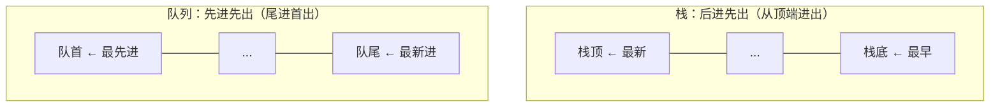

# 第 5 章：栈与队列

- **难度**：★☆☆ | **预估学时**：1.5 小时 | **前置**：第 4 章

## 学习目标
学完本章，你能：
- 说出栈"后进先出"和队列"先进先出"的规则；
- 知道栈和队列分别适合解决什么问题；
- 理解双向队列的特点；
- 看懂栈在递归（函数调用）中的作用。

## 一句话核心
栈是"后进先出"的一摞盘子，队列是"先进先出"的排队通道——它们是加了访问限制的线性结构。

## 零基础讲解
### 概念 1：栈（stack）（难度：基础）
**栈**只允许在同一端（**栈顶**）放入和取出，规则是**后进先出（LIFO, Last In First Out）**：

```python
stack = []
stack.append(1)   # 入栈
stack.append(2)
stack.pop()       # 出栈：取出 2（最后放的最先走）
```

- 入栈 push、出栈 pop 都只动栈顶，O(1)。
- 应用：浏览器"后退"、括号匹配、函数调用栈（每层函数就是一个栈帧）。

### 概念 2：队列（queue）（难度：基础）
**队列**在一端（**队尾**）进、另一端（**队首**）出，规则是**先进先出（FIFO, First In First Out）**：

```python
from collections import deque
q = deque()
q.append(1)   # 入队（队尾）
q.append(2)
q.popleft()   # 出队（队首）：取出 1
```

- 应用：排队叫号、消息缓冲、BFS 广度优先搜索（后面第 9 章会用到）。

### 概念 3：双向队列（deque）（难度：进阶）
**双向队列**两端都能进出，是栈和队列的合体。Python 的 `collections.deque` 就是它，头尾增删都是 O(1)，比 list 在头部删除（O(n)）高效。

## 图示

**看图说明**：栈只有一个开口（顶端），后放的先拿；队列有两个开口，先排的先服务。

## 类比与实例
- 类比：栈像一摞叠好的盘子——你只能从最上面拿走一个，最后放上去的最先被拿走。队列像高铁站检票口——先到的先检票。**失效边界**：盘子摞太高会塌，栈太深会栈溢出（递归过深）。
- 实例：浏览器点"后退"，就是把访问过的页面压栈，后退时弹栈。函数 A 调用 B 调用 C，C 结束后回到 B、再回到 A——这正是调用栈的 LIFO 顺序。

## 常见误解
- 别以为栈和队列是两种全新的内存结构——实际上它们通常就是用数组或链表"加限制"实现的，限制的是"只能在哪端动"。
- 别以为 list 的 append/pop 可以高效当队列用——实际上 list 在头部删除（pop(0)）是 O(n)，队列应该用 deque。

## 自测题（答案）
1. （单选）栈的访问规则是？ A. 先进先出 B. 后进先出 C. 随机访问 D. 双向进出（答案：B；解析：LIFO。）
2. （单选）广度优先搜索（BFS）通常借助哪种结构实现？ A. 栈 B. 队列 C. 哈希表 D. 树（答案：B；解析：BFS 按层先来后到地展开，天然是 FIFO 队列。）
3. （填空）函数 A 调 B 调 C，C 执行完后先回到______，这是调用栈的______规则。（答案：B；后进先出/LIFO；解析：最后压栈的函数先返回。）
4. （判断）用 Python list 的 pop(0) 模拟队列是高效做法。（答案：错误；解析：list 头部删除要平移 O(n)，队列应使用 deque.popleft()，O(1)。）

## 复习锚点
- 栈 LIFO：后进先出，用于括号匹配、后退、函数调用。
- 队列 FIFO：先进先出，用于排队、BFS。
- deque 两端都能 O(1) 进出。
