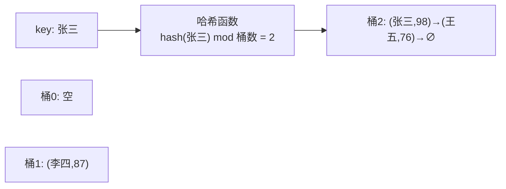

# 第 6 章：哈希表

- **难度**：★★☆ | **预估学时**：2 小时 | **前置**：第 4 章

## 学习目标
学完本章，你能：
- 说清哈希表为什么能做到 O(1) 查找；
- 理解哈希冲突及两种解决办法；
- 知道负载因子与扩容的关系；
- 识别哈希表的典型应用场景。

## 一句话核心
哈希表用"哈希函数把键映射成桶编号"，把查找从 O(n) 降到平均 O(1)，代价是要处理碰撞。

## 零基础讲解
### 概念 1：哈希表（hash table）（难度：基础）
**哈希表**存的是"键值对"（key → value）。它有一个数组（若干**桶**），外加一个**哈希函数**：给它一个 key，它算出一个桶编号，把 value 放进去：

```python
hmap = {"张三": 98, "李四": 87}
print(hmap["张三"])   # 直接算出"张三"在哪个桶 → 98，平均 O(1)
```

查找时同样算一次哈希函数，直达那个桶，不用逐个翻——这就是 O(1) 的来源。

### 概念 2：哈希冲突（hash collision）（难度：进阶）
不同的 key 算出同一个桶编号，就是**哈希冲突**。两种主流解决办法：

1. **链式地址**：每个桶挂一条链表，冲突的元素都链在同一桶里。
2. **开放寻址**：冲突时按规则向后探测下一个空桶放进去。

### 概念 3：负载因子与扩容（难度：进阶）
**负载因子** = 元素总数 ÷ 桶总数。装太满，冲突变多，查找退化。一般设定一个阈值（如 2/3），超过就扩容（桶数翻倍、重新哈希）。这和动态数组扩容是一个思路：用偶尔的大开销，换长期的平均高效。

### 概念 4：好的哈希函数（难度：进阶）
目标：让 key 均匀分布到各个桶，减少冲突。简单做法如"把 key 的字符编码加起来再对桶数取模"。过于聚集的哈希函数会让大量 key 挤进少数桶。

## 图示

**看图说明**：哈希函数把"张三"直接算到桶 2，查找时再算一次就能定位；桶 2 里挂了两个元素（发生过冲突，用链表串起来）。

## 类比与实例
- 类比：哈希表像图书索引卡片柜。每个书名经过索引规则算出抽屉编号，卡片就塞进那个抽屉——找书时不用翻遍所有抽屉。**失效边界**：两本书算出同一抽屉号（冲突），就得在同一抽屉里挂多张卡片（链地址），查找退化成 O(链表长度)。
- 实例：统计一篇文章每个单词出现几次——字典 hmap[word] += 1，O(1) 每次，比双重循环两两比较快得多。

## 常见误解
- 别以为哈希表查找"永远"O(1)——实际上若哈希函数很烂，所有 key 挤进一个桶，就退化成 O(n) 遍历链表。
- 别以为冲突是 bug——实际上冲突不可避免，哈希表设计的核心恰恰就是怎么处理冲突。

## 自测题（答案）
1. （单选）哈希表平均查找一个键值对的复杂度是？ A. O(1) B. O(log n) C. O(n) D. O(n²)（答案：A；解析：哈希函数直达桶。）
2. （填空）不同 key 算出同一桶编号叫______，常见解法有链式地址和______寻址。（答案：哈希冲突；开放；解析：两者是教材给的两大方案。）
3. （判断）负载因子越大，哈希表查找越快。（答案：错误；解析：负载因子过大导致冲突增多、查找退化，需要扩容。）
4. （简答）为什么说哈希表是"用空间换时间"？（答案：它要开足够多的桶并预留空闲（负载因子 < 1），牺牲一部分内存换取 O(1) 直达查找。）

## 复习锚点
- 哈希表 = 数组桶 + 哈希函数，键值对 O(1) 直达。
- 冲突必然发生：链式地址 / 开放寻址。
- 负载因子超阈值就扩容重哈希。
