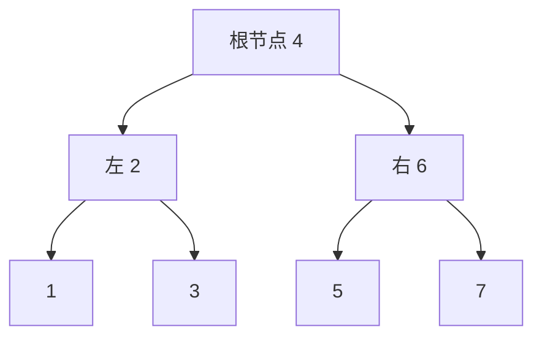

# 第 7 章：树（二叉树）

- **难度**：★★★ | **预估学时**：3.5 小时 | **前置**：第 4 章、第 5 章

## 学习目标
学完本章，你能：
- 说出二叉树的基本术语与形态；
- 写出前/中/后序、层序四种遍历；
- 理解二叉搜索树的性质与查找复杂度；
- 知道平衡树（AVL）为什么重要。

## 一句话核心
树是层次结构：每个节点最多两个子节点就是二叉树；四种遍历按"根"的位置区分；二叉搜索树让查找变成 O(log n)。

## 零基础讲解
### 概念 1：二叉树（binary tree）（难度：基础）
**树**由节点和边组成，有一个**根节点**，每个节点有零个或多个子节点。**二叉树**规定每个节点最多两个子节点（左子节点、右子节点）。没有子节点的叫**叶节点**。

```python
class TreeNode:
    def __init__(self, val):
        self.val = val
        self.left = None    # 左子节点
        self.right = None   # 右子节点
```

相关术语：**层**（根是第 0 层）、**高度**（到最远叶节点的边数）、**度**（子节点个数）。特殊形态：完美二叉树、完全二叉树、满二叉树、平衡二叉树。

### 概念 2：四种遍历（难度：进阶）
遍历就是"按什么顺序访问每个节点一次"：

- **前序遍历**：根 → 左 → 右
- **中序遍历**：左 → 根 → 右
- **后序遍历**：左 → 右 → 根
- **层序遍历**：从上到下、每层从左到右（用队列）

```python
def preorder(node, res):
    if node is None:
        return
    res.append(node.val)      # 根
    preorder(node.left, res)  # 左
    preorder(node.right, res) # 右
```

中序遍历二叉搜索树会得到一个升序序列——这是后面用它做查找的关键。

### 概念 3：二叉树的数组表示（难度：进阶）
完全二叉树可以紧凑地存在数组里：节点 i 的左孩子是 2i+1，右孩子是 2i+2。下一章的堆就是这样存的。

### 概念 4：二叉搜索树（binary search tree, BST）（难度：进阶）
**二叉搜索树**规定：左子树所有节点值 < 根 < 右子树所有节点值。查找时和目标比大小，每次砍掉一半子树 → O(log n)。

```
        4
       / \
      2   6
     / \ / \
    1  3 5  7
```
找 5：4→6→5，三次定位。但如果树严重倾斜（退化成链表），就退化回 O(n)。

### 概念 5：AVL 树与平衡（难度：高难）
**AVL 树**是一种自平衡二叉搜索树：任何节点的左右子树高度差（平衡因子）不超过 1，插入删除时通过旋转自动重新平衡。这样查找稳定在 O(log n)。

## 图示

**看图说明**：这是一棵二叉搜索树。中序遍历它得到 1,2,3,4,5,6,7——有序。查找任意值最多走 3 层 = O(log n)。

## 类比与实例
- 类比：二叉树像家谱树或公司组织架构图——一个领导管两个副手，副手再各管两个。**失效边界**：真实组织可以一个人管十几个人，二叉树规定最多两个孩子。
- 实例：查字典用二叉搜索树——每翻一页砍掉一半候选页，log n 步内定位。

## 常见误解
- 别以为"树就是复杂的东西所以一定慢"——实际上平衡树每次砍掉一半，比链表逐个找快得多。
- 别以为二叉搜索树永远 O(log n)——实际上插入数据有序时它会退化成一条斜链，变成 O(n)，这就是需要 AVL 这类平衡树的原因。

## 自测题（答案）
1. （单选）中序遍历二叉搜索树得到的序列是？ A. 降序 B. 升序 C. 随机 D. 与结构无关（答案：B；解析：左<根<右的性质使中序输出天然有序。）
2. （填空）前序遍历的顺序是______、左、______。（答案：根；右；解析：按"根"访问位置区分前中后序。）
3. （单选）平衡二叉搜索树（AVL）查找的时间复杂度是？ A. O(1) B. O(log n) C. O(n) D. O(n log n)（答案：B；解析：高度保持对数级。）
4. （判断）二叉搜索树在任何插入顺序下都是 O(log n) 查找。（答案：错误；解析：数据有序插入会退化成斜链 O(n)，需平衡树保证。）

## 复习锚点
- 二叉树：每节点 ≤2 子节点；前/中/后/层序四种遍历。
- BST：左<根<右，中序有序，查找 O(log n)（平衡时）。
- AVL 通过旋转维持平衡因子 ≤1。
