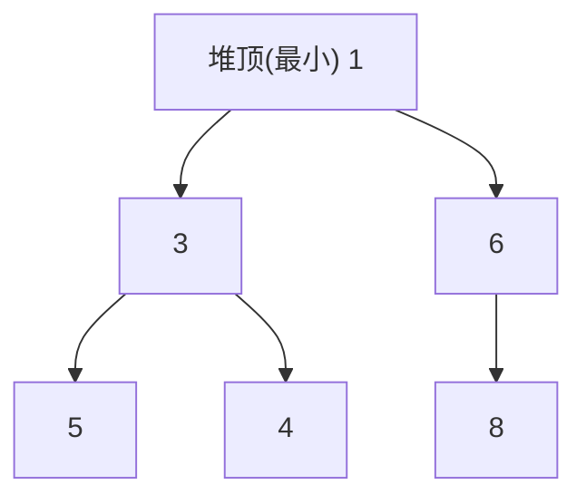

# 第 8 章：堆

- **难度**：★★☆ | **预估学时**：2 小时 | **前置**：第 7 章

## 学习目标
学完本章，你能：
- 说清大顶堆/小顶堆的定义与数组表示；
- 理解堆化（sift down）的过程；
- 用堆解决 Top-k 问题；
- 知道堆与优先队列的关系。

## 一句话核心
堆是一棵"父节点总是 ≥（或 ≤）子节点"的完全二叉树，用数组存储，能在 O(log n) 内取出当前最大/最小元素。

## 零基础讲解
### 概念 1：堆（heap）（难度：基础）
**堆**是一种特殊的完全二叉树，分两种：
- **大顶堆**：每个父节点 ≥ 其子节点，堆顶是全局最大；
- **小顶堆**：每个父节点 ≤ 其子节点，堆顶是全局最小。

它存在数组里（完全二叉树紧凑表示）：节点 i 的左孩子 2i+1、右孩子 2i+2。

```python
import heapq
min_heap = []
heapq.heappush(min_heap, 3)   # 入堆 O(log n)
heapq.heappush(min_heap, 1)
heapq.heappop(min_heap)       # 弹出最小 1，O(log n)
```

### 概念 2：堆化（heapify / sift down）（难度：进阶）
当某节点违反堆性质时，把它和它两个孩子中"最大/最小者"交换，并向下继续，直到满足性质。插入是从底部上浮（sift up），删除堆顶是与末尾交换后向下堆化。每次调整沿树高走 → O(log n)。

### 概念 3：堆与优先队列（priority queue）（难度：基础）
**优先队列**每次取出"优先级最高"的元素，堆正是它的高效实现：堆顶永远是极值。任务调度、Top-k 都是它的典型场景。

### 概念 4：Top-k 问题（难度：进阶）
从海量数据里找最大的 k 个元素。维护一个大小为 k 的小顶堆：遍历数据，比堆顶大就替换堆顶并堆化。最后堆里就是最大的 k 个，全程 O(n log k)，不用把全部数据排序。

## 图示

**看图说明**：小顶堆——堆顶 1 是全局最小，每个父节点都 ≤ 孩子。用数组按层填入即可。

## 类比与实例
- 类比：堆像"摇号机"——最大的球永远浮到最上面（大顶堆），你每次直接从最上面拿。**失效边界**：它只保证堆顶是极值，不保证整棵树有序。
- 实例：100 万个数找前 10 大——用大小 10 的小顶堆扫一遍即可，不必全排序 O(n log n)。

## 常见误解
- 别以为堆是排序好的数组——实际上堆只保证"父≥子"这一条局部性质，兄弟节点之间没有大小关系。
- 别以为取出极值要 O(n)——实际上堆把"找最值+维护"压到 O(log n)，这正是它比数组排序再取顶快的地方。

## 自测题（答案）
1. （单选）小顶堆的堆顶元素是？ A. 全局最大 B. 全局最小 C. 随机 D. 中间值（答案：B；解析：父≤子，堆顶即最小。）
2. （填空）插入或删除堆元素后做堆化，时间复杂度是______（沿树高走）。（答案：O(log n)；解析：树高为 log n。）
3. （单选）从 100 万数据里找最大的 k 个，高效做法是？ A. 全排序 B. 大小 k 的小顶堆 C. 随机抽样 D. 遍历两遍（答案：B；解析：维护 k 大小堆，O(n log k)。）
4. （判断）堆中兄弟节点之间有固定大小顺序。（答案：错误；解析：堆只约束父子关系，兄弟无序。）

## 复习锚点
- 堆 = 完全二叉树 + 父≥子（大顶）/父≤子（小顶），数组存储。
- 堆化沿树高 O(log n)。
- 堆是优先队列的实现；Top-k 用大小 k 的堆。
