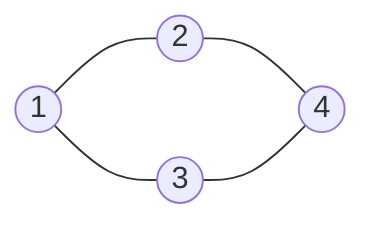

# 第 9 章：图

- **难度**：★★☆ | **预估学时**：2.5 小时 | **前置**：第 5 章、第 7 章

## 学习目标
学完本章，你能：
- 说清图的顶点、边、有向/无向、权重等概念；
- 比较邻接矩阵与邻接表两种存储；
- 写出 BFS 和 DFS 两种图遍历；
- 理解图能建模什么现实问题。

## 一句话核心
图是顶点和边组成的网状结构；用邻接表存储，用 BFS（队列）或 DFS（栈/递归）遍历。

## 零基础讲解
### 概念 1：图（graph）基本概念（难度：基础）
**图**由一组**顶点**和连接顶点的**边**组成：
- **无向图**：边没有方向（朋友关系）；
- **有向图**：边有方向（粉丝关注）；
- **有权图**：边带权重（路程、费用）；
- 与顶点相关：**度**（连出的边数；有向图分入度/出度）；**路径**（一串相连的顶点）。

### 概念 2：图的存储（难度：进阶）
1. **邻接矩阵**：n×n 数组，matrix[i][j] 表示 i 与 j 之间是否有边。查边快 O(1)，但占 O(n²) 空间，适合稠密图。
2. **邻接表**：每个顶点维护一个它直接相连的顶点列表。省空间 O(n+m)，适合稀疏图，工程上更常用。

### 概念 3：图的遍历（难度：进阶）
- **广度优先搜索 BFS**：从起点出发，先访问近邻，再一层层向外扩。用**队列**实现，天然求"最少步数"类问题。
- **深度优先搜索 DFS**：一条路走到底，走不通再回退。用**栈/递归**实现。

两者都要用一个 visited 集合记录已访问顶点，否则会在环里死循环。

## 图示

**看图说明**：4 个顶点、5 条边的无向图。BFS 从 1 出发会先访问 2、3，再访问 4；DFS 会先走 1→2→4 这条到底。

## 类比与实例
- 类比：图像城市地图——顶点是路口，边是马路。BFS 是从家一圈圈向外找最近的咖啡店；DFS 是沿着一条小巷钻到底再换一条。**失效边界**：地图可以走回头路，图遍历必须记录 visited 否则绕圈。
- 实例：朋友圈"六人关系链"、地铁换乘最少站数，都是图上的 BFS/DFS 问题。

## 常见误解
- 别以为图就是"复杂"——实际上它是最一般化的数据结构，数组/树都可看成特殊的图。
- 别以为遍历图不用记 visited——实际上图有环，不标记会无限循环。

## 自测题（答案）
1. （单选）BFS 通常借助哪种结构实现？ A. 栈 B. 队列 C. 堆 D. 哈希表（答案：B；解析：按层先来后到展开。）
2. （填空）图的两种存储方式是邻接______和邻接______。（答案：矩阵；表；解析：稠密用矩阵、稀疏用表。）
3. （单选）在图遍历中必须用 visited 记录已访问顶点，是因为图存在？ A. 权重 B. 环 C. 方向 D. 叶子（答案：B；解析：不标记会在环里死循环。）
4. （判断）邻接矩阵对稀疏图最省空间。（答案：错误；解析：邻接矩阵固定 O(n²)，稀疏图用邻接表更省。）

## 复习锚点
- 图 = 顶点 + 边；分有向/无向/有权。
- 存储：邻接矩阵（稠密）vs 邻接表（稀疏）。
- 遍历：BFS 用队列，DFS 用栈/递归，都要 visited。
