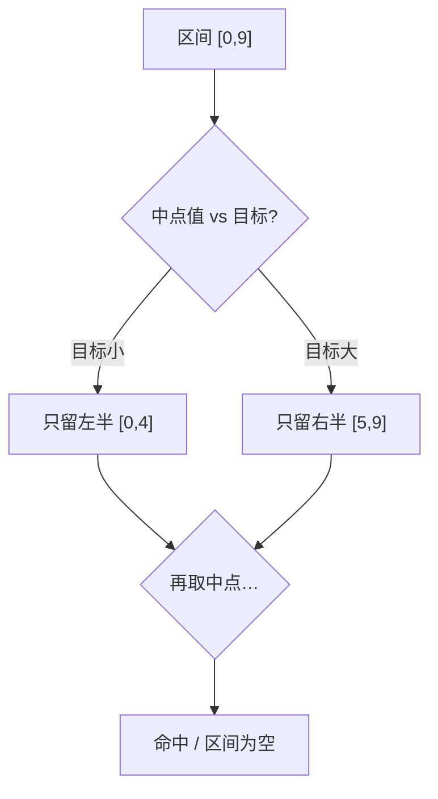

# 第 10 章：搜索（二分查找）

- **难度**：★★☆ | **预估学时**：2 小时 | **前置**：第 2 章、第 4 章

## 学习目标
学完本章，你能：
- 写出在有序数组上的二分查找；
- 说明二分查找为什么是 O(log n)；
- 处理"插入点""边界"等二分查找的变形；
- 知道什么时候用哈希优化代替暴力搜索。

## 一句话核心
在有序数组上，每次比较中间元素就能砍掉一半区间，把查找从 O(n) 压到 O(log n)。

## 零基础讲解
### 概念 1：二分查找（binary search）（难度：基础）
**前提**：数组已经排好序。取区间中点，与目标比大小：目标小就去左半区，目标大就去右半区，每次砍掉一半。

```python
def binary_search(nums, target):
    i, j = 0, len(nums) - 1
    while i <= j:
        m = (i + j) // 2      # 中点
        if nums[m] < target:
            i = m + 1         # 去右半区
        elif nums[m] > target:
            j = m - 1         # 去左半区
        else:
            return m          # 命中
    return -1
```

每次区间减半 → 最多 log₂n 次 → **O(log n)**。100 万数据只要约 20 次比较。

### 概念 2：二分查找的变形（难度：进阶）
- **查找插入点**：目标不存在时，找出它应该插入的下标；
- **查找边界**：有重复元素时，找第一个/最后一个等于目标的位置。
关键是在循环里控制 i、j 的收缩方向，别漏掉边界。

### 概念 3：哈希优化策略（难度：进阶）
如果不需要有序、只需要"快速判断存不存在"，直接用哈希集合 O(1) 查找，比二分的 O(log n) 还快。搜索算法分两类：
- 暴力遍历 O(n)；
- 利用有序性/索引：二分 O(log n)、哈希 O(1)。

## 图示

**看图说明**：每一步比较中点后排除一半，区间长度按 2 的幂缩小，所以是对数级。

## 类比与实例
- 类比：猜数字游戏（1~100）——"是 50 吗？大了。是 25 吗？小了。"每次猜中间值、听反馈缩范围，7 次内必中。**失效边界**：这个玩法只在"有序/单调"时成立，乱序数组不能二分。
- 实例：在已排序的成绩表里找某分数，20 次比较内定位 100 万条记录。

## 常见误解
- 别以为二分查找适用所有数组——实际上它**要求数组有序**，无序数组只能 O(n) 遍历。
- 别以为 O(log n) 比 O(1) 快——实际上哈希查找才是 O(1)；二分是"有序数据"的工具，哈希是"快速判存在"的工具。

## 自测题（答案）
1. （单选）二分查找的时间复杂度是？ A. O(1) B. O(log n) C. O(n) D. O(n log n)（答案：B；解析：每次砍半。）
2. （填空）二分查找的前提是数组已经______。（答案：有序/排好序；解析：否则不能用大小关系砍半。）
3. （单选）100 万条有序记录用二分查找最多比较约多少次？ A. 100 万 B. 1 万 C. 20 D. 1000（答案：C；解析：log₂10⁶≈20。）
4. （判断）只需要快速判断"某元素在不在"时，二分查找总比哈希集合好。（答案：错误；解析：无序只判存在时哈希集合 O(1) 更快；二分依赖有序。）

## 复习锚点
- 二分查找：有序数组，每次砍半，O(log n)。
- 变形：插入点、左右边界，靠控制 i/j 收缩方向。
- 搜索效率阶梯：暴力 O(n) < 二分 O(log n) < 哈希 O(1)。
