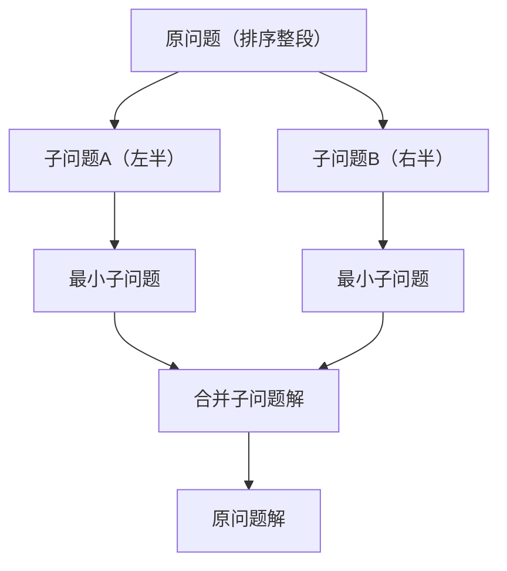

# 第 12 章：分治

- **难度**：★★☆ | **预估学时**：2 小时 | **前置**：第 2 章、第 7 章、第 11 章

## 学习目标
学完本章，你能：
- 说清分治的"分—治"两阶段；
- 判断一个问题是否适合分治；
- 用分治思想理解归并排序、二分查找、汉诺塔；
- 解释分治为什么能提升效率。

## 一句话核心
分治 = 把大问题拆成互相独立的小问题，分别解决后合并答案；归并排序是它最典型的样板。

## 零基础讲解
### 概念 1：分治（divide and conquer）两阶段（难度：基础）
1. **分**：递归地把原问题拆成两个或多个规模更小的同类子问题，直到小到一眼能解；
2. **治**：从最小子问题开始，从底向上把子问题的解合并成原问题的解。

归并排序：数组对半拆到只剩 1 个元素，再两两合并成有序段。

### 概念 2：分治的判断依据（难度：进阶）
一个问题适不适合分治，看三条：
1. 能拆成同类小子问题；
2. 子问题之间**相互独立**（不重叠、不依赖）；
3. 子问题的解能合并成原问题的解。

### 概念 3：分治为什么快（难度：进阶）
- **操作数减少**：把 O(n²) 的冒泡拆成两半，操作数从 n² 降到约 n²/2+2n；
- **可并行**：子问题独立，多核可同时算。

二分查找也是分治：每轮砍掉一半候选，只是它"无须合并答案"。

### 概念 4：典型例子——汉诺塔（难度：高难）
把 n 个圆盘从 A 移到 C（小圆盘必须在大圆盘上）：
- 先把上面 n-1 个借 C 移到 B；
- 把最底下 1 个移到 C；
- 再把 B 上 n-1 个借 A 移到 C。
时间复杂度 O(2ⁿ)。

## 图示

**看图说明**：自上而下"分"，自下而上"治"，中间是合并。这就是分治的骨架。

## 类比与实例
- 类比：分治像"大工程拆包"——一本厚书要校对，拆成上下两册分给两个人，校完再合订。**失效边界**：两个子任务必须互不干扰；如果它们共用同一页纸（子问题重叠），那就不是分治，而是动态规划。
- 实例：二分查找每次把搜索区间砍半——也是分治，只是答案直接由唯一幸存的区间给出。

## 常见误解
- 别以为分治和动态规划是一回事——实际上分治的子问题相互独立不重叠；动态规划的子问题大量重叠。
- 别以为分治一定更快——实际上它先减少常数项，反复拆才把 O(n²) 降到 O(n log n)。

## 自测题（答案）
1. （单选）分治的两个阶段是？ A. 递归与迭代 B. 分与治 C. 入栈与出栈 D. 拆分与排序（答案：B；解析：先拆成子问题，再合并解。）
2. （填空）分治要求子问题之间相互______，这是它与动态规划的关键区别。（答案：独立/不重叠；解析：DP 子问题重叠。）
3. （单选）下列哪个是分治的典型应用？ A. 哈希表 B. 归并排序 C. 栈 D. 队列（答案：B；解析：归并排序 = 拆 + 合并。）
4. （判断）二分查找属于分治，但不需要"合并子问题解"。（答案：正确；解析：每轮只保留一个幸存区间，命中即得解。）

## 复习锚点
- 分治：分（拆成独立子问题）→ 治（合并解）。
- 判断三依据：可拆、独立、可合并。
- 典型：归并排序、快速排序、二分查找、汉诺塔。
