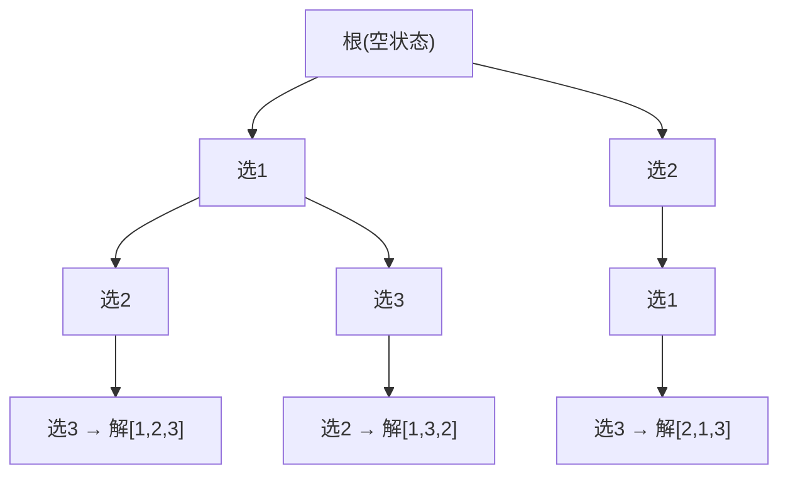

# 第 13 章：回溯

- **难度**：★★★ | **预估学时**：3 小时 | **前置**：第 5 章、第 7 章、第 12 章

## 学习目标
学完本章，你能：
- 说清回溯的"尝试—回退—剪枝"框架；
- 用回溯写出全排列、子集和、n 皇后；
- 理解剪枝为什么能大幅提速；
- 区分回溯与分治/动态规划。

## 一句话核心
回溯是带着约束的穷举：一条路走到底，走不通就撤销上一步（回退）换条路，并在过程中提前剪掉无效分支。

## 零基础讲解
### 概念 1：回溯框架（难度：基础）
**回溯算法**用深度优先搜索穷举解空间，三件套：
- **尝试**：做一个选择，更新当前状态；
- **回退**：走不通就撤销这个选择，回到上一状态；
- **剪枝**：遇到不满足约束的分支，提前停下，不再往下试。

通用框架：
```python
def backtrack(state, choices, res):
    if is_solution(state):
        res.append(list(state))
        return
    for choice in choices:
        if is_valid(state, choice):      # 剪枝
            make_choice(state, choice)  # 尝试
            backtrack(state, choices, res)
            undo_choice(state, choice)  # 回退
```

### 概念 2：全排列（难度：进阶）
给定 [1,2,3]，列出所有排列。用一个 selected 数组记录"这个元素是否已选"，避免重复选；结果是 n! 种。

### 概念 3：子集和（难度：进阶）
从数组里选出和为 target 的子集。关键技巧：用 start 变量规定"下一轮只能从后面选"，从而避免 [4,5] 和 [5,4] 这种重复子集。

### 概念 4：n 皇后（难度：高难）
在 n×n 棋盘放 n 个皇后，使其互不攻击（同行/同列/同斜线都不行）。逐行放，用三个布尔数组做列约束和两条对角线约束的剪枝。

### 概念 5：回溯 vs 分治 vs DP（难度：进阶）
- 分治：子问题独立，一次拆完；
- 回溯：穷举所有解，靠剪枝提速；
- DP：子问题重叠，靠记忆避免重复算。
很多组合优化问题（0-1 背包、旅行商）先用回溯能解，但 DP/贪心更高效。

## 图示

**看图说明**：全排列的递归树——每条根到叶路径是一个排列；遇到已选元素就剪枝。

## 类比与实例
- 类比：回溯像走迷宫——每条岔路都试着走，撞墙了就退回到上一个岔口换方向（回退），看到墙上写着"此路不通"就不再走（剪枝）。**失效边界**：迷宫只有有限岔路；回溯的解空间可能指数爆炸，必须剪枝。
- 实例：n 皇后 n=8 有 92 个解，全排列 n=9 就有 36 万种——不剪枝算不动。

## 常见误解
- 别以为回溯就是"暴力枚举"——实际上好的剪枝能砍掉绝大部分无效分支，远快于无脑穷举。
- 别以为找到一个解就够——实际上很多问题（全排列、n 皇后）要的是**所有**解，要继续遍历完。

## 自测题（答案）
1. （单选）回溯算法的三大动作是？ A. 分、治、合并 B. 尝试、回退、剪枝 C. 入队、出队、遍历 D. 建堆、堆化、弹出（答案：B；解析：这是回溯框架核心。）
2. （填空）用 start 变量约束下一轮选择的起点，是为了避免______子集。（答案：重复（顺序不同但元素相同）；解析：如 [4,5] 与 [5,4]。）
3. （单选）n 皇后问题用三个布尔数组做剪枝，不包含哪种约束？ A. 同列 B. 同主对角线 C. 同次对角线 D. 同色（答案：D；解析：行列/双斜线是皇后攻击范围。）
4. （判断）回溯是解决所有组合优化问题的最优方法。（答案：错误；解析：DP/贪心往往更高效，回溯是通用但较慢的兜底。）

## 复习锚点
- 回溯 = DFS 穷举 + 尝试/回退/剪枝。
- 典型：全排列、子集和、n 皇后。
- 与分治/DP 的区别在子问题是否重叠、是否求所有解。
