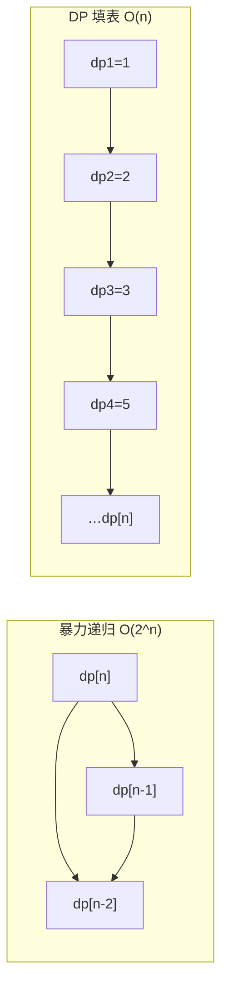

# 第 14 章：动态规划

- **难度**：★★★ | **预估学时**：4 小时 | **前置**：第 2 章、第 12 章、第 13 章

## 学习目标
学完本章，你能：
- 说清动态规划（DP）的三大特性；
- 写出爬楼梯、最小路径和、0-1 背包、编辑距离的状态转移方程；
- 区分"记忆化搜索（从顶到底）"与"递推（从底到顶）"；
- 理解滚动变量/数组的空间优化。

## 一句话核心
DP 把重叠子问题的解存进 dp 表，从最小子问题一步步推到原问题，把指数级暴力压成多项式级。

## 零基础讲解
### 概念 1：从爬楼梯说起（难度：基础）
n 阶楼梯，每次上 1 或 2 阶，问有几种走法。设 dp[i] = 到第 i 阶的方案数。因为到 i 只能从 i-1 或 i-2 跨上来：

**dp[i] = dp[i-1] + dp[i-2]**，初值 dp[1]=1, dp[2]=2。

```python
def climbing_stairs_dp(n):
    dp = [0] * (n + 1)
    dp[1], dp[2] = 1, 2
    for i in range(3, n + 1):
        dp[i] = dp[i - 1] + dp[i - 2]
    return dp[n]
```

### 概念 2：DP 的三大特性（难度：进阶）
1. **重叠子问题**：递归求解时大量重复算同一个子问题（暴力递归 O(2ⁿ)），用 dp 表记忆后 O(n)。
2. **最优子结构**：原问题最优解可由子问题最优解构造（如最小路径和取 min）。
3. **无后效性**：当前状态一旦确定，未来怎么走只与它有关，与怎么走到它的无关。

### 概念 3：从顶到底 vs 从底到顶（难度：进阶）
- **记忆化搜索（从顶到底）**：从原问题递归往下拆，碰到算过的子问题就查表。
- **动态规划递推（从底到顶）**：从最小子问题的已知解出发，填表到原问题。
两者等价，DP 通常写成自底向上的循环。

### 概念 4：0-1 背包（难度：高难）
n 个物品（各有重量 wgt[i]、价值 val[i]），背包容量 cap，每件最多拿一次，求最大价值。状态 dp[i][c] = 前 i 个物品、容量 c 下的最大价值：

**dp[i][c] = max(dp[i-1][c], dp[i-1][c-wgt[i-1]] + val[i-1])**（拿或不拿取较大者）

空间优化：用一维数组**倒序**遍历，避免覆盖上一行还没用过的值。

### 概念 5：编辑距离（难度：高难）
把字符串 s 改成 t，允许插入/删除/替换，求最少步数。dp[i][j] = 把 s 前 i 个改成 t 前 j 个的最少步数：末尾字符相同就继承左上；不同就取三种操作（插/删/替）的最小值 +1。

## 图示

**看图说明**：左边递归树里 dp[n-2] 被重复算无数次；右边 DP 每个子问题只算一次，顺着填到答案。

## 类比与实例
- 类比：DP 像"记账递推"——你不求一步登天，而是把每个台阶/格子的最优答案记下来，后面的答案只查前面的账本。**失效边界**：这要求"过去怎么走到这格"不影响未来（无后效性）；如果约束让你必须记得所有历史路径，DP 就失效。
- 实例：最小路径和——机器人从左上到右下只能向右/下，dp[i][j] = min(上方, 左方) + 当前格代价。

## 常见误解
- 别以为 DP 就是"递归加个缓存"——实际上二者等价，但递推写法避免递归栈，更省空间。
- 别以为背包优化成一维是正序遍历——实际上 0-1 背包必须**倒序**遍历容量，否则同一物品被重复拿。
- 别以为所有最优化问题都能 DP——实际上不满足无后效性时（如带历史依赖的问题），DP 无解，只能用启发式方法。

## 自测题（答案）
1. （填空）爬楼梯的状态转移方程是 dp[i] = ______。（答案：dp[i-1] + dp[i-2]；解析：只能跨 1 或 2 阶。）
2. （单选）DP 的三大特性不包括？ A. 重叠子问题 B. 最优子结构 C. 无后效性 D. 子问题独立（答案：D；解析：子问题独立是分治的特征，DP 子问题重叠。）
3. （单选）0-1 背包一维空间优化时，容量 c 应怎样遍历？ A. 正序 B. 倒序 C. 随机 D. 双层正序（答案：B；解析：倒序防止覆盖上一行尚未使用的值。）
4. （简答）记忆化搜索与动态规划递推的关系？（答案：等价，前者从顶到底递归查表，后者从底到顶循环填表，结果一致。）
5. （判断）编辑距离中两字符串末尾字符相同时，需要做一次替换。（答案：错误；解析：相同则直接继承 dp[i-1][j-1]，无需编辑。）

## 复习锚点
- DP = dp 表 + 状态转移方程 + 初始状态。
- 三特性：重叠子问题、最优子结构、无后效性。
- 经典模型：爬楼梯、背包、编辑距离；空间用滚动数组优化。
