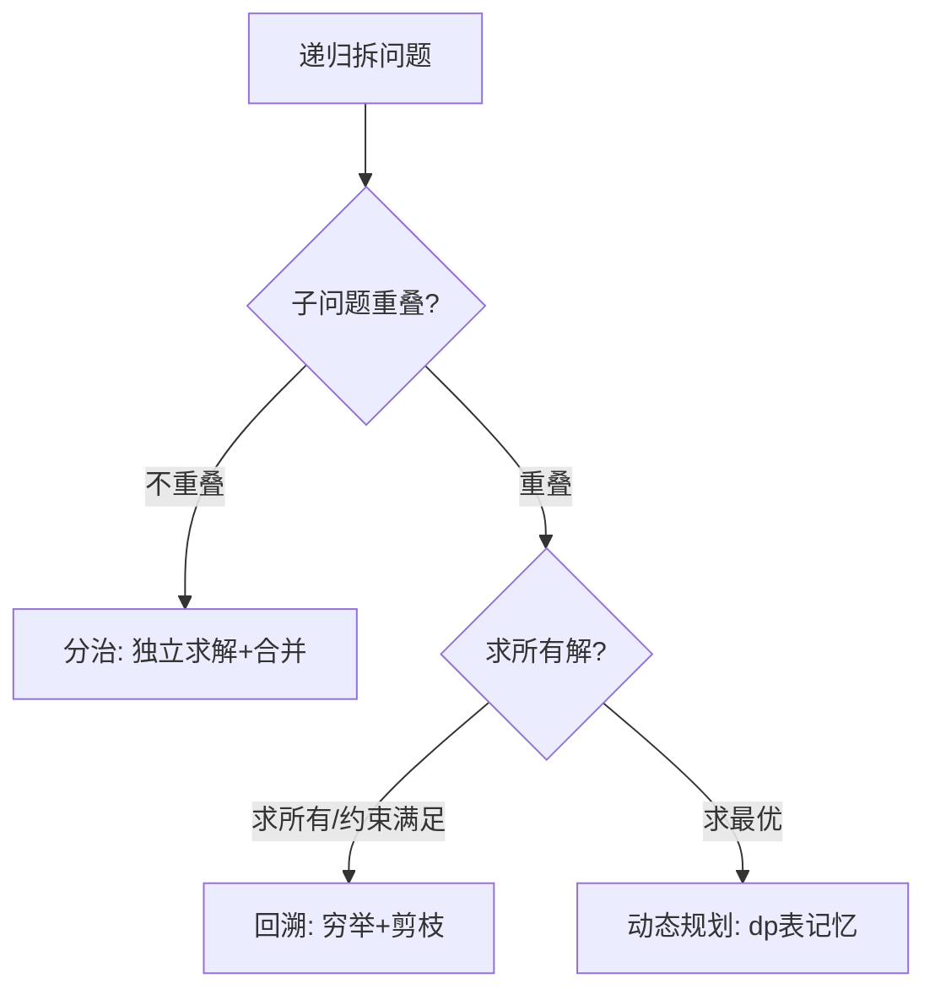

# 分治、回溯与动态规划

- **难度**：高难 | **涉及章节**：第 12、13、14 章

## 一句话定义
三种都基于递归拆问题，但区别在子问题是否重叠、是否求所有解：分治独立合并、回溯穷举剪枝、DP 记忆重叠子问题。

## 为什么重要
这是全书最难的概念分水岭——选错策略，要么慢到爆炸，要么漏解。

## 图示

**看图说明**：这张决策树帮你在三道门之间选对门。

## 详解
| 策略 | 子问题 | 目标 | 代表 |
|---|---|---|---|
| 分治 | 独立不重叠 | 合并出解 | 归并排序、二分 |
| 回溯 | （在解空间树上） | 列出所有满足约束的解 | 全排列、n 皇后 |
| 动态规划 | 重叠 | 求最优解 | 背包、编辑距离 |

## 常见误解
- 别以为三者都是"递归"就通用——实际上重叠子问题用分治会重复算爆炸，求最优用回溯会枚举爆炸。
- 别以为 DP 是万能最优解——实际上不满足无后效性时 DP 失效。

## 在书中出现的脉络
| 章节 | 语境 | 关键结论 |
|---|---|---|
| 第 12 章 | 分治 | 拆+治、子问题独立 |
| 第 13 章 | 回溯 | 尝试/回退/剪枝 |
| 第 14 章 | DP | 三特性、dp 表 |

## 相关概念
- 前置：递归、复杂度；后续：贪心（第 15 章）。
