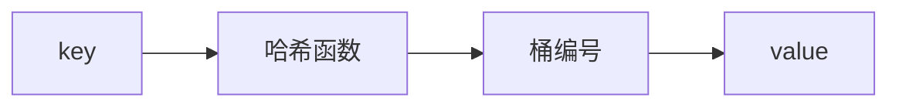

# 哈希

- **难度**：基础 | **涉及章节**：第 6、10 章

## 一句话定义
哈希用函数把 key 映射成桶编号，实现键值对的 O(1) 平均查找。

## 为什么重要
它是把"判存在/查表"从 O(n) 拉到 O(1) 的关键手段，几乎所有高频查询系统背后都有哈希。

## 图示

**看图说明**：一次哈希计算直达目标桶。

## 详解
- **冲突**：不同 key 落到同桶 → 链式地址 / 开放寻址。
- **负载因子**：太满则冲突增多，需扩容重哈希。
- **应用**：字典、集合、缓存、去重、计数统计。

## 常见误解
- 别以为哈希查找恒为 O(1)——实际上哈希函数差时退化成 O(n)。
- 别以为哈希和排序冲突——实际上哈希不保留顺序，要顺序输出得配合排序。

## 在书中出现的脉络
| 章节 | 语境 | 关键结论 |
|---|---|---|
| 第 6 章 | 哈希表 | O(1) 查找、冲突处理 |
| 第 10 章 | 哈希优化搜索 | 比二分 O(log n) 更快判存在 |

## 相关概念
- 前置：数组；后续：图的邻接表、缓存。
