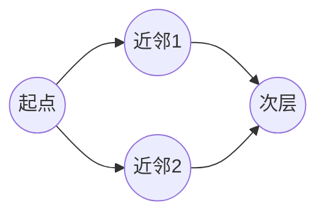

# 图遍历：BFS 与 DFS

- **难度**：进阶 | **涉及章节**：第 9、13 章

## 一句话定义
BFS 用队列一层一层向外扩展，DFS 用栈/递归一条路走到底——两者都要记录已访问顶点避免绕环。

## 为什么重要
它们是搜索图、树、迷宫、网络的通用引擎；"最少步数"问题天然归 BFS。

## 图示

**看图说明**：BFS 按距离分层；DFS 会先沿 Start→N1→N3 走到底再换 N2。

## 详解
- **BFS**：队列 + visited；适合最短路径（无权图最少边数）。
- **DFS**：递归/栈 + visited；适合探索所有路径、连通性判断。
- 二者时间都是 O(V+E)（遍历所有顶点和边）。

## 常见误解
- 别以为 DFS 一定找到最短路——实际上 BFS 才保证无权图最短。
- 别以为图可以不标 visited——实际上有环会死循环。

## 在书中出现的脉络
| 章节 | 语境 | 关键结论 |
|---|---|---|
| 第 9 章 | 图的遍历 | BFS 队列、DFS 递归 |
| 第 13 章 | 回溯 | 回溯本质是在解空间树上 DFS |

## 相关概念
- 前置：队列、栈、递归；后续：最短路径、网络分析。
