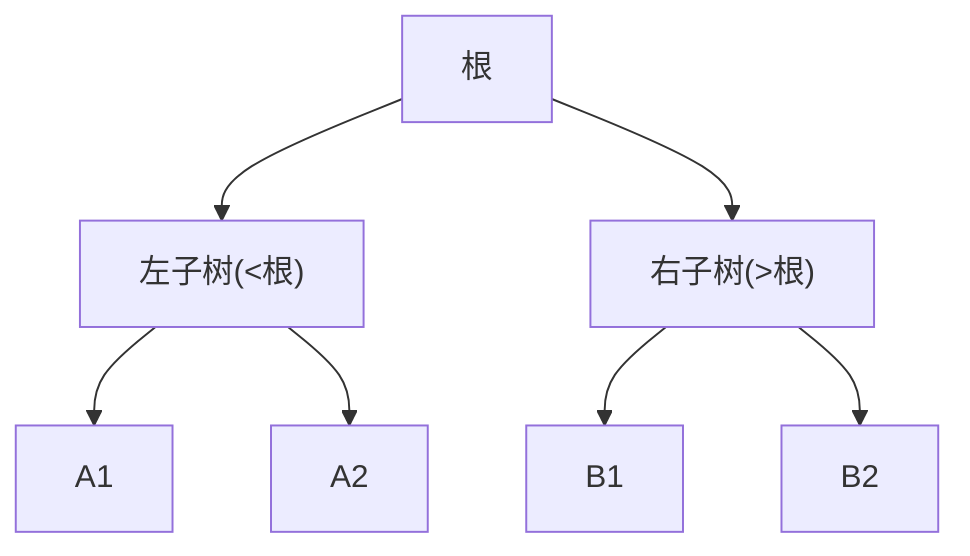

# 树与二叉搜索树

- **难度**：进阶 | **涉及章节**：第 7、8、9、12 章

## 一句话定义
树是层次化的节点结构；二叉搜索树通过"左<根<右"的排序性质，把查找变成每次砍半的 O(log n)。

## 为什么重要
树是连接"线性结构"和"图"的桥梁；堆、BST、文件系统、数据库索引都是树的变体。

## 图示

**看图说明**：每次比较目标与根，决定去左还是去右，区间减半。

## 详解
- **二叉树**：每节点 ≤2 子节点；四种遍历（前/中/后/层序）。
- **BST**：中序遍历输出升序；查找平均 O(log n)，退化成斜链时 O(n)。
- **平衡树（AVL）**：旋转维持平衡因子 ≤1，保证对数级查找。
- **堆**：完全二叉树的特例，父子约束极值，数组存储。

## 常见误解
- 别以为 BST 天然 O(log n)——实际上有序插入会退化成链表，需要平衡。
- 别以为树和图无关——实际上树是无环连通的特殊图。

## 在书中出现的脉络
| 章节 | 语境 | 关键结论 |
|---|---|---|
| 第 7 章 | 二叉树/BST/AVL | 中序有序、查找 O(log n) |
| 第 8 章 | 堆 | 父子极值、数组存储 |
| 第 9 章 | 图 | 树是无环图 |
| 第 12 章 | 由遍历重建树 | 分治划分左右子树 |

## 相关概念
- 前置：递归、数组/链表；后续：图、堆排序。
