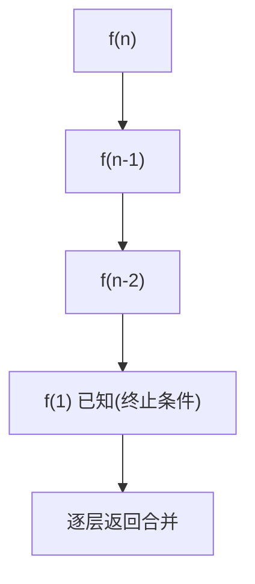

# 递归

- **难度**：进阶 | **涉及章节**：第 2、7、12、13、14 章

## 一句话定义
递归是函数直接或间接调用自身，把大问题拆成同形的小问题，直到碰到"一眼能解"的终止条件。

## 为什么重要
递归是分治、回溯、树遍历、动态规划共用的"工具"。理解它，等于拿到打开大半本书的钥匙。

## 图示

**看图说明**：向下"递"到终止条件，再向上"归"回来——这就是递归树。

## 详解
- **两个要素**：终止条件 + 递归关系。缺终止条件会栈溢出。
- **调用栈**：每层未返回的函数占一块栈帧；递归越深栈越大。
- **与三种算法的关系**：
  - 分治：子问题独立不重叠；
  - 回溯：穷举 + 回退 + 剪枝；
  - DP/记忆化：子问题重叠，用表缓存避免重复算。

## 常见误解
- 别以为递归都优雅高效——实际上不缓存的递归（如斐波那契）是指数级灾难。
- 别以为 Python 会自动优化尾递归——实际上不会，递归深度受栈限制。

## 在书中出现的脉络
| 章节 | 语境 | 关键结论 |
|---|---|---|
| 第 2 章 | 迭代 vs 递归 | 递归=自己调自己+终止条件 |
| 第 7 章 | 树遍历 | 前/中/后序都是递归 |
| 第 12 章 | 分治 | 汉诺塔 O(2ⁿ) |
| 第 14 章 | DP | 记忆化把递归压成 O(n) |

## 相关概念
- 前置：复杂度度量；后续：分治、回溯、动态规划。
