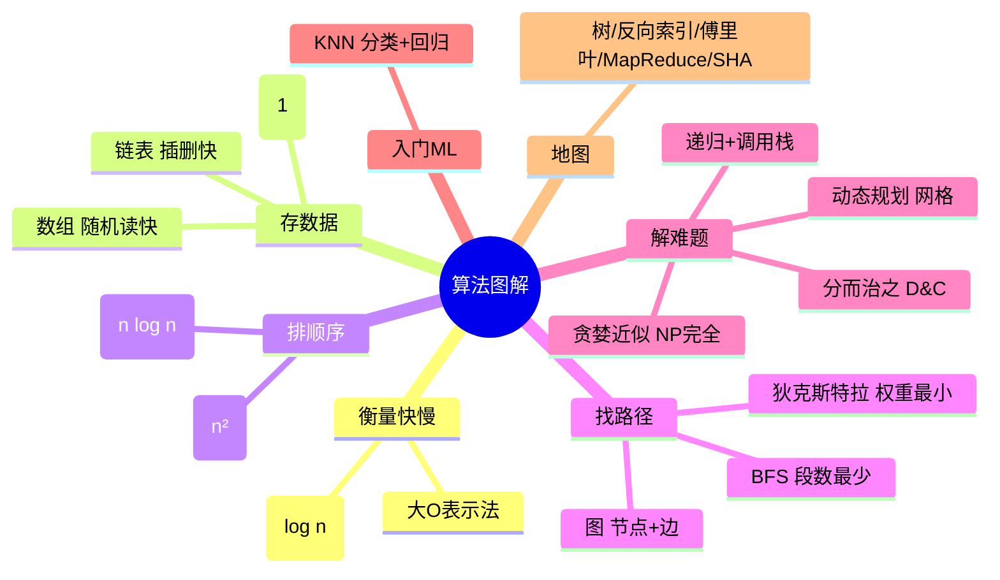

# 算法图解（Grokking Algorithms）点化学习系统

## 这本书在讲什么

Aditya Bhargava 用"生活类比 + 一页图 + 一段 Python"的方式，把算法世界的入门地图画给零基础读者：**如何衡量算法快慢（大O）、如何把数据存好（数组/链表/散列表）、如何在网络里找路（BFS/狄克斯特拉）、遇到难题时怎么办（递归/分治/动态规划/贪婪近似）**。全书主张：算法不是靠背的公式，而是一套"遇到新问题该怎么想"的思维工具箱。

## 全书心智模型

## 学习路径（推荐顺序，拓扑序）

| 步骤 | 章节 | 主题 | 前置 | 检查点 |
|---|---|---|---|---|
| 01 | ch01 | 算法简介：二分查找与大O | 无 | 通过 ch01 自测（≥80%） |
| 02 | ch02 | 选择排序：数组与链表 | ch01 | 通过 ch02 自测 |
| 03 | ch03 | 递归与调用栈 | ch01 | 通过 ch03 自测 |
| 04 | ch04 | 快速排序与分而治之 | ch01、ch03 | 通过 ch04 自测 |
| 05 | ch05 | 散列表 | ch02 | 通过 ch05 自测 |
| 06 | ch06 | 广度优先搜索 | ch05 | 通过 ch06 自测 |
| 07 | ch07 | 狄克斯特拉算法 | ch06 | 通过 ch07 自测 |
| 08 | ch08 | 贪婪算法与NP完全 | ch01 | 通过 ch08 自测 |
| 09 | ch09 | 动态规划 | ch08 | 通过 ch09 自测 |
| 10 | ch10 | K最近邻 | ch01 | 通过 ch10 自测 |
| 11 | ch11 | 接下来如何做 | 全部 | 完成最终检验项目 |

> 说明：原书章节顺序本身就是拓扑序——作者已按依赖排好。跨章硬依赖：ch04 需要 ch03 的递归；ch06 需要 ch05 的散列表（图用 dict 表示）；ch07 需要 ch06 的图概念；ch09 承接 ch08 的背包问题。

## 章节索引

- 第 1 章 算法简介（难度 ★☆☆）→ chapters/ch01-算法简介.md
- 第 2 章 选择排序（难度 ★☆☆）→ chapters/ch02-选择排序.md
- 第 3 章 递归（难度 ★★☆）→ chapters/ch03-递归.md
- 第 4 章 快速排序（难度 ★★☆）→ chapters/ch04-快速排序.md
- 第 5 章 散列表（难度 ★★☆）→ chapters/ch05-散列表.md
- 第 6 章 广度优先搜索（难度 ★★☆）→ chapters/ch06-广度优先搜索.md
- 第 7 章 狄克斯特拉算法（难度 ★★★）→ chapters/ch07-狄克斯特拉算法.md
- 第 8 章 贪婪算法（难度 ★★☆）→ chapters/ch08-贪婪算法.md
- 第 9 章 动态规划（难度 ★★★）→ chapters/ch09-动态规划.md
- 第 10 章 K最近邻算法（难度 ★☆☆）→ chapters/ch10-K最近邻算法.md
- 第 11 章 接下来如何做（难度 ★☆☆）→ chapters/ch11-接下来如何做.md

## 前置知识（零基础缺口补讲）

| 缺口 | 对应补讲位置 | 学完标志 |
|---|---|---|
| 不会 Python 基本语法（def/列表/循环） | ch01 代码逐行注释 + ch02 findSmallest | 能照着敲 binary_search 并改测试用例 |
| 不记得对数 log | ch01「概念2：对数」 | 能口算 log₂8=3、log₂1024=10 |
| 没听过"数组/索引" | ch02「概念1/2」 | 能说清索引从 0 开始、随机访问 |
| 没写过任何递归 | ch03 用纸笔跟踪 fact(3) | 能手画调用栈 4 个状态 |

## 术语表 / 模式库 / 速查表 入口

- 术语表 → glossary.md
- 模式与反模式 → patterns.md
- 速查表 → cheatsheet.md
- 测验（含最终检验） → quiz.md
- 抽认卡 → flashcards.md
