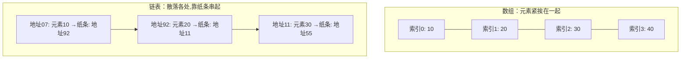

# 第 2 章：选择排序

- **难度**：★☆☆ | **预估学时**：1.5 小时 | **前置**：第 1 章（大O表示法、对数）

## 学习目标

学完本章，你能：

1. 说清数组与链表在"读取、插入、删除"三个操作上的速度差异及原因。
2. 解释什么是索引、随机访问与顺序访问。
3. 口述选择排序的步骤，并说出它为什么是 O(n²)。

## 一句话核心

**数组和链表是存储一串数据的两种基本方式：数组挤在一起所以"随机读取快"，链表散落各处靠地址串起来所以"插删快"；选择排序靠"反复找最小"工作，思路直白但代价是 O(n²)。**

## 零基础讲解

### 概念 1：内存、数组、链表（难度：基础）

**内存**像一整排带编号的抽屉，每个抽屉有地址。要存一串数据，有两种基本摆法：

- **数组（array）**：所有元素紧挨在一起存放，像电影院里连坐的座位。
- **链表（linked list）**：元素可以散落在内存任何地方，每个元素存一张"小纸条"——记下一个元素的地址，像寻宝游戏：找到第一个 → 按纸条找到第二个 → 再按纸条找到第三个。

**类比**：和朋友去看电影。数组 = 6 个人必须连坐，满场时找不到 6 个连座就得整队搬家（插入可能要整体复制）；链表 = "我们分开坐"，哪里有空位坐哪里，加人减人都灵活。
- 失效边界：链表灵活是有代价的——你没法直接跳到"第 5 个元素"，只能从第 1 个顺着纸条一路摸过去。

### 概念 2：索引、随机访问、顺序访问（难度：基础）

**索引（index）**：数组中元素的位置编号。几乎所有语言都**从 0 开始**编号：第一个元素在索引 0，第二个在索引 1。

- **随机访问（random access）**：直接跳到任意位置。数组支持——起始地址是 00、每个元素一格，第 5 个元素地址 = 00+4 = 04，一步算出。
- **顺序访问（sequential access）**：只能从第一个元素逐个往后读。链表只支持顺序访问。

三种常用操作的运行时间对照（原书结论）：

| 操作 | 数组 | 链表 |
|---|---|---|
| 读取（随机访问） | O(1) | O(n) |
| 在开头/结尾插入 | O(n)（数组要整体后移或搬家） | O(1) |
| 删除 | O(n)（数组后面元素要前移） | O(1)（改纸条即可） |

> 注：链表删除 O(1) 的前提是"你已经站在那个元素旁边"。通常我们只记住链表的头尾，所以删头尾是 O(1)。

### 概念 3：选择排序（难度：基础）

**选择排序（selection sort）**：每次从未排序部分里找出最小的元素，挪到新列表末尾；重复直到全部排完。

**实例（可复核）**：对 `[5, 3, 6, 2, 10]` 升序排序。

1. 找最小：2（在第 4 位）→ 取出，新列表 `[2]`，余 `[5,3,6,10]`
2. 找最小：3 → 新列表 `[2, 3]`，余 `[5,6,10]`
3. 找最小：5 → `[2,3,5]`，余 `[6,10]`
4. 找最小：6 → `[2,3,5,6]`，余 `[10]`
5. 剩 10 → `[2,3,5,6,10]`

**为什么是 O(n²)**：找一次最小要 O(n)（挨个看一遍），要找 n 次，总共 n × O(n) = O(n²)。原书特意解释：有人说"第 2 轮只要看 n−1 个元素，平均是 n/2 个"——对，但大O**省略常数 1/2**，所以仍写 O(n²)。

**Python 代码（原书示例）**：

```python
def findSmallest(arr):
    smallest = arr[0]        # 假设第一个最小
    smallest_index = 0       # 记录最小元素的索引
    for i in range(1, len(arr)):
        if arr[i] < smallest:
            smallest = arr[i]
            smallest_index = i
    return smallest_index

def selectionSort(arr):
    newArr = []
    for i in range(len(arr)):
        smallest = findSmallest(arr)       # 找最小的
        newArr.append(arr.pop(smallest))   # 取出并追加到新列表
    return newArr

print(selectionSort([5, 3, 6, 2, 10]))  # => [2, 3, 5, 6, 10]
```

## 图示



**看图说明**：数组一行整齐排开，算地址就能直达任意元素（读取快）；链表每个元素只告诉你"下一个在哪"，要读第 3 个必须先摸过第 1、2 个（顺序访问）。插入新元素时，数组可能要整排搬家，链表只要改一张纸条。

## 类比与实例

- **类比**：数组像带抽屉编号的文件柜（找第 5 号抽屉 = 直接拉）；链表像"寻人启事链"——每个人手里只握着下一个人的电话。
- **实例（原书练习 2.1 复核）**：记账 App 每天追加一笔支出（插入多），月底才汇总一次（读取少）→ 选**链表**；Facebook 登录要频繁按用户名查找，且二分查找要求随机访问中间元素 → 选**数组**。

## 常见误解

- **别以为"数组更好/链表更好"有标准答案**——实际上要看操作：频繁随机读取选数组，频繁中间插删选链表。原书还举了 Facebook 式混合结构（26 个桶，每个桶一条链表），说明真实系统是混搭的。
- **别以为索引从 1 开始**——实际上几乎所有语言都从 0 开始，第 2 个元素在索引 1。
- **别以为"选择排序每次检查的元素越来越少，所以不是 O(n²)"**——实际上大O省略常数（这里是 1/2），n × (n/2) 仍写作 O(n²)。

## 自测题（答案）

1. （单选）要在链表中读取第 1000 个元素，最快需要多久？A. O(1)　B. O(log n)　C. O(n)　D. O(n²)
   （答案：C；解析：链表只能顺序访问，必须从第 1 个顺着纸条摸 1000 次。）
2. （单选）饭店点菜单：服务员总在队尾加菜、厨师总从队首取菜。该用数组还是链表？A. 数组　B. 链表
   （答案：B；解析：全程是队尾插入+队首删除，正是链表擅长的操作；用不到随机访问。）
3. （填空）对 n 个元素做选择排序，运行时间是 O(____)。
   （答案：n²；解析：n 轮 × 每轮 O(n) 找最小。）
4. （简答）为什么数组插入元素可能很慢？
   （答案：数组要求元素紧挨存放，中间插入要把后面所有元素向后挪一位；若空间不够还要整体复制到更大的新位置。）

## 复习锚点

- 数组：紧挨存放，随机读取 O(1)，中间插删 O(n)；索引从 0 开始。
- 链表：散落存放+地址串联，插删 O(1)，只能顺序访问 O(n)。
- 选择排序：反复找最小挪到新列表，O(n²)——能跑通，但快排（第4章）会教你快得多的做法。
