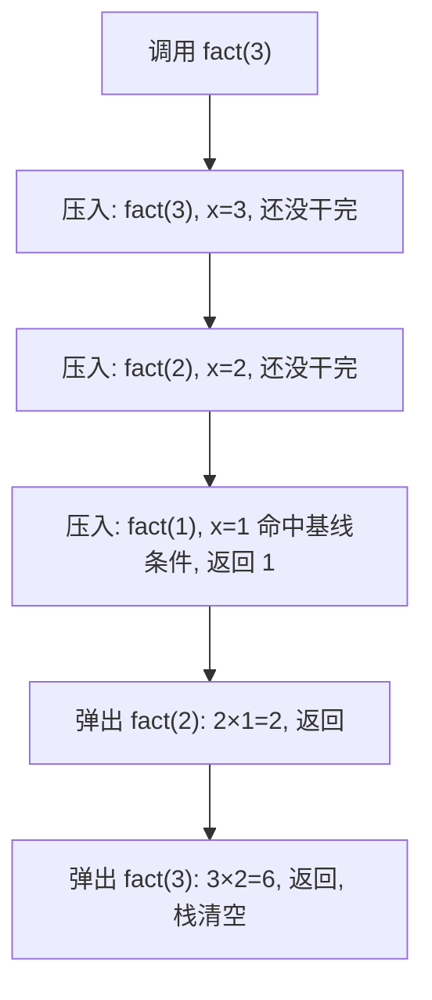

# 第 3 章：递归

- **难度**：★★☆ | **预估学时**：1.5 小时 | **前置**：第 1 章

## 学习目标

学完本章，你能：

1. 写出任何递归函数的两半——基线条件与递归条件。
2. 用纸笔跟踪一个递归函数的调用栈变化。
3. 解释栈的"压入/弹出"和调用栈为什么可能撑爆内存。

## 一句话核心

**递归就是函数自己调自己；要让它停得住，必须有一个"不再调用自己"的基线条件；计算机用一摞叫调用栈的"便条纸"记住每个进行到一半的函数。**

## 零基础讲解

### 概念 1：递归（难度：基础）

**递归（recursion）**：调用自身的函数。

**类比（原书找钥匙）**：阁楼一箱子套一箱子，钥匙在某个盒子里。
- 循环派：建一个"待查盒子堆"，每次从堆里取一个盒子翻，翻到小盒子就丢回堆里。
- 递归派：打开当前盒子，每看到一个小盒子，就"打开这个小盒子"（调用自己），每看到钥匙就喊"找到了"。

两种方法结果相同，递归版代码更短更清晰。原书引用 Stack Overflow 一句话：**"用循环性能可能更高，用递归更容易理解。怎么选看你更在乎哪个。"**

### 概念 2：基线条件与递归条件（难度：进阶）

每个递归函数必须有两部分：

- **递归条件（recursive case）**：函数调用自己。
- **基线条件（base case）**：函数不再调用自己，直接返回——防止无限循环。

**实例（可复核）**：倒数函数。

```python
def countdown(i):
    print(i)
    if i <= 0:        # 基线条件：到 0 就停
        return
    else:
        countdown(i-1) # 递归条件：自己调自己，规模减 1
```

没有基线条件时：`countdown(3)` 会一直数下去：3, 2, 1, 0, −1, −2……（按 Ctrl+C 才能停）。

### 概念 3：栈与调用栈（难度：进阶）

**栈（stack）**：一种只能在同一端"压入（push）"和"弹出（pop）"的数据结构，后进先出（LIFO）。像一摞便条纸：你只能在最上面加一张、从最上面抽一张。

**调用栈（call stack）**：计算机内部用栈来记住"每个函数调用进行到哪了"。关键规则：**调用另一个函数时，当前函数暂停并保留全部变量，等被调函数返回后从断点继续。**

**实例（可复核）**：计算阶乘 `fact(3)`：

```python
def fact(x):
    if x == 1:        # 基线条件
        return 1
    else:
        return x * fact(x-1)  # 递归条件
```

调用栈的演化（栈顶在最上）：

```
fact(3)            fact(3)            fact(3)            fact(3)=6
  ↑                  ↑                  ↑
fact(2)            fact(2)            fact(2)=2          (空)
  ↑                  ↑
fact(1)=1          (弹出)
先压入 fact(3) → 再压 fact(2) → 再压 fact(1) 命中基线
→ 弹回 fact(2): 2×1=2 → 弹回 fact(3): 3×2=6
```

每个 fact 调用都有自己独立的 x，互不干扰。栈就是那叠"还没干完的活儿"的便条纸。

**代价**：栈里每个调用都占内存。递归太深 → 栈太高 → **栈溢出（stack overflow）**，程序崩溃。两个出路：改写为循环，或用高级技巧"尾递归"（本书不展开，且并非所有语言支持）。

## 图示



**看图说明**：每向下调一层，栈就厚一张便条；基线条件像"弹仓"，从最里层开始一层层往外结算。注意方向——**先压入的后弹出**（LIFO），fact(3) 虽然最先压入，却最后才结算完。

## 类比与实例

- **类比**：调用栈 = 摞盘子。你只能从最上面放盘子、从最上面取盘子；想拿底下那个，必须先把上面的全拿掉。
  - 失效边界：摞盘子是物理动作，调用栈是内存记录——递归太深时不是"拿不动"，而是内存被占满导致崩溃。
- **实例（可复核）**：fact(5) = 5 × fact(4) = 5 × 4 × 3 × 2 × 1 = 120。用纸笔：先写 5×，再调 fact(4)……直到 fact(1)=1，再一路乘回去。

## 常见误解

- **别以为递归"更快"**——实际上递归通常不比循环快，它的价值是**思路清晰**；栈里还多存了每层的变量，反而费内存。
- **别以为"递归函数自己调自己，会把数据搞混"**——实际上每次调用都有独立的变量副本，fact(3) 的 x 和 fact(2) 的 x 互不相识。
- **别以为无限递归只是"多跑一会儿"**——实际上它会让调用栈无限增厚，最终栈溢出，程序直接被杀掉。

## 自测题（答案）

1. （单选）递归函数必须包含哪两部分？A. 循环与判断　B. 基线条件与递归条件　C. 压入与弹出　D. 输入与输出
   （答案：B；解析：没有基线条件就无限循环；没有递归条件就退化成普通函数。）
2. （单选）栈的取出顺序是？A. 先进先出　B. 后进先出　C. 随机　D. 按大小排序
   （答案：B；解析：LIFO，像一摞便条纸，最上面的先抽走。）
3. （填空）`fact(4)` 的结果是 ____。
   （答案：24；解析：4×3×2×1 = 24。）
4. （简答）不小心写出了一个停不下来的递归函数，会发生什么？
   （答案：每次调用都在调用栈占一块内存，栈越来越高，直到栈空间耗尽，程序因栈溢出而终止。）

## 复习锚点

- 递归 = 函数调自己；必须配基线条件刹车。
- 栈 = 压入/弹出、后进先出；所有函数调用都走调用栈。
- 递归省思路但费内存；栈太深会栈溢出。下一章用递归解决真正的问题——快速排序。
