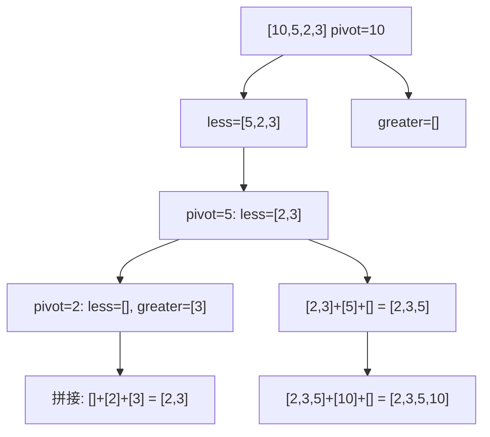

# 第 4 章：快速排序

- **难度**：★★☆ | **预估学时**：2 小时 | **前置**：第 1 章（大O）、第 3 章（递归、调用栈）

## 学习目标

学完本章，你能：

1. 用"找基线条件 → 缩小规模"两步口述分而治之（D&C）的思路。
2. 手写快速排序代码，并说出基准值、分区的作用。
3. 解释快速排序为什么平均 O(n log n)、最糟 O(n²)，以及为什么"随机选基准值"能避开最糟。

## 一句话核心

**分而治之：先想最简单到不用干的基线条件，再想怎么把问题变小；快速排序就是"选一个基准值，小的甩左边、大的甩右边，再对左右两边递归来一遍"——平均 O(n log n)，比选择排序快一个量级。**

## 零基础讲解

### 概念 1：分而治之 D&C（难度：进阶）

**分而治之（divide and conquer, D&C）**：一种递归式解题思路，两步走：

1. **找基线条件**：最简单、不用再分解就能直接回答的情况。
2. **缩小规模**：每次递归都把原问题切到更接近基线条件。

**实例 1（分地，可复核）**：把 1680m × 640m 的地切成同样大的最大正方形。

- 基线条件：一边是另一边的整数倍（如 25×50，直接切两个 25×25）。
- 缩小规模：先划掉两个 640×640，剩下 640×400 这块"小一号的同款问题"→ 再划 400×400，剩 400×240 → 划 240×240，剩 240×160 → 划 160×160，剩 160×80，已是整数倍。
- 答案：最大正方形 = **80m × 80m**。（这就是欧几里得算法求最大公约数的思路。）

**实例 2（递归求和，可复核）**：

```python
def sum(arr):
    if arr == []:        # 基线条件：空数组和为 0
        return 0
    return arr[0] + sum(arr[1:])  # 递归条件：第一个元素 + 剩下的和
```

口诀：**涉及数组的递归，基线条件通常是空数组或只有一个元素的数组。**

### 概念 2：快速排序（难度：高难）

**快速排序（quicksort）**：

1. 从数组里挑一个元素当**基准值（pivot）**。
2. **分区（partitioning）**：把所有 ≤ 基准值的放一个子数组，所有 > 基准值的放另一个。
3. 对两个子数组递归地再做快速排序。
4. 拼接：左子数组 + [基准值] + 右子数组。

**实例（可复核）**：排序 `[33, 10, 15, 7, 33选首元素33]`——以 33 为基准值：左边 [10,15,7]，右边 []；再对 [10,15,7] 以 10 为基准值：左边 [7]，右边 [15]。拼接 [7] + [10] + [15] = [7,10,15]，最后得 [7,10,15,33]。

**Python 代码（原书示例）**：

```python
def quicksort(array):
    if len(array) < 2:                # 基线条件：空或单元素，本来就有序
        return array
    else:
        pivot = array[0]              # 选第一个元素当基准值
        less = [i for i in array[1:] if i <= pivot]   # 小于等于基准的
        greater = [i for i in array[1:] if i > pivot]  # 大于基准的
        return quicksort(less) + [pivot] + quicksort(greater)

print(quicksort([10, 5, 2, 3]))   # => [2, 3, 5, 10]
```

### 概念 3：平均情况 vs 最糟情况；常数（难度：高难）

- **最糟情况**：总拿第一个元素当基准值，而输入恰好已有序。每次分区一边是空的、一边只剩 n−1 个——调用栈高度 O(n)，每层花 O(n)，总共 **O(n²)**（和选择排序一样慢）。
- **最佳/平均情况**：每次都把数组大致平分，栈高 O(log n)，每层 O(n)，总共 **O(n log n)**。
- 原书关键结论：**只要随机选基准值，平均运行时间就是 O(n log n)**；这也是快速排序实战中比合并排序快的原因——它们大O相同（都是 O(n log n)），但快速排序的**常数**更小，且平均情况几乎总撞上。

> 关于常数：原书用 `print_items`（每秒打一个）vs `print_items2`（每个元素先 sleep 1 秒）说明——两者都是 O(n)，但实际速度差很多。大O不同的算法比常数没意义；大O相同的算法（快排 vs 合并排序）常数才有决定意义。

## 图示



**看图说明**：每条横线把问题砍成两个小同款问题；递归到最底层只剩 0 或 1 个元素（基线条件，不用排），再沿路拼接回去。看每层处理的元素总数——每层都是 O(n)，层数是 O(log n)，乘起来 O(n log n)。

## 类比与实例

- **类比**：快速排序像打扑克分堆——抓起第一张牌当"分数线"，手里牌比它小的放左边、大的放右边，然后对两堆分别重复；最后从左往右一摊就是 sorted。
  - 失效边界：如果你总拿"最极端的一张"当分数线（如已排好序的牌堆每次拿最左那张），就会退化成每次只分出一张——O(n²)。所以实战要随机抽牌。
- **实例（可复核）**：打印数组每个元素 = O(n)；每个元素乘 2 = O(n)；只把第一个元素乘 2 = O(1)；用数组做乘法表（每个元素去乘其他所有元素）= O(n²)。

## 常见误解

- **别以为"快速排序永远是 O(n log n)"**——实际上它的速度取决于基准值选得好不好，最糟（已排序输入+固定取首元素）会退化到 O(n²)。
- **别以为"大O相同就一样快"**——实际上快排和合并排序都是 O(n log n)，但快排常数小、平均情况常见，实战更快。
- **别以为"数组递归求和非用循环不可"**——实际上递归版 `arr[0] + sum(arr[1:])` 完全正确，函数式语言（如 Haskell）连循环都没有，全靠递归。

## 自测题（答案）

1. （单选）快速排序的平均运行时间是？A. O(n)　B. O(log n)　C. O(n log n)　D. O(n²)
   （答案：C；解析：栈高 O(log n) × 每层 O(n)。）
2. （单选）只把数组第一个元素的值乘 2，运行时间是？A. O(1)　B. O(n)　C. O(n log n)　D. O(n²)
   （答案：A；解析：原书练习 4.7——只碰一个元素，与 n 无关。）
3. （填空）快速排序的基线条件是数组为空或只有 ____ 个元素。
   （答案：一；解析：空数组和单元素数组本来就有序，直接返回。）
4. （简答）为什么"随机选基准值"能让快速排序平均变快？
   （答案：固定取首元素遇到已排序输入会退化成 O(n²)；随机选基准值意味着每次大致平分的概率很高，栈高维持在 O(log n)，平均就是 O(n log n)。）

## 复习锚点

- D&C 两步：找最简单的基线条件；每次递归把问题变小。
- 快排 = 选基准值 + 分区 + 递归排序左右两边再拼接；代码 4 行核心。
- 平均 O(n log n)、最糟 O(n²)；随机选基准值避开最糟；大O相同时比常数。
