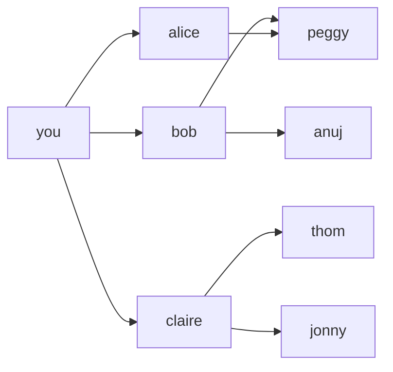

# 第 6 章：广度优先搜索

- **难度**：★★☆ | **预估学时**：2 小时 | **前置**：第 5 章（散列表，用于表示图）

## 学习目标

学完本章，你能：

1. 用"节点 + 边"的语言说清什么是图，并区分有向图与无向图。
2. 口述广度优先搜索（BFS）的步骤，解释为什么必须用队列、为什么必须标记已检查。
3. 说出 BFS 能回答的两类问题，及其运行时间 O(V+E)。

## 一句话核心

**广度优先搜索：从起点出发，先把所有"一步之遥"的人查完，再查"两步之遥"的，依次往外扩——所以它找到的一定是段数最少的路径；它的标配是队列（先进先出）和一张"已检查"名单。**

## 零基础讲解

### 概念 1：图（难度：基础）

**图（graph）**：模拟"谁和谁相连"的结构，由两种零件组成：

- **节点（node）**：一个点，比如一个人、一个地点。
- **边（edge）**：两个节点之间的连线。直接相连的节点互为**邻居**。

- **有向图（directed graph）**：边带箭头，关系单向（rama → adit 表示 rama 欠 adit 钱，反过来不成立）。
- **无向图（undirected graph）**：边不带箭头，关系双向（ross — rachel 互相约会）。
- **树（tree）**：一种特殊的图，所有边都朝一个方向指（没有"绕回去"的边），如家谱。

Python 里用**散列表**表示图：键是节点，值是它的所有邻居。

```python
graph = {}
graph["you"] = ["alice", "bob", "claire"]
graph["bob"] = ["anuj", "peggy"]
graph["alice"] = ["peggy"]
graph["claire"] = ["thom", "jonny"]
graph["anuj"] = []      # 没邻居也要登记，否则 KeyError
```

### 概念 2：队列（难度：基础）

**队列（queue）**：先进先出（FIFO）的数据结构——像公交站排队，先来的先上车。只支持两种操作：**入队（enqueue）**和**出队（dequeue）**。

对比：**栈**是后进先出（LIFO），像一摞盘子。

BFS 为什么必须用队列？因为要保证"一度关系先于二度关系"被检查：先加入查找名单的人，先被取出检查。若用栈（后入先出），就会一头扎进二度关系，找到的就不是最近的那个人。

### 概念 3：广度优先搜索（难度：进阶）

**广度优先搜索（BFS）**回答两类问题：

1. 从 A 到 B **有路径吗**？
2. 如果有，**哪条路径段数最少**（最短路径）？

**实例（原书芒果销售商，可复核）**：你在 Facebook 人脉网里找芒果销售商。

```python
from collections import deque

def person_is_seller(name):
    return name[-1] == 'm'     # 原书简化：名字以 m 结尾就算是销售商

def search(name):
    search_queue = deque()
    search_queue += graph[name]   # 第一步：把你的所有邻居入队
    searched = []                 # 已检查名单，防止重复和无限循环
    while search_queue:
        person = search_queue.popleft()   # 取出队首（最早入队的）
        if person not in searched:
            if person_is_seller(person):
                print(person + " is a mango seller!")
                return True
            else:
                search_queue += graph[person]  # 他的朋友全部入队
                searched.append(person)
    return False

search("you")
```

两个关键细节：

- **必须标记已检查**：Peggy 既是 Alice 的朋友又是 Bob 的朋友，会入队两次；不做标记还可能在"你 ↔ Peggy"之间无限循环。
- **运行时间**：沿每条边走一遍 = O(边数 E)，每个人入队一次 = O(人数 V)，合计 **O(V + E)**。

**拓扑排序**：如果任务 A 依赖 B（先刷牙才能吃早餐），把任务排成"B 必须在 A 前面"的有序列表——这叫拓扑排序，用来给依赖图排执行顺序（如婚礼筹备清单）。

## 图示



**看图说明**：从 you 出发，BFS 按"圈层"扩展——第 1 圈 alice/bob/claire，第 2 圈 anuj/peggy/thom/jonny。如果 thom 是销售商，任何一条到 thom 的路径都不会比 2 段更短（因为第 1 圈没人是）。队列保证了这个圈层顺序。

## 类比与实例

- **类比**：BFS 像往水里扔石头的涟漪——从落点一圈一圈往外扩，所以"第一圈碰不到、第二圈碰到"的目标，距离就是 2。
  - 失效边界：BFS 算的是"段数最少"，不是"路程最短"。如果每段路有不同耗时，要用第 7 章的狄克斯特拉算法。
- **实例（可复核）**：原书早晨任务图——不能没刷牙就吃早餐，但洗澡和刷牙谁先谁后都行。可行的排法：起床 → 洗澡 → 刷牙 → 吃早餐；或 起床 → 刷牙 → 洗澡 → 吃早餐。两种都满足"吃早餐在刷牙后"。

## 常见误解

- **别以为"BFS 找的是路程最短"**——实际上它找的是**经过的节点数最少**（段数最少）。每条边权重不同时它会给你快不了的路径。
- **别以为"不标记已检查只是慢一点"**——实际上不标记可能无限循环：你不是销售商 → 把你的邻居重新入队 → 循环往复。
- **别以为"链表也能当队列用"**——队列要队首出、队尾进；关键是"按加入顺序处理"，数据结构叫什么不重要，重要的是 FIFO 语义。

## 自测题（答案）

1. （单选）广度优先搜索使用的数据结构是？A. 栈　B. 队列　C. 散列表　D. 数组
   （答案：B；解析：FIFO 保证先加入的一度关系先被检查，找到的才是最短路径。）
2. （单选）BFS 的运行时间通常写作？A. O(n)　B. O(n²)　C. O(V + E)　D. O(log n)
   （答案：C；解析：每个顶点入队一次 O(V)，每条边走一次 O(E)。）
3. （填空）有向图的边带 ____，表示关系单向；不带箭头的叫 ____ 图。
   （答案：箭头；无向；解析：无向图中两节点互为邻居。）
4. （简答）为什么 BFS 找到的一定是最短路径（段数最少）？
   （答案：因为它按圈层扩展——先检查完所有一度关系，再检查二度关系。第一个被找到的目标，必然是在最小的圈层里，即段数最少。）

## 复习锚点

- 图 = 节点 + 边；有向（箭头）/无向（双向）；树是特殊的图。
- BFS：队列 + 已检查名单，回答"有路径吗 / 最短路径是哪条"，O(V+E)。
- 依赖任务的排序用拓扑排序。第 7 章升级：边带权重时改用狄克斯特拉算法。
