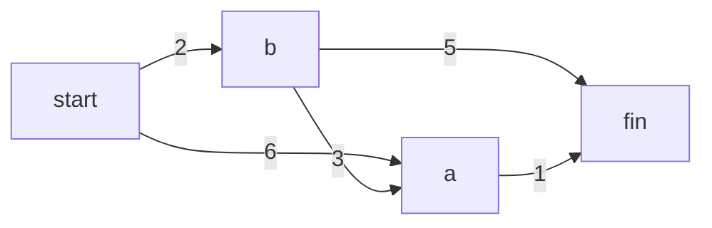

# 第 7 章：狄克斯特拉算法

- **难度**：★★★ | **预估学时**：2.5 小时 | **前置**：第 6 章（图、BFS）、第 5 章（散列表）

## 学习目标

学完本章，你能：

1. 说出 BFS 与狄克斯特拉算法的分工：非加权图 vs 加权图。
2. 按四步手算一遍狄克斯特拉算法（找最便宜节点 → 更新邻居开销 → 重复 → 回溯路径）。
3. 解释为什么负权边会让狄克斯特拉失效，以及该用什么替代。

## 一句话核心

**狄克斯特拉算法：每次挑"当前已知最便宜（最短）"的节点处理，一旦处理过就封死"不会更便宜了"这个假设——所以它能在加权图里找出总权重最小的路径，但这个假设只在没有负权边时成立。**

## 零基础讲解

### 概念 1：加权图与最短路径（难度：进阶）

- **权重（weight）**：每条边上的数字，表示距离/时间/费用。
- **加权图（weighted graph）**：边带权重的图；反之叫非加权图。
- **分工**：非加权图找段数最少 → BFS；加权图找总权重最小 → **狄克斯特拉算法（Dijkstra's algorithm）**。

原书小图：起点 → A（6 分钟）、起点 → B（2 分钟）、B → A（3）、B → 终点（5）、A → 终点（1）。BFS 会给"两段直达"的 7 分钟路径（起点→B→终点），但狄克斯特拉算出更快的 **6 分钟**：起点→B（2）→A（3）→终点（1）。

### 概念 2：狄克斯特拉四步法（难度：高难）

1. 找出**最便宜**的节点（从起点出发，能在最短时间/最少费用到达的未处理节点）。
2. 对它的每个邻居，检查"经过本节点是否更近"，更近就**更新开销**并记下父节点。
3. 重复 1~2，直到所有节点都处理过。
4. 沿父节点**回溯**出最终路径。

**手算实例（原书换钢琴，可复核）**：Rama 用乐谱换钢琴，要求额外花钱最少。

| 步骤 | 选中节点 | 更新后的关键开销 |
|---|---|---|
| 1 | 海报（0 美元，最便宜） | 低音吉他 30、架子鼓 35 |
| 2 | 黑胶唱片（+5 美元） | 架子鼓降到 20、吉他降到 15 |
| 3 | 吉他（15） | 钢琴 = 15+20 = 35 |
| 4 | 架子鼓（20） | 钢琴降到 20+15 = **35** |

回溯父节点：钢琴 ← 架子鼓 ← 黑胶唱片 ← 乐谱。**最终答案：最少额外花 35 美元**。

### 概念 3：三个散列表与代码（难度：高难）

原书实现用三个散列表：`graph`（图+权重）、`costs`（到每个节点当前已知的最小开销）、`parents`（父节点，用于回溯），外加一个 `processed` 列表。

```python
infinity = float("inf")
costs = {"a": 6, "b": 2, "fin": infinity}
parents = {"a": "start", "b": "start", "fin": None}
processed = []

def find_lowest_cost_node(costs):
    lowest_cost = float("inf")
    lowest_cost_node = None
    for node in costs:                       # 遍历所有节点
        cost = costs[node]
        if cost < lowest_cost and node not in processed:  # 未处理且更便宜
            lowest_cost = cost
            lowest_cost_node = node
    return lowest_cost_node

node = find_lowest_cost_node(costs)
while node is not None:
    cost = costs[node]
    neighbors = graph[node]
    for n in neighbors.keys():
        new_cost = cost + neighbors[n]       # 经过本节点去邻居的开销
        if costs[n] > new_cost:             # 发现更短路径
            costs[n] = new_cost
            parents[n] = node
    processed.append(node)
    node = find_lowest_cost_node(costs)
```

### 概念 4：负权边与适用边界（难度：高难）

- **环（cycle）**：从某节点出发绕一圈回到自己。有向图里绕环只会增加总权重，不会是最短路径。
- **负权边**：某条边的权重为负（如"换这个还能倒赚 7 美元"）。
- **为什么不能用**：狄克斯特拉的核心假设是"节点一旦处理，就不可能有更便宜的路径"。负权边会制造"处理完又变便宜"的矛盾，算法会选错误路径。
- **替代**：含负权边的图用**贝尔曼-福德算法（Bellman-Ford）**（本书不展开）。

## 图示



**看图说明**：BFS 数段数会选 start→b→fin（2 段，7 分钟）；但把权重加起来算，start→b→a→fin = 2+3+1 = **6 分钟**更短。狄克斯特拉的每一步都在问"这条新路是不是比已知的便宜"，所以能挖出这条绕一下却更快的路。

## 类比与实例

- **类比**：狄克斯特拉像导航软件——你从家出发，它先解锁"已知最近"的路口，从那个路口再看能不能拐出更短的路。
  - 失效边界：如果有一条"越走越便宜"的暗道（负权边），导航的"最近路口已封死"假设就错了——得换算法。
- **实例（可复核）**：原书练习 7.1 答案：图 A 最短总权重 = 8；图 B = 60；图 C 有负权边，狄克斯特拉**无法**找出最短路径。

## 常见误解

- **别以为"狄克斯特拉和 BFS 一样找段数最少"**——实际上它找的是**总权重最小**，路径可能多绕几段。
- **别以为"负权边只是省钱，算法照样能用"**——实际上负权边会破坏"处理过即最优"的假设，得到错误答案，必须换贝尔曼-福德。
- **别以为"环会带来更短路径"**——实际上绕环只会累加权重，永远不可能更短，所以算法不用考虑绕环。

## 自测题（答案）

1. （单选）在加权图中找总权重最小的路径，应使用？A. BFS　B. 选择排序　C. 狄克斯特拉算法　D. 快速排序
   （答案：C；解析：BFS 只管段数，不管权重。）
2. （单选）图中出现负权边时，正确做法是？A. 照常使用狄克斯特拉　B. 改用贝尔曼-福德算法　C. 忽略负权边　D. 用 BFS
   （答案：B；解析：负权边使狄克斯特拉的"已处理即最优"假设失效。）
3. （填空）狄克斯特拉算法每一步都先选出____最低的节点来处理。
   （答案：开销（成本/代价）；解析：这是它能保证最优的关键——先封死最便宜的节点。）
4. （简答）最终路径是怎么算出来的？
   （答案：算法本身只算出每个节点的最小开销；从终点沿父节点一列往回追（钢琴←架子鼓←黑胶唱片←乐谱），追到起点就得到完整路径。）

## 复习锚点

- 非加权图最短路径 = BFS；加权图最短路径 = 狄克斯特拉。
- 四步：选最便宜节点 → 更新邻居开销 → 重复 → 父节点回溯。
- 红线：有负权边就不能用，换贝尔曼-福德。
