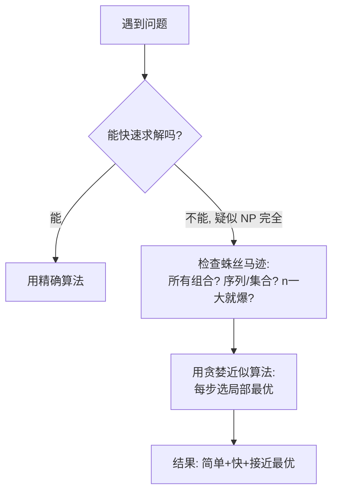

# 第 8 章：贪婪算法

- **难度**：★★☆ | **预估学时**：2 小时 | **前置**：第 1 章（O(n!)）

## 学习目标

学完本章，你能：

1. 说清什么是贪婪策略（每步选局部最优），并举一个它恰好得到全局最优的例子。
2. 识别 NP 完全问题，并说明为什么对它该用近似算法。
3. 用集合运算（并集/交集/差集）读懂原书集合覆盖问题的代码。

## 一句话核心

**贪婪算法 = 每一步都选眼前看起来最好的那一个；它不保证全局最优，但胜在简单飞快——遇到 NP 完全问题（旅行商、集合覆盖）时，与其死磕精确解，不如用贪婪近似解凑合。**

## 零基础讲解

### 概念 1：贪婪策略（难度：基础）

**贪婪算法（greedy algorithm）**：每一步都做**局部最优选择**，指望拼出全局最优。

**实例 1（教室调度，贪婪恰好最优）**：一间教室要排尽可能多的不冲突课程。做法：每次选**结束最早**的课 → 再选它结束后才开始、且结束最早的课……原书结果：美术（10:00 结束）→ 数学 → 音乐，共 3 节。对这个问题，简单贪婪就是最优解。

**实例 2（背包，贪婪会翻车）**：35 磅背包，音响 30 磅/$3000、笔记本 3 磅/$2000、吉他 1 磅/$1500。贪婪先偷最贵的音响 → 装满，得 $3000；但偷笔记本+吉他 = $3500 更优。**贪婪不保证最优，但"非常接近"**。

### 概念 2：集合覆盖问题与近似算法（难度：进阶）

**问题**：要让全美 50 个州都听到广播，每个广播台覆盖几个州且彼此重叠，求**最少**广播台集合。

**精确解**：列出所有可能的子集（**幂集**，2ⁿ 个），逐个检查哪个覆盖全部州且最小——运行时间 **O(2ⁿ)**，广播台一多就算到天荒地老。

**贪婪近似解**（原书代码，O(n²)）：

```python
states_needed = set(["mt", "wa", "or", "id", "nv", "ut", "ca", "az"])
stations = {
    "kone":  set(["id", "nv", "ut"]),
    "ktwo":  set(["wa", "id", "mt"]),
    "kthree":set(["or", "nv", "ca"]),
    "kfour": set(["nv", "ut"]),
    "kfive": set(["ca", "az"]),
}
final_stations = set()

while states_needed:
    best_station = None
    states_covered = set()
    for station, states in stations.items():
        covered = states_needed & states        # 交集：该台新覆盖多少未覆盖的州
        if len(covered) > len(states_covered):  # 当前覆盖最多未覆盖州的台
            best_station = station
            states_covered = covered
    states_needed -= states_covered            # 差集：划掉已覆盖的州
    final_stations.add(best_station)

print(final_stations)   # 原书结果: {'ktwo','kthree','kone','kfive'}
```

每次选"覆盖最多**还没覆盖**的州"的广播台，重复直到全覆盖。**近似算法（approximation algorithm）**的好坏看两点：速度多快、离最优解多近。

**集合三运算**：并集 `|`（合并）、交集 `&`（共有元素）、差集 `-`（剔除共有元素）。

### 概念 3：NP 完全问题（难度：高难）

**NP 完全问题（NP-complete）**：以难解著称、目前没人找到快速解法的问题。两个经典代表：

- **旅行商问题**：n 个城市的路线数 = n!（3 城 6 条、4 城 24 条、10 城 360 万条）。
- **集合覆盖问题**：子集数 2ⁿ。

**蛛丝马迹（原书识别清单）**：

- 元素少时很快，n 一大就慢得离谱；
- 涉及"所有组合/所有排列"；
- 不能拆成小问题，必须考虑各种可能；
- 涉及序列（城市顺序）或集合（广播台集合）且难办；
- 能归约成旅行商或集合覆盖问题。

**应对**：别找精确解，直接上贪婪近似。完美是优秀的敌人。

## 图示



**看图说明**：这是原书反复用的决策路径——先判断问题"能不能快速解"，不能就别死磕精确解；贪婪算法的价值不在最优，而在"够用、够快、够简单"。

## 类比与实例

- **类比**：贪婪算法像收拾行李——每次抓"现在最想要的"塞进背包。对大部分日常打包，这已经够好；只有在精确称重的比赛里才输。
  - 失效边界：遇到"全局组合最优"类问题（背包、覆盖、旅行商），局部最优拼不出全局最优。
- **实例（可复核）**：装卡车：每次塞"还能塞进剩余空间的最大箱子"——快，但不保证空间利用率最优（原书练习 8.1）。

## 常见误解

- **别以为"贪婪算法不好所以不用学"**——实际上它对教室调度这类问题就是精确最优解；对 NP 完全问题，它是最快的近似方案。
- **别以为"集合覆盖问题可以靠多买几台服务器硬算"**——实际上 2ⁿ 增长比硬件快得多，n=60 时子集数已超过宇宙原子量级级别，只能近似。
- **别以为"问题长得像最短路径就有快解"**——实际上"A 到 B"有快解，但"途经所有指定点"就是旅行商，NP 完全。

## 自测题（答案）

1. （单选）下列哪个是贪婪算法？A. 快速排序　B. 广度优先搜索　C. 每次选结束最早的课排进教室　D. 二分查找
   （答案：C；解析：原书练习 8.3~8.5：快排不是贪婪；BFS 和狄克斯特拉是（每步选当前最优）。）
2. （单选）集合覆盖问题的精确解运行时间是？A. O(n)　B. O(n log n)　C. O(2ⁿ)　D. O(log n)
   （答案：C；解析：幂集有 2ⁿ 个子集，要逐个检查。）
3. （填空）`A = {1,2,3}`，`B = {2,3,4}`，则 `A & B` = ____，`A | B` = ____。
   （答案：{2,3}；{1,2,3,4}；解析：交集取共有，并集合并去重。）
4. （简答）邮递员要给 20 个家庭送信并找最短路线，这是 NP 完全问题吗？为什么？
   （答案：是。它就是旅行商问题——要试遍 20 个家庭的排列顺序，20! 是天文数字（原书练习 8.6）。）

## 复习锚点

- 贪婪 = 每步局部最优；有时恰好全局最优（教室调度），有时只是近似（背包）。
- NP 完全问题：旅行商 n!、集合覆盖 2ⁿ；识别靠"组合爆炸/序列/集合"等蛛丝马迹。
- 对付 NP 完全：放弃精确解，用贪婪近似——简单、快、接近最优。
