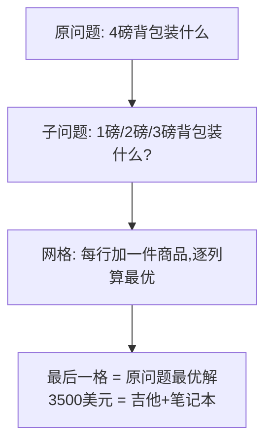

# 第 9 章：动态规划

- **难度**：★★★ | **预估学时**：3 小时 | **前置**：第 8 章（背包问题引入）

## 学习目标

学完本章，你能：

1. 说出动态规划的核心动作：建网格、逐格填、每格 = 一个子问题的最优值。
2. 手填背包问题网格，解释"单元格公式"的两部分比较。
3. 区分最长公共子串与最长公共子序列，并写出它们的递推公式。

## 一句话核心

**动态规划：把大问题拆成一排排小问题（子背包），把每个小问题的最优答案填进网格格子里，填到最后一格时，大问题的答案自己跳出来——前提是子问题彼此独立、不互相依赖。**

## 零基础讲解

### 概念 1：背包问题的网格解法（难度：高难）

**问题**：背包容量 4 磅，可偷：吉他（1 磅/$1500）、音响（4 磅/$3000）、笔记本电脑（3 磅/$2000）。怎么偷总价值最大？

**网格设计**：行 = 商品（吉他、音响、笔记本）；列 = 背包容量（1、2、3、4 磅）。每个格子 = "当前行商品 + 当前列容量"下的最大价值。

**逐行填（可复核）**：

| | 1磅 | 2磅 | 3磅 | 4磅 |
|---|---|---|---|---|
| 吉他 | 1500 | 1500 | 1500 | 1500 |
| 音响（4磅） | 1500 | 1500 | 1500 | **3000** |
| 笔记本（3磅） | 1500 | 1500 | 2000 | **3500** |

关键格（笔记本行 × 4磅）的算法：

- 不偷笔记本：沿用旧最优 3000。
- 偷笔记本（占 3 磅）：2000 + 剩余 1 磅格子里的最优（吉他 1500）= 3500。
- 取大者：**3500**。

**答案：吉他 + 笔记本，总价值 $3500**（不是最贵的音响 $3000）。

**通用格子公式**：`当前格 = max(上一格的值, 当前商品价值 + 剩余容量对应格子的值)`。

**原书 FAQ 要点**：

- 加新商品（iPhone 1 磅/$2000）：只加一行重算，不用推倒重来 → 新答案 iPhone+笔记本 = 4000。
- 行的顺序随便换，结果不变。
- 商品重量必须是整数粒度（0.5 磅的项链就需要更细的网格）。
- **不能偷商品的一部分**（要么整件拿、要么不拿）；想偷散装的（如按斤称米）请用第 8 章贪婪算法。
- 子问题必须**彼此独立**（去巴黎旅游这种"后面的景点依赖前面的行程"无法建模）。

### 概念 2：最长公共子串（难度：高难）

**问题**：用户拼错成 `hish`，到底想查 `fish` 还是 `vista`？

**网格**：行 = 单词 A 的每个字母，列 = 单词 B 的每个字母。格子 (i,j) = "A 前 i 个字母"与"B 前 j 个字母"的**最长公共子串长度**。

**公式**：

```python
if word_a[i] == word_b[j]:        # 两个字母相同
    cell[i][j] = cell[i-1][j-1] + 1   # 左上角格子 +1
else:                              # 不同
    cell[i][j] = 0                    # 打断，归零
```

结果：`hish` vs `fish` 公共子串 "ish" = **3**；`hish` vs `vista` = **2**。所以用户想查的是 **fish**。

> 注意：答案是网格里**最大的数**，不一定在右下角！

### 概念 3：最长公共子序列（难度：高难）

**子序列**：字母不必连续出现，但顺序要对。例：`fosh` 与 `fish` 的公共子序列是 `f, s, h` = 3。

**公式**（只在 else 分支不同）：

```python
if word_a[i] == word_b[j]:
    cell[i][j] = cell[i-1][j-1] + 1
else:
    cell[i][j] = max(cell[i-1][j], cell[i][j-1])  # 取上方或左方较大者
```

**用途**：DNA 相似性比较、git diff、编辑距离（拼写检查）、Word 断字。

## 图示



**看图说明**：动态规划的精髓在箭头方向——先把子问题（各种小背包）全部算完并存进格子；原问题求解时直接查格子里已算好的答案拼起来，不再重复计算。

## 类比与实例

- **类比**：动态规划像爬楼梯——你不用知道怎么从 0 楼到 10 楼，只要知道"站在第 k 楼时怎么到 k+1 楼"（每格公式），再从 1 楼一步步填到 10 楼。
  - 失效边界：如果楼梯的台阶之间互相干扰（子问题不独立，如"先去巴黎才能便宜去卢浮宫"），格子就没法独立填，动态规划失效。
- **实例（可复核）**：原书练习 9.2——6 磅露营背包：水（3 磅/价值10）、书（1/3）、食物（2/9）、夹克（2/5）、相机（1/6）。答案：**水 + 食物 + 相机**（3+2+1=6 磅，价值 10+9+6=25）。

## 常见误解

- **别以为"动态规划就是把所有组合试一遍"**——实际上试所有组合是 O(2ⁿ) 的蛮力；动态规划每格只做一次比较，是多项式时间。
- **别以为"答案总在最后一格"**——背包问题是，但最长公共子串问题的答案是网格中的最大值，可能在中间。
- **别以为"动态规划什么问题都能解"**——实际上子问题必须离散独立；有依赖关系（去巴黎影响后续景点价格）就建不了网格。

## 自测题（答案）

1. （单选）背包问题 4 磅、吉他（1/$1500）、音响（4/$3000）、笔记本（3/$2000），最优解是？A. 音响 $3000　B. 吉他+笔记本 $3500　C. 吉他+音响 $4500　D. 笔记本 $2000
   （答案：B；解析：音响 4 磅占满；笔记本 3 磅 + 吉他 1 磅 = 4 磅，$3500。）
2. （单选）最长公共子串与最长公共子序列的公式区别在哪个分支？A. 字母相同　B. 字母不同　C. 初始化　D. 无区别
   （答案：B；解析：不同时子串归 0，子序列取 max（上/左）。）
3. （填空）动态规划每种解法都涉及一张 ____，每个格子代表一个____ 的最优值。
   （答案：网格；子问题；解析：这是原书小结的原话。）
4. （简答）为什么"去巴黎顺便游卢浮宫"这类问题动态规划处理不了？
   （答案：子问题不独立——加了"去巴黎"这件事后，游卢浮宫的成本从 1.5 天变成 1 天，子问题的值互相依赖，没法在网格里独立填格。）

## 复习锚点

- 动态规划 = 网格 + 逐格子问题最优值；每格公式：max（不拿 / 拿+剩余格子）。
- 适用条件：约束下求最优、子问题离散独立；不适用：可拆分散装、子问题互相依赖。
- 子串（连续，不同则归 0）vs 子序列（可跳着取，不同则取 max）。
