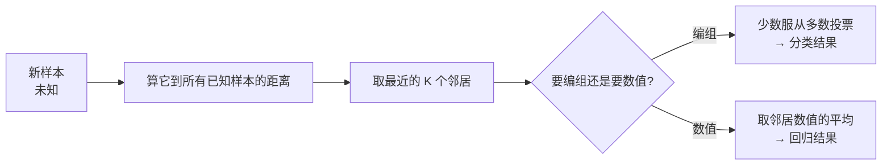

# 第 10 章：K 最近邻算法

- **难度**：★☆☆ | **预估学时**：1.5 小时 | **前置**：第 1 章

## 学习目标

学完本章，你能：

1. 说清 KNN 的两步：抽特征 → 找最近的 K 个邻居 → 投票/平均。
2. 区分**分类**（编组）与**回归**（预测数值）。
3. 解释为什么"特征选得好不好"决定 KNN 的成败。

## 一句话核心

**K 最近邻：把每个东西变成一组坐标，算它和谁离得最近；分类就看最近 K 个邻居大多是哪类，回归就把这 K 个邻居的数值取平均——简单，但效果完全取决于你抽的特征好不好。**

## 零基础讲解

### 概念 1：特征抽取与距离（难度：基础）

**特征（feature）**：把物品量化成几个数字。水果用"个头、颜色"两个数字；Netflix 用户用"对 5 类电影的打分"5 个数字。

**距离公式（毕达哥拉斯公式）**：

```
两点 (x1,y1) 与 (x2,y2) 的距离 = √((x1−x2)² + (y1−y2)²)
```

原书实例：Priyanka 与 Justin 兴趣几乎一致，距离 = **1**（很近）；Priyanka 与 Morpheus（都爱动作片、讨厌爱情片）距离 = **24**（很远）。5 维、100 维也用同一个公式。

### 概念 2：分类与回归（难度：基础）

**K 最近邻（KNN, k-nearest neighbours）**：

- **分类（classification）= 编组**：新水果是橙子还是柚子？看离它最近的 3 个邻居里橙子多还是柚子多——多数票决定。
- **回归（regression）= 预测数值**：Priyanka 会给某电影打几分？取最近 5 个邻居打分的**平均值**：(3+4+4+5+5)/5 = **4.2**。

**实例（面包店，可复核）**：用 K=4 邻居的销量平均预测今天烤多少条面包。历史数据里与今天（周末、天气不错）最接近的 4 天销量 A、B、D、E，平均 = **218.75 条**，就烤这么多。

### 概念 3：特征选择与 K 的选择（难度：进阶）

- **好特征**：与要预测的目标紧密相关；不偏不倚（不能只让人给喜剧片打分，否则看不出谁喜欢动作片）。
- **K 取多少**：原书经验法则——用户数为 N 时，取 **√N** 个邻居；K 太小容易被个别异常带偏。
- **打分尺度不一**：Yogi 宽松全打 5 星、Pinky 挑剔——先**归一化**（按各自平均评分调整）再比较。
- **实际中常用余弦相似度**（比较向量夹角而不是直线距离），对"一个人整体打分偏高"更鲁棒。
- **延伸**：OCR 字符识别、垃圾邮件过滤（朴素贝叶斯）、语音/人脸识别，都是"先训练、再找最近邻"的套路。

## 图示



**看图说明**：KNN 没有复杂的"训练"——所有计算都在"来了新样本的那一刻"发生：先算距离，再圈出最近 K 个，最后看任务是投票还是取平均。

## 类比与实例

- **类比**：判断一个陌生水果是橙是柚，你不会背诵植物学论文，而是瞟一眼旁边最像的 3 个水果——多数是橙就是橙。KNN 就是"随大流看邻居"的数学版。
  - 失效边界：如果旁边摆的 3 个全是被误标的水果，或者你只看了"颜色"这一个特征而忽略了"个头"，结论就会错——特征质量决定一切。
- **实例（可复核）**：推荐系统——找出与你最近的 5 个用户，他们看过而你没看过的电影，推荐给你。你评论越多，坐标越准，推荐越准（这就是 Netflix 反复求你评分的原因）。

## 常见误解

- **别以为"KNN 必须 K=5"**——实际上 K 随便取（2、10、10000），名字里的 K 就是这个意思；经验上取 √N。
- **别以为"回归就是再训练一个复杂模型"**——实际上原书的回归就是把 K 个邻居的数值求平均，一行算术。
- **别以为"给更多维度打分总是更好"**——实际上如果特征与目标无关（让人给小猫图片打分来推电影），维度再多也是噪声。

## 自测题（答案）

1. （单选）KNN 做"回归"时，最终输出是？A. 投票多数的类别　B. 最近 K 个邻居数值的平均值　C. 距离公式　D. 最大值
   （答案：B；解析：分类=编组投票，回归=数值平均。）
2. （单选）判断用户品味是否相近，最合适的第一步是？A. 直接比较用户名　B. 把用户对各类电影的打分变成坐标再算距离　C. 让用户自我介绍　D. 用二分查找
   （答案：B；解析：特征抽取——把人变成可比较的数字向量。）
3. （填空）原书经验法则：N 个用户时，K 取 ____ 个。
   （答案：√N（N 的平方根）；解析：太少易被异常带偏，太多会引入不相似的邻居。）
4. （简答）为什么 Netflix 总催你多给电影打分？
   （答案：你打分越多，你的特征向量维度越完整、越准确，算法算"谁和你像"就越准，推荐质量越高。）

## 复习锚点

- KNN 两步：抽特征（量化）→ 找最近 K 个邻居。
- 分类 = 投票；回归 = 平均。
- 成败在特征：要相关、不偏袒；尺度不一要归一化，实战常用余弦相似度。
