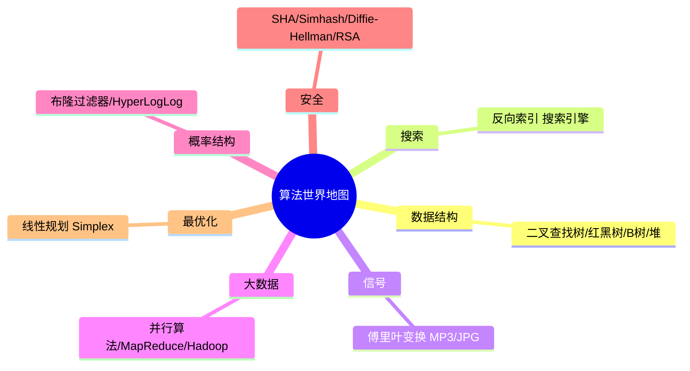

# 第 11 章：接下来如何做

- **难度**：★☆☆ | **预估学时**：1 小时 | **前置**：第 1~10 章全部（本章是地图，不是新课）

## 学习目标

学完本章，你能：

1. 说出 10 个进阶主题各自解决什么问题（一句话级别）。
2. 在自己的兴趣方向（数据结构 / 搜索 / 信号 / 大数据 / 安全 / 最优化）里，选出下一个该深入的主题。
3. 复述"哈希"与"SHA"的区别、"布隆过滤器"与"散列表"的区别。

## 一句话核心

**本章不教新算法，而是给你一张地图：本书只是算法世界的入口，每个方向都有更专深的主题——挑你感兴趣的，一头扎进去。**

## 零基础讲解

### 概念 1：树类数据结构（难度：进阶）

**二叉查找树（binary search tree）**：每个节点，左子节点值比它小、右子节点值比它大。查找几乎和二分查找一样：从根开始，目标小就往左、大就往右。

- 平均查找 O(log n)；但**不平衡时退化为 O(n)**（树歪成一根棍子）。
- 插入/删除比有序数组快得多（数组插完要重排才能二分）。
- 平衡变种：**红黑树、B 树**（数据库常用）、堆、伸展树。

### 概念 2：反向索引（难度：基础）

**反向索引（inverted index）**：散列表，键 = 单词，值 = 包含该单词的网页列表。用户搜 "hi" → 查表 → 拿到所有含 hi 的页面。这是搜索引擎的雏形。

### 概念 3：信号与并行（难度：进阶）

- **傅里叶变换**：把混合信号拆成成分——一首歌拆成各种频率，删掉不重要的频率就是 MP3/JPG 压缩；还用于地震预测、DNA 分析、音乐识别（Shazam）。
- **并行算法**：多核时代，排序可并行到 O(n)；但提速不是线性的——有管理开销和负载均衡两个坑。
- **MapReduce**：分布式并行，map（对每个元素做同样处理，可拆散到多台机器）+ reduce（把数组归并成一个值，如求和）。Hadoop 生态，处理数十亿行数据。

### 概念 4：概率型数据结构与安全（难度：进阶）

- **布隆过滤器（Bloom filter）**：判断"某元素在不在集合里"的概率型结构。**可能错报**（说在，其实不在），但**绝不漏报**（说不在，就肯定不在）。占用空间极小，适合"网页是否抓过"这类场景。
- **HyperLogLog**：近似数出集合里有多少不同元素，内存极小、答案八九不离十。
- **SHA（安全散列算法）**：任意字符串 → 一段短散列值。用途：比对大文件是否相同；**存密码只存散列值**（单向，反推不出原密码）。密码用 SHA-2/SHA-3，最安全是 bcrypt。
- **Simhash（局部敏感散列）**：改一个字符结果就只变一点——用来判相似（查重论文、判断网页是否重复）。
- **Diffie-Hellman / RSA**：公钥加密——公钥谁都能拿到用来加密，私钥只有你有用来解密，解决了"没见过面怎么安全通信"的老问题。

### 概念 5：线性规划（难度：高难）

**线性规划（linear programming）**：在给定约束（布料几米、扣子几粒）下最大化某个指标（利润）。原书说"所有图算法都能装进线性规划这个大框架"，图问题只是它的子集。求解用 Simplex 算法。

## 图示

**看图说明**：本书 11 章是地图上的"主城区"（查找、排序、递归、图、动态规划、KNN）；这 10 个主题是向外辐射的卫星城。按兴趣选一个方向深入即可。

## 类比与实例

- **类比**：本书像驾校——教会你开车的基本功；本章像地图，告诉你高速公路网通往哪些城市。先学会上路，再挑目的地。
- **实例（可复核）**：你上传一张 4GB 电影到云端，朋友也有这文件——不用传整个文件，各算 SHA 散列值对比，相等就是同一文件。

## 常见误解

- **别以为"SHA 就是散列表用的散列函数"**——实际上散列表散列函数输出数组下标；SHA 输出另一个短字符串，用于比对和密码安全，目的完全不同。
- **别以为"布隆过滤器答案 100% 可靠"**——实际上它可能错报（说在但不在），绝不会漏报；适合"可能恶意请小心"这类容忍误报的场景。
- **别以为"二叉查找树总是 O(log n)"**——实际上不平衡时是 O(n)，这才需要红黑树这类平衡变种。

## 自测题（答案）

1. （单选）判断"这个网页我抓过没有"，且容忍偶发错报、要求极省内存，该用？A. 散列表　B. 布隆过滤器　C. 数组　D. 快速排序
   （答案：B；解析：布隆过滤器可能错报但绝不漏报，空间极小。）
2. （单选）数据库存密码，正确做法是？A. 明文存　B. 存密码的 SHA 散列值　C. 用 Base64 编码　D. 存逆向加密的密码
   （答案：B；解析：SHA 单向，泄露散列值也反推不出原密码。）
3. （填空）MapReduce 的两个核心函数是 ____ 和 ____。
   （答案：map（映射，逐元素同样处理）；reduce（归并，数组压成一个值）；解析：分布式并行的基石。）
4. （简答）反向索引是什么？为什么搜索引擎需要它？
   （答案：一张"单词 → 包含该单词的网页列表"的散列表；用户搜某个词时直接查表拿到候选页面，而不是每次翻遍所有网页。）

## 复习锚点

- 二叉查找树：平均 O(log n)，不平衡退化 O(n)；数据库用 B 树。
- 概率结构：布隆过滤器（不漏报、可能错报）、HyperLogLog（近似计数）。
- 安全：SHA 单向散列存密码；Simhash 判相似；Diffie-Hellman/RSA 公钥加密。
- 终点大地图：线性规划 = 图算法的超集框架。
