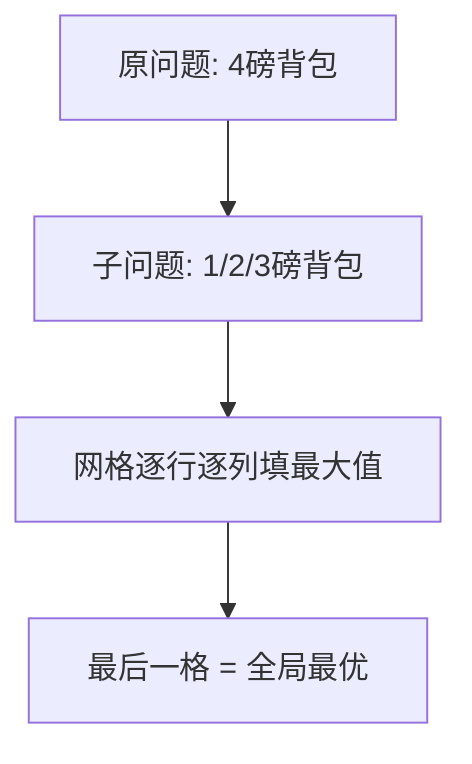

# 动态规划

- **难度**：高难 | **涉及章节**：第 9 章（承接第 8 章背包问题）

## 一句话定义

**动态规划 = 把大问题拆成网格状的小问题，每个格子存"这个子问题的最优解"，填完网格大问题自然现形。**

## 为什么重要

它和贪婪是处理同一类"约束下求最优"问题的两种武器：子问题能独立拆分时用 DP 拿精确最优（背包 $3500）；子问题互相依赖或要求快时用贪婪拿近似。

## 图示

**看图说明**：关键不是"递归"，而是"把所有子问题答案存进格子，避免重复算"。

## 详解

- 每格公式：max（不拿当前商品的旧值 / 拿当前商品 + 剩余容量格子的最优值）。
- 两个变种公式：
  - 最长公共子串：字母相同 = 左上+1；不同 = 0。
  - 最长公共子序列：字母相同 = 左上+1；不同 = max（上, 左）。
- 适用边界：子问题离散独立；不能偷散装；粒度要对（0.5 磅商品需要更细的列）。
- 答案位置：背包在右下角；子串/子序列在网格最大值处。

## 常见误解

- 别以为"动态规划=递归"——它是自底向上填表，和递归方向相反。
- 别以为"加新商品要整张表重算"——只需加一行。

## 在书中出现的脉络

| 章节 | 语境 | 关键结论 |
|---|---|---|
| 第8章 | 背包贪婪失败 | 引出"想要精确最优怎么办" |
| 第9章 | 背包网格/公共子串/子序列 | 网格+递推公式；DNA/git diff 应用 |

## 相关概念

- 前置：贪婪策略与 NP 完全
- 后续：无（本书终点；进阶可碰线性规划）
