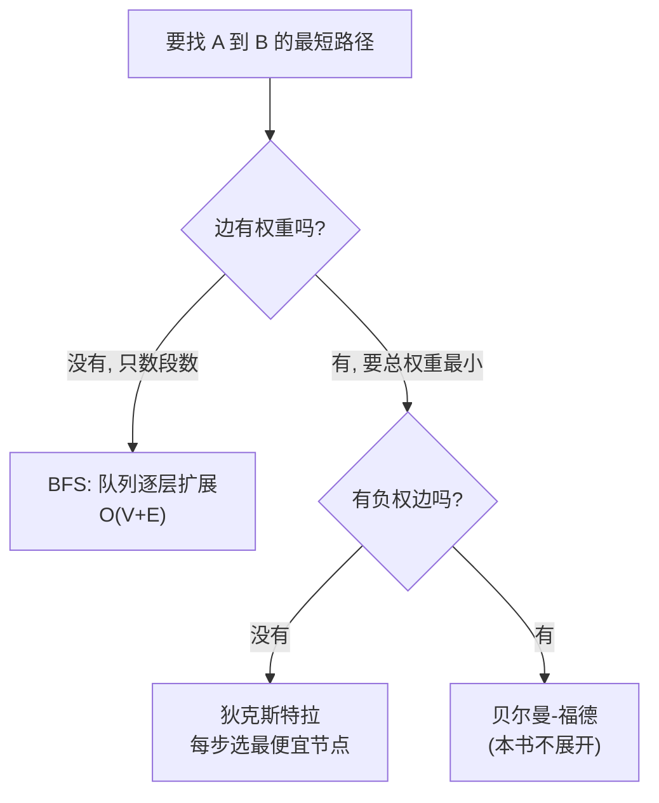

# 图与最短路径

- **难度**：进阶 | **涉及章节**：第 6、7 章

## 一句话定义

**图 = 节点 + 边；"最短路径"有两种口径——非加权图用 BFS 找段数最少，加权图用狄克斯特拉找总权重最小。**

## 为什么重要

原书说图算法是最有用的一类：人际网络、地图导航、任务依赖、网页链接结构，全都是图。选 BFS 还是狄克斯特拉，取决于"每段路有没有权重"。

## 图示

**看图说明**：这是原书第 6、7 章合起来的决策树；选错算法（如在加权图上用 BFS）会得到"段数最少但不是最快"的路径。

## 详解

- 有向图（箭头单向）/ 无向图（双向，本质是环）/ 树（无回边的特殊图）。
- BFS 标配：队列（FIFO）+ 已检查名单（防重复防无限循环）。
- 狄克斯特拉四步：选最便宜节点 → 更新邻居开销 → 重复 → 父节点回溯。
- 负权边 = 狄克斯特拉红线。

## 常见误解

- 别以为"最短路径就是路程最短"——它可能是换乘最少、费用最少，取决于你给边赋什么权重。
- 别以为"狄克斯特拉能处理负权边"——负权会破坏"已处理节点不可能更便宜"的假设。

## 在书中出现的脉络

| 章节 | 语境 | 关键结论 |
|---|---|---|
| 第6章 | 芒果销售商/公交换乘 | BFS 找一度→二度→三度关系 |
| 第7章 | 换钢琴/导航 | 加权图用狄克斯特拉，负权换贝尔曼-福德 |
| 第8章 | 旅行商 | 途经所有点的最短路径 = NP 完全 |

## 相关概念

- 前置：散列表（表示图）、队列
- 后续：贪婪策略与 NP 完全（旅行商是图问题的 NP 完全变体）
