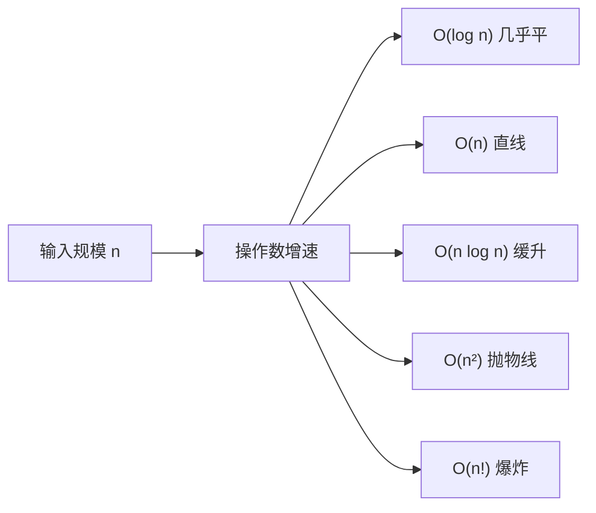

# 大O表示法

- **难度**：进阶 | **涉及章节**：第 1、2、4 章

## 一句话定义

**大O表示法是描述"当输入规模 n 变大时，算法操作数涨得多快"的记号，它看最糟情况、忽略常数。**

## 为什么重要

全书所有算法比较都靠它：没有大O，你只能说"二分查找 7 毫秒、简单查找 100 毫秒"——这是 n=100 时的快照；n=10 亿时结论反转成 11 天 vs 30 毫秒。大O让你预测未来。

## 图示

**看图说明**：五条曲线在 n 小时差别不大，n 一大就天壤之别。选算法就是选曲线的形状。

## 详解

- **不是秒数**：O(n) = "操作数和 n 成正比"，每步 1 毫秒还是 1 秒是常数，大O不关心。
- **是最糟情况**：简单查找一次翻中目标是 O(1) 运气，但大O写 O(n)——它给的是"保证不会更差"的上限。
- **忽略常数**：O(2n)、O(n/2)、O(n+26) 全简写为 O(n)。第 4 章补刀：大O相同时常数才有意义（快排 vs 合并排序）。

**常见档位（从快到慢）**：O(log n) < O(n) < O(n log n) < O(n²) < O(n!)。

## 常见误解

- 别以为"n 越大 O(1) 和 O(n) 差距不变"——实际上差距随 n 线性放大。
- 别以为"最糟情况没意义"——它是给你的承诺：算法永远不会更慢。

## 在书中出现的脉络

| 章节 | 语境 | 关键结论 |
|---|---|---|
| 第1章 | 二分查找 vs 简单查找 | O(log n) vs O(n)，n=10 亿时差 3300 万倍 |
| 第2章 | 选择排序 | 找 n 次 × 每次 O(n) = O(n²)，常数 1/2 被省略 |
| 第4章 | 快排平均/最糟 | 平均 O(n log n)，最糟 O(n²)；快排常数比合并排序小 |

## 相关概念

- 前置：无（第 1 章引入）
- 后续：递归与调用栈（理解快排栈高为何是 O(log n)）
