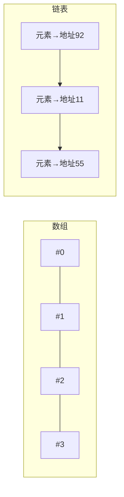

# 数组与链表

- **难度**：基础 | **涉及章节**：第 2 章（第 5、6 章反复用）

## 一句话定义

**数组 = 元素紧挨存放、靠编号直接定位（读取 O(1)、插删 O(n)）；链表 = 元素散落、靠"下一个的地址"串联（插删 O(1)、顺序读 O(n)）。**

## 为什么重要

它们是全书所有高级数据结构的地基：散列表用数组存储 + 链拉链；图用散列表表示邻接；队列/栈是受限的链表。选错地基，上层算法全错。

## 图示

**看图说明**：数组一行连坐，知道编号就能跳；链表是寻宝纸条，只能从头顺着摸。

## 详解

| 操作 | 数组 | 链表 |
|---|---|---|
| 随机读取 | O(1) | O(n) |
| 开头/结尾插入 | O(n) | O(1) |
| 删除（已站在旁边） | O(n) | O(1) |

- 索引从 0 开始；第 2 个元素在索引 1。
- 数组中间插入要整体后移，可能还要整块搬家（预留座位是权宜之计）。
- 真实系统常混合：原书 Facebook 例子 = 26 个桶各挂一条链表；第 5 章的散列表也是数组+链表拉链。

## 常见误解

- 别以为"链表更快"——它只在插删场景快；要随机访问（二分查找）必须数组。
- 别以为"删除链表元素一定 O(1)"——前提是你已经找到那个元素；光"找"这步可能就是 O(n)。

## 在书中出现的脉络

| 章节 | 语境 | 关键结论 |
|---|---|---|
| 第2章 | 选择排序/记账/队列 | 读取多选数组，插删多选链表 |
| 第5章 | 散列表冲突拉链 | 数组位置挂链表，越长越慢 |
| 第6章 | BFS 队列 | deque 实现，队首出队尾进 |

## 相关概念

- 前置：无
- 后续：散列表（数组 + 散列函数）
