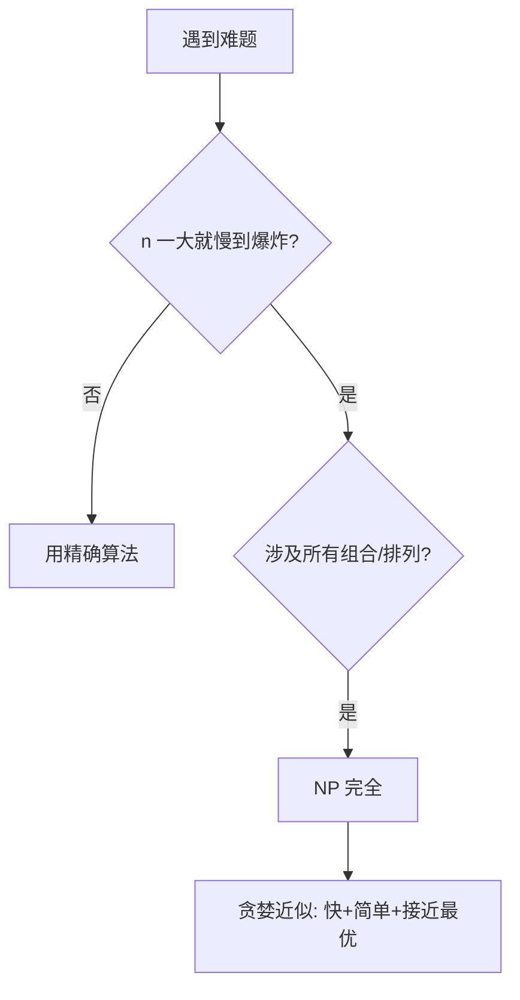

# 贪婪策略与 NP 完全

- **难度**：高难 | **涉及章节**：第 8 章（呼应第 1 章旅行商）

## 一句话定义

**贪婪 = 每步选眼前最优；NP 完全问题 = 精确解要试遍所有组合（2ⁿ 或 n!）的问题，实战中放弃精确解、用贪婪近似凑合。**

## 为什么重要

这是原书的"避坑指南"：很多新手在 NP 完全问题上死磕最优解，浪费数周。学会一眼认出这类问题，立刻切换到近似算法，是算法工程师的核心判断力。

## 图示

**看图说明**：原书识别 NP 完全的蛛丝马迹——组合爆炸、序列、集合、无法拆成独立子问题。

## 详解

- 贪婪何时精确最优：教室调度（每次选结束最早）。
- 贪婪何时只是近似：背包（先偷最贵音响 $3000，输给 $3500 组合）。
- 集合覆盖：精确解 O(2ⁿ)；贪婪近似 O(n²)。
- 旅行商：路线数 n!；10 城就 360 万条。

## 常见误解

- 别以为"贪婪算法=偷懒"——对某些问题它就是最优解。
- 别以为"NP 完全是因为算力不够，升级电脑就能解"——2ⁿ 比任何硬件升级都快。

## 在书中出现的脉络

| 章节 | 语境 | 关键结论 |
|---|---|---|
| 第1章 | 旅行商 5 城 120 条路 | O(n!) 引入 |
| 第8章 | 集合覆盖/背包 | 贪婪近似 + NP 完全识别清单 |

## 相关概念

- 前置：大O表示法
- 后续：动态规划（与贪婪互补——能拆成独立子问题就 DP，不能就贪婪近似）
