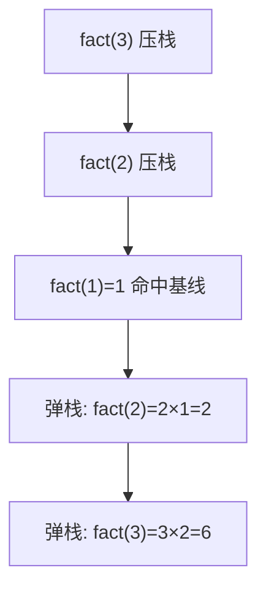

# 递归与调用栈

- **难度**：进阶 | **涉及章节**：第 3、4 章

## 一句话定义

**递归是函数调用自身；基线条件负责刹车，调用栈（一摞后进先出的便条纸）负责记住每个暂停在半路的函数。**

## 为什么重要

全书第二个里程碑：第 4 章的快速排序、分而治之，全建立在递归上。理解调用栈，你才能解释"为什么栈高是 O(log n) 而不是 O(n)"。

## 图示

**看图说明**：向下递归 = 栈增厚；基线条件触发 = 从最里层往回结算，每个暂停的函数从断点继续。

## 详解

- **两半缺一不可**：递归条件（调自己）+ 基线条件（不再调）。没有基线 = 无限递归 = 栈溢出。
- **每层独立**：fact(3) 的 x 和 fact(2) 的 x 是不同变量，互不干扰。
- **代价**：每次压栈都占内存。递归太深 → 栈溢出崩溃；解法是改写循环或尾递归。
- **D&C 心法**：找最简单到不用干的基线条件（数组题通常是空/单元素数组），再想每次怎么把问题缩小一圈。

## 常见误解

- 别以为递归"性能更好"——它的价值是思路清晰，内存开销反而更大。
- 别以为"递归层数和栈高是一回事"——快排平分时栈高 O(log n)，因为每层同时处理左右两个子问题，串行调用的总次数是 O(n) 但栈的**深度**只有 O(log n)。

## 在书中出现的脉络

| 章节 | 语境 | 关键结论 |
|---|---|---|
| 第3章 | factorial/countdown | 基线+递归两条件；调用栈压入弹出 |
| 第4章 | 快排与 D&C | 基线为空/单元素数组；栈高决定平均 O(n log n) vs 最糟 O(n²) |

## 相关概念

- 前置：大O表示法
- 后续：动态规划（递归的另一种落地——自底向上填表）
