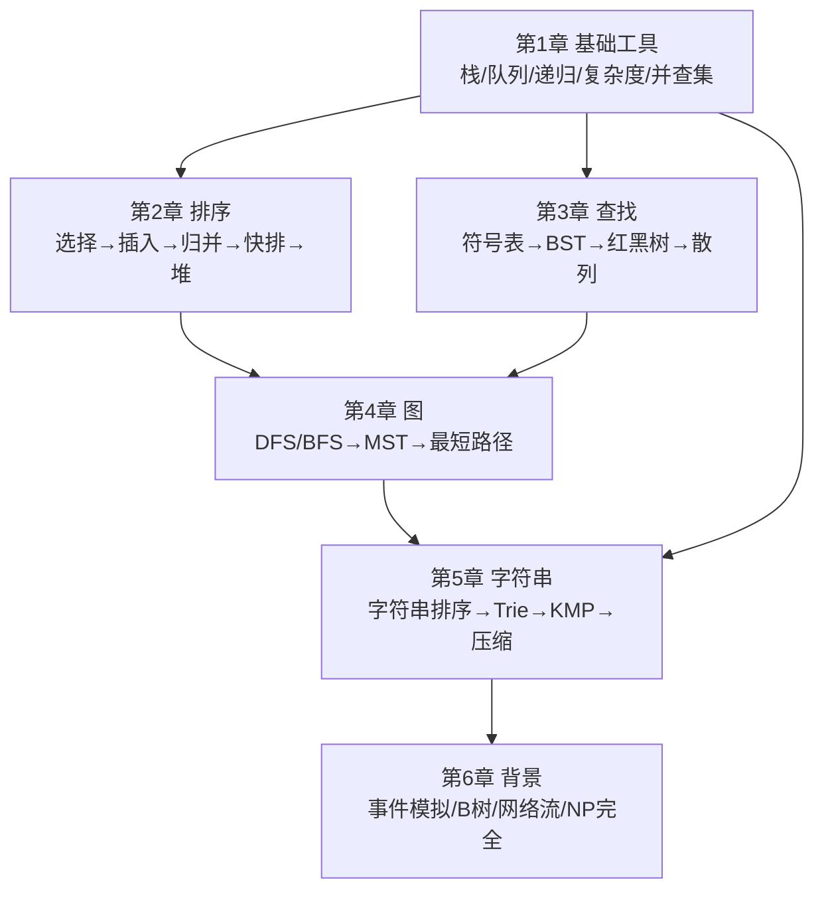

# 算法（第 4 版）点化学习系统

## 这本书在讲什么
本书（Sedgewick & Wayne 著，谢路云译）要回答一个问题：**面对一个实际问题，怎样选出或设计出又正确又快的算法？** 作者的主线是"实现 → 分析 → 比较 → 改进"：先写 Java 实现，再用增长数量级分析成本，再和同类算法比较，再用数据结构（栈/队列/树/散列/图）把它改进到实用。全书六章：基础工具 → 排序 → 查找 → 图 → 字符串 → 背景拓展。

## 全书心智模型

**看图说明**：第 1 章是地基，排序与查找是两根主梁，图与字符串是两大应用域，第 6 章标出"哪些问题算不动"的边界。

## 学习路径（推荐顺序，拓扑序）
| 步骤 | 章节 | 主题 | 前置 | 检查点 |
|---|---|---|---|---|
| 01 | ch01a | Java 编程模型与二分查找 | 无 | 通过 ch01a 自测 |
| 02 | ch01b | 数据抽象 ADT | ch01a | 通过 ch01b 自测 |
| 03 | ch01c | 背包队列栈与链表 | ch01b | 通过 ch01c 自测 |
| 04 | ch01d | 算法分析（O 记号） | ch01a | 通过 ch01d 自测 |
| 05 | ch01e | 并查集 | ch01c, ch01d | 通过 ch01e 自测 |
| 06 | ch02a | 初级排序（选择/插入/希尔） | ch01d | 通过 ch02a 自测 |
| 07 | ch02b | 归并排序 | ch01a(递归) | 通过 ch02b 自测 |
| 08 | ch02c | 快速排序 | ch02b | 通过 ch02c 自测 |
| 09 | ch02d | 优先队列与堆排序 | ch01c | 通过 ch02d 自测 |
| 10 | ch02e | 排序应用与选型 | ch02a~d | 通过 ch02e 自测 |
| 11 | ch03a | 符号表与顺序查找 | ch01a, ch01c | 通过 ch03a 自测 |
| 12 | ch03b | 二叉查找树 BST | ch03a, ch01a | 通过 ch03b 自测 |
| 13 | ch03c | 平衡查找树与红黑树 | ch03b | 通过 ch03c 自测 |
| 14 | ch03d | 散列表 | ch03a | 通过 ch03d 自测 |
| 15 | ch03e | 符号表应用 | ch03a~d | 通过 ch03e 自测 |
| 16 | ch04a | 无向图遍历 DFS/BFS | ch01c, ch01e | 通过 ch04a 自测 |
| 17 | ch04b | 有向图 | ch04a | 通过 ch04b 自测 |
| 18 | ch04c | 最小生成树 | ch04a, ch02d | 通过 ch04c 自测 |
| 19 | ch04d | 最短路径 Dijkstra | ch04c, ch02d | 通过 ch04d 自测 |
| 20 | ch05a | 字符串排序 | ch02c | 通过 ch05a 自测 |
| 21 | ch05b | 单词查找树 Trie | ch03b | 通过 ch05b 自测 |
| 22 | ch05c | 子字符串查找 KMP | ch01a | 通过 ch05c 自测 |
| 23 | ch05d | 正则表达式与 NFA | ch05c | 通过 ch05d 自测 |
| 24 | ch05e | 数据压缩 | ch03d | 通过 ch05e 自测 |
| 25 | ch06 | 背景拓展 | 全部 | 通过 ch06 自测 |

## 章节索引（含难度）
- 第 1 章 基础
  - ch01a 基础编程模型与二分查找（★☆☆）
  - ch01b 数据抽象（★☆☆）
  - ch01c 背包队列栈与链表（★☆☆）
  - ch01d 算法分析（★★☆）
  - ch01e 并查集（★★☆）
- 第 2 章 排序
  - ch02a 初级排序（★☆☆）/ ch02b 归并（★★☆）/ ch02c 快排（★★☆）/ ch02d 堆排序（★★☆）/ ch02e 应用选型（★☆☆）
- 第 3 章 查找
  - ch03a 符号表（★☆☆）/ ch03b BST（★★☆）/ ch03c 红黑树（★★★）/ ch03d 散列（★★☆）/ ch03e 应用（★☆☆）
- 第 4 章 图
  - ch04a 无向图（★★☆）/ ch04b 有向图（★★☆）/ ch04c MST（★★★）/ ch04d 最短路径（★★★）
- 第 5 章 字符串
  - ch05a 字符串排序（★★☆）/ ch05b Trie（★★☆）/ ch05c 子串查找（★★★）/ ch05d 正则 NFA（★★★）/ ch05e 数据压缩（★★☆）
- 第 6 章 背景（★★☆）

## 前置知识（零基础缺口补讲）
| 缺口 | 对应补讲位置 | 学完标志 |
|---|---|---|
| 不会 Java 基本语法 | ch01a | 能看懂本书代码结构 |
| 不懂"复杂度/大 O" | ch01d + concepts/c-复杂度O记号 | 能判断一个循环是几阶 |
| 没写过递归 | ch01a 递归两铁律 | 能写归并/树遍历递归 |
| 不懂"键值对/字典" | ch03a | 理解符号表 put/get |

## 入口
- 术语表：glossary.md
- 模式库：patterns.md
- 速查表：cheatsheet.md
- 测验：quiz.md
- 抽认卡：flashcards.md
