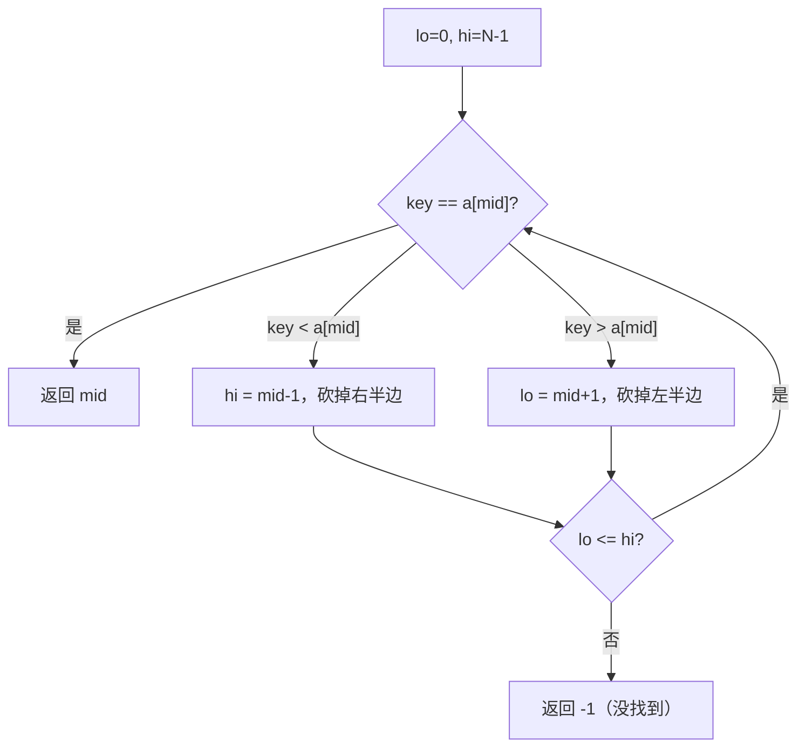

# 第 1 章（1.1）：基础编程模型——用 Java 描述算法的方式

- **难度**：★☆☆ | **预估学时**：2.5 小时 | **前置**：无（会用任何一门语言写过循环即可）

## 学习目标
学完本节，你能：
1. 说清一段 Java 程序的基本结构（类、`main` 方法、静态方法）；
2. 看懂本书所有 Java 代码示例的"长相"，知道 `StdIn`/`StdOut` 是干什么的；
3. 手写**二分查找**（binary search），并说清它为什么是对数级别。

## 一句话核心
本书不教 Java 语法大全，只借 Java 这门语言把算法"说清楚"；而第一个被讲透的算法就是二分查找——在有序数组里每次猜一半。

## 零基础讲解

### 概念 1：Java 程序的基本结构（难度：基础）
本书所有代码都长一个样：一个 `public class`，里面有一个 `static void main(String[] args)` 方法作为入口。**静态方法（static method）**就是"挂在类身上、不依赖具体对象就能直接调用的函数"，本书用它来演示算法逻辑，省掉面向对象的开销。

本书自带几个工具库（从官网下载 `.java` 文件放同目录即可用）：
- `StdOut.println(x)`：打印一行；
- `StdIn.readInt()`：从输入读一个整数；
- `StdRandom`：产生随机数；
- `Stopwatch`：秒表，用来测程序跑了多久（第 1.4 节算法分析的关键工具）。

### 概念 2：二分查找（难度：基础）
**二分查找（binary search）**：在一个**已经排好序**的数组里找某个键 `key`，每次和"中间元素"比大小，排除一半，直到找到或区间为空。

本书代码（算法 1.1，保留 Java 原样并加中文注释）：

```java
public static int rank(int key, int[] a) {
    // a 必须是有序的。返回 key 的下标；不存在则返回 -1
    int lo = 0;
    int hi = a.length - 1;
    while (lo <= hi) {
        int mid = lo + (hi - lo) / 2;   // 中间下标（防溢出写法）
        if      (key < a[mid]) hi = mid - 1;  // key 更小，答案在左半边
        else if (key > a[mid]) lo = mid + 1;  // key 更大，答案在右半边
        else return mid;                      // 正好命中
    }
    return -1;
}
```

**一步一步可复核的例子**：在 `[1, 3, 8, 12, 17, 25, 40]`（下标 0~6）里找 `17`：
1. lo=0, hi=6 → mid=3，`a[3]=12`，`17>12` → lo=4；
2. lo=4, hi=6 → mid=5，`a[5]=25`，`17<25` → hi=4；
3. lo=4, hi=4 → mid=4，`a[4]=17` → 返回 4。

7 个元素只比了 3 次。N 个元素最多比 `⌊log₂N⌋ + 1` 次，这就是**对数级别（logarithmic）**的来源。

### 概念 3：递归（难度：基础）
**递归（recursion）**：一个方法调用它自己来解决规模更小的同类问题。两个铁律（原书强调）：① 必须有**基准条件**（不再自我调用、直接返回）；② 子问题和父问题**不能有交集**。本书后面归并排序、树的遍历全靠它。

## 图示

**看图说明**：整个流程就是"每次砍掉一半"。每砍一次区间长度减半，所以 N 个元素最多砍 `log₂N` 次——这就是对数复杂度的直观来源。

## 类比与实例
- **类比**：翻字典找"算法"。你不会从第 1 页逐页翻，而是翻开中间，看"这页是 D 开头"，于是只在左半本继续翻。每次砍一半，翻完 1000 页字典最多 10 次。*失效边界*：字典必须按字母排序才成立——无序数组不能用二分查找。
- **实例**：上面找 `17` 的 3 步过程已带数字带结果，可拿计算器复核 `log₂7 ≈ 2.8`。

## 常见误解
- **别以为**二分查找适用于任何数组——实际上它**只在有序数组**上成立，前提"已排序"必须先满足。
- **别以为** `mid = (lo+hi)/2` 和 `lo+(hi-lo)/2` 完全一样——数学上一样，但 `lo+hi` 在极大数组下可能**整数溢出**变负数，本书专门用防溢出写法。

## 自测题（答案）
1. 在有序数组 `[2, 5, 9, 14, 22, 31, 48]` 中用二分查找找 `31`，第 2 次比较时 `mid` 指向的值是多少？（答案：22；解析：第 1 次 mid=3→a[3]=14，31>14 故 lo=4；第 2 次 lo=4,hi=6→mid=5→a[5]=31。等等——重新算：第1次 lo=0,hi=6,mid=3,a[3]=14,31>14→lo=4。第2次 lo=4,hi=6,mid=5,a[5]=31 直接命中。所以第 2 次比较 mid 指向 31。）
2. N=1024 个元素的有序数组，二分查找最多比较约几次？（答案：10 次；解析：2¹⁰=1024，最多 ⌊log₂1024⌋+1=11，约 10~11 次。）
3. 二分查找要求输入满足什么前提？（答案：数组必须已经排好序；解析：靠"中间值"排除一半的前提是左边全小、右边全大。）

## 复习锚点
- 本书所有代码 = 一个 class 里一个 `main`，算法用静态方法写。
- 二分查找：有序数组 + 每次砍一半 → 对数级别。
- 递归两铁律：有基准条件、子问题不相交。
