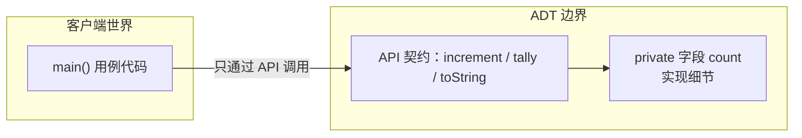

# 第 1 章（1.2）：数据抽象——把"数据"和"操作"打包成类型

- **难度**：★☆☆ | **预估学时**：2 小时 | **前置**：ch01a

## 学习目标
学完本节，你能：
1. 说清**抽象数据类型（ADT）**是什么、为什么它让算法代码更好懂；
2. 看懂本书反复使用的"API 表格"阅读法；
3. 用 Counter/Accumulator 的例子理解"用例—实现"分离。

## 一句话核心
数据抽象 = 只暴露"能对数据做什么操作"（API），把"数据内部怎么存"藏起来；学算法时我们站在 API 这一侧用它，偶尔再翻进去看实现。

## 零基础讲解

### 概念 1：抽象数据类型（ADT，难度：基础）
**数据抽象**：定义一种新的数据类型时，只规定"它支持哪些操作"，不暴露内部表示。**抽象数据类型（Abstract Data Type, ADT）**就是"数据 + 一组允许的操作"这个整体。

**类比**：微波炉。你只用面板按钮（API：加热/解冻/定时），不需要知道磁控管怎么工作（内部实现）。*失效边界*：当你要调试"为什么不热了"，就得钻进内部——学算法分析时我们经常要钻进去。

本书惯例：用一张 **API 表**描述一个数据类型，例如 `Counter`：

| 操作 | 作用 |
|---|---|
| `Counter(String id)` | 创建一个名为 id 的计数器 |
| `void increment()` | 计数器 +1 |
| `int tally()` | 当前计数 |
| `String toString()` | 打印形式 |

**客户端（client）**：调用 API 的代码。**实现者（implementor）**：写 API 背后代码的人。两者只通过 API 契约沟通。

### 概念 2：实例方法与封装（难度：基础）
和 1.1 的静态方法不同，ADT 里的方法叫**实例方法**：它绑在一个具体对象（实例）身上。`private` 修饰的字段表示"外部不许碰"，这叫**封装（encapsulation）**——防止用例乱改内部状态。

```java
public class Counter {
    private int count;          // 内部状态，外部不可见
    private final String name;  // 名字

    public Counter(String id) { name = id; }
    public void increment()    { count++; }   // 只许通过这个方法加
    public int tally()         { return count; }
    public String toString()   { return name + ": " + count; }
}
```

### 概念 3：设计数据类型的启示（难度：进阶）
原书 1.2.5 强调好 ADT 的标准：① 设计要**简洁**，操作围绕某种一致的抽象；② 一组操作要足以支持用例；③ 封装让实现可替换。`Accumulator`（累加器）是最小例子：只管 `addDataValue(double)` 和 `mean()`。

## 图示

**看图说明**：客户端箭头只能指向 API，永远不能指向 `private` 字段。这个边界就是"数据抽象"四个字的实体化。

## 类比与实例
- **类比**：银行账户。你在 ATM 上只能查询、取款、转账（API），看不到也碰不到银行金库账本（内部表示）。*失效边界*：审计监管就要突破封装——对应调试性能时要看实现。
- **实例**：建两个计数器 `heads`、`tails`，抛硬币 1000 次分别 `increment()`，最后打印两个 tally——用例代码完全不关心 count 变量是 `int` 还是 `long`。

## 常见误解
- **别以为** ADT 就是"面向对象"——实际上 ADT 是思想，面向对象是它在 Java 里的一种落地；C 语言也能模拟 ADT。
- **别以为** `private` 是安全防线——实际上它是**编译期约定**，目的是帮程序员不乱改，不是安全加密。

## 自测题（答案）
1. ADT 的"封装"要求外部代码通过什么访问对象？（答案：通过公开 API 方法；解析：private 字段外部不可见，只能走约定好的操作。）
2. 客户端和实现者之间的契约叫什么？（答案：API；解析：它是双方唯一沟通界面。）
3. Counter 类里 `count` 为什么声明为 `private`？（答案：防止外部绕过 increment() 直接篡改计数，保证计数规则一致；解析。）

## 复习锚点
- ADT = 数据 + 操作集合；只露 API，藏内部。
- 本书的 API 表 = 这个类型的"操作说明书"。
- 用例与实现分离，是模块化编程的基础。
