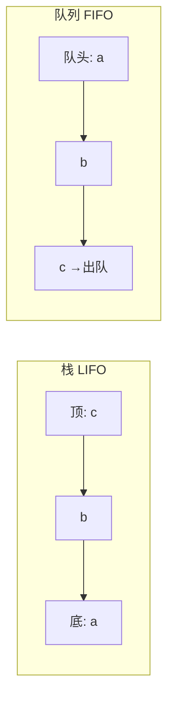
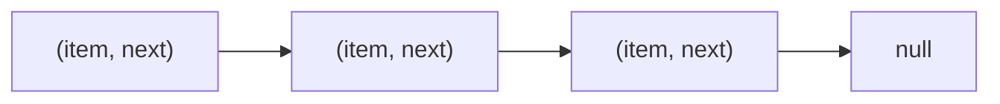

# 第 1 章（1.3）：背包、队列和栈——三种最基础的数据结构

- **难度**：★☆☆ | **预估学时**：3 小时 | **前置**：ch01b

## 学习目标
学完本节，你能：
1. 说清**背包（Bag）、队列（Queue）、栈（Stack）**三种数据结构的进出规则；
2. 用**数组**和**链表**两种方式实现它们，知道"动态调整数组大小"的均摊思想；
3. 徒手画出链表节点的插入/删除指针操作。

## 一句话核心
栈是"后进先出"（像弹夹），队列是"先进先出"（像排队），背包只收不取；它们是后面所有复杂结构（树、图算法）的积木。

## 零基础讲解

### 概念 1：栈（Stack，LIFO，难度：基础）
**栈（stack）**：只能在一端（栈顶）压入和弹出。**后进先出（Last In First Out, LIFO）**——最后压进去的最先出来。

类比：手枪弹夹，压弹最后进去的最先打出。*失效边界*：你不能从弹夹中间取子弹——栈也不让。

### 概念 2：队列（Queue，FIFO，难度：基础）
**队列（queue）**：一端入队、另一端出队。**先进先出（First In First Out, FIFO）**。类比：食堂打饭排队，先到先服务。

### 概念 3：背包（Bag，难度：基础）
**背包（bag）**：只能往里加元素、遍历所有元素，不支持取出。用途：收集一批数据后再整体处理（比如累加器收集所有样本再求平均）。

### 概念 4：链式实现——链表（linked list，难度：进阶）
**链表（linked list）**：一串节点，每个节点含一个数据 + 一个指向下一节点的引用。

```java
private class Node {
    Item item;      // 存的数据
    Node next;      // 指向下一个节点
}
```

**头插法建栈**：每次把新节点插在链表最前面——
```java
Node oldFirst = first;      // 记住旧首节点
first = new Node();
first.item = item;
first.next = oldFirst;      // 新节点指向旧首节点
```
四行完成，不用移动任何已有节点。**链表的杀手锏：插入/删除节点只需改指针，常数时间。**

### 概念 5：动态调整数组大小（均摊成本，难度：高难）
数组实现栈时，数组满了怎么办？原书做法：**容量翻倍**（`resize` 到 2 倍），元素太少（栈大小 < 数组 1/4）时**减半**。为什么是 4 而不是 2？防止"频繁入栈出栈导致反复扩容缩容"的抖动。

**均摊分析**：N 次 `push` 中，只有 `resize` 的那几次贵（要复制整个数组，成本 ~N），其余都是常数。把翻倍的总成本 `1+2+4+…+N ≈ 2N` 平摊到 N 次操作上，每次 `push` 的**均摊成本**仍是常数。

## 图示

**看图说明**：栈从顶取（c 先出），队列从头取（a 先出）。两个方向相反的进出规则，就是栈与队列的全部区别。


**看图说明**：链表节点像一串回形针——每个回形针扣着下一个。插入/删除 = 改两个"扣环"的指向，不用搬动整串。

## 类比与实例
- **类比（栈）**：浏览器"后退"按钮其实就是一个栈——你点链接压入历史，后退弹出。*失效边界*：栈不支持随机访问第 k 个元素。
- **实例**：用链表栈压入 a、b、c：头插后链表是 c→b→a。弹出顺序 c、b、a——后进先出验证通过。

## 常见误解
- **别以为**链表比数组"更快"——实际上链表读第 k 个元素要一路走指针（O(N)），数组 O(1)；链表只在**插入删除**上快。
- **别以为**动态数组每次 push 都很贵——实际上只有偶尔的翻倍贵，均摊后每次仍是常数。
- **别以为**背包和栈一样能取出——实际上背包只进不出，连 pop 都没有。

## 自测题（答案）
1. 依次压入 1、2、3 再弹出一次，弹出的值是几？（答案：3；解析：栈 LIFO，最后压入的 3 最先弹出。）
2. 队列中依次入队 a、b、c，然后出队两次，队头现在是？（答案：c；解析：FIFO，先出 a、再出 b，剩下 c 在队头。）
3. 数组实现栈时，栈大小降到数组容量的多少时缩容？为什么不是 1/2？（答案：降到 1/4 时减半；解析：留一倍缓冲，避免在容量边界反复 push/pop 造成扩容缩容抖动。）
4. 链表头插法需要修改几个指针引用？（答案：2 个；解析：first 指向新节点、新节点 next 指向旧首节点。）

## 复习锚点
- 栈 LIFO / 队列 FIFO / 背包只进不出。
- 链表插入删除常数时间；随机访问慢。
- 动态数组：满了翻倍、空了缩半，均摊成本常数。
