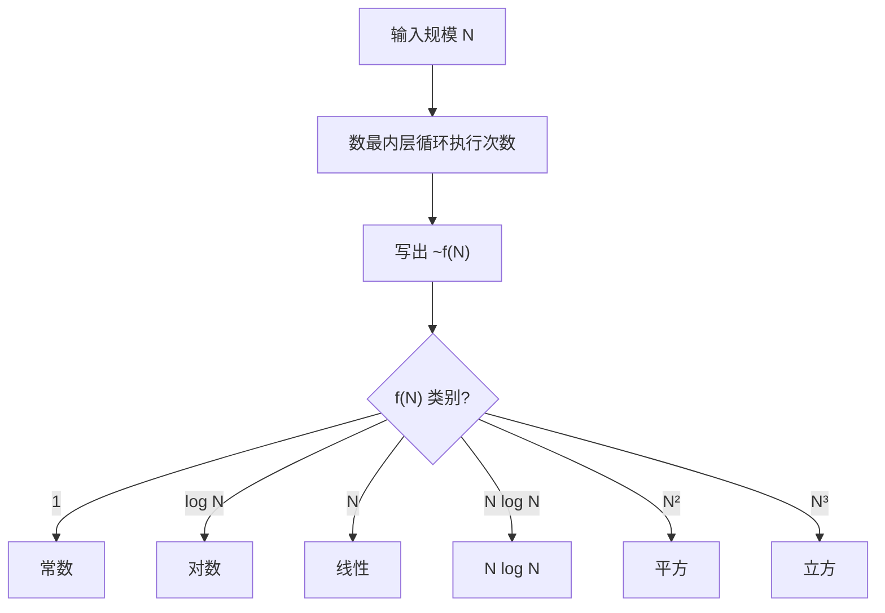

# 第 1 章（1.4）：算法分析——用"增长数量级"比较算法快慢

- **难度**：★★☆ | **预估学时**：3 小时 | **前置**：ch01a、ch01c

## 学习目标
学完本节，你能：
1. 用**大 O / ~ / 增长数量级**语言描述一个算法的运行时间；
2. 背出本书 7 种常见增长量级（常数、对数、线性、N log N、平方、立方、指数）；
3. 用**倍率实验**（doubling ratio）实测一个算法的复杂度；区分最坏情况、最好情况、平均情况。

## 一句话核心
比较两个算法不比"跑多少毫秒"，而比"输入翻倍时时间涨几倍"——涨 1 倍是线性，涨平方倍是平方级。

## 零基础讲解

### 概念 1：增长数量级（order of growth，难度：进阶）
**增长数量级**：当输入规模 N 越来越大时，运行时间函数里"起决定作用的那一项"的类别。本书用 `~` 表示近似（忽略低阶项和常数因子）。

**表 1.4.3 常见增长数量级（原书）**：

| 量级 | 函数 | 典型算法 |
|---|---|---|
| 常数级别 | 1 | 普通语句、数组取值 |
| 对数级别 | log N | 二分查找 |
| 线性级别 | N | 遍历一次数组 |
| 线性对数级别 | N log N | 归并排序（后讲） |
| 平方级别 | N² | 双重循环（选择/插入排序） |
| 立方级别 | N³ | 三重循环（ThreeSum） |
| 指数级别 | 2^N | 第 6 章的穷举（不用作实用算法） |

**读法**：`~N²/2` 和 `~N²` 是同一量级——常数 1/2 在 N 极大时不改变"它是平方级"这个判断。

### 概念 2：ThreeSum 与倍率实验（难度：进阶）
**ThreeSum**：数出 N 个整数中三数之和为 0 的组合数。三重循环 → `~N³/6`。

**倍率实验（doubling experiment）**：把输入 N 每次翻倍，记录运行时间 t(N)，看比值 `t(2N)/t(N)`：
- 比值 → 2：线性；
- 比值 → 4：平方；
- 比值 → 8：立方；
- 比值收敛到 2^b，b 就是量级的指数。

实测时用 `Stopwatch` 计 `ThreeSum` 跑 N=1000,2000,4000… 的时间，比值趋近 8 → 验证 `N³`。

### 概念 3：最坏/最好/平均情况（难度：进阶）
- **最坏情况（worst case）**：最倒霉输入下的上界——理论研究者的角度，给**保证**。
- **平均情况（average case）**：所有输入的期望——告诉我们**典型表现**。
- 本书名言：随机化（如快排先打乱输入）能让"实际最坏情况"概率小到像被雷劈，当作实用保证。

### 概念 4：内循环（难度：基础）
**内循环（inner loop）**：被执行最频繁的那层循环。经验法则：**程序总时间由执行最频繁的指令决定**——分析时盯着最内层循环数次数即可。

### 概念 5：注意事项（难度：高难）
原书 1.4.7 警告：①大常数可能让"渐近更优"的算法在小 N 时更慢；②不要把"能跑通"当成"够快"；③实验必须独立于硬件（用倍率比值消掉机器常数）。

## 图示

**看图说明**：分析算法 = 数最内层循环次数 → 套进量级表。这是全书复杂度分析的统一流水线。

## 类比与实例
- **类比**：判断"一锅粥熬多久"不看火大火小（硬件常数），而看"米量翻倍要熬多久"（倍率）。*失效边界*：小锅（N 小）时搅拌时间（常数项）反而主导。
- **实例**：TwoSum（数两数之和为 0）两层循环 ~N²/2；ThreeSum 三层循环 ~N³/6。N=1000 时后者比前者慢约 500 倍。

## 常见误解
- **别以为** O(N²) 一定比 O(N log N) 慢——实际上当 N 只有几十时，带大常数的 N log N 算法可能更慢；复杂度比较只在 N 很大时才有决定性意义。
- **别以为**大 O 是精确运行时间——实际上它**丢掉了所有常数和低阶项**，只描述增长趋势。
- **别以为**平均情况等于最坏情况——实际上快排最坏 O(N²)，但平均 ~1.39 N lg N，差别巨大。

## 自测题（答案）
1. 一个算法内层循环执行 ~N²/2 次，它的增长数量级是？（答案：平方级别 O(N²)；解析：常数 1/2 不改变量级类别。）
2. 倍率实验中 t(2N)/t(N) 趋近 4，算法是几阶？（答案：二阶 O(N²)；解析：时间 ∝ N^b，翻倍后比值 2^b=4 → b=2。）
3. 为什么分析时只盯着内循环？（答案：最频繁指令决定总时间；解析：外层次数乘以内层次数，内层量级最大。）
4. 二分查找的量级是？（答案：对数级别 O(log N)；解析：每次砍一半。）

## 复习锚点
- 量级七兄弟：1 / log N / N / N log N / N² / N³ / 2^N。
- 倍率实验：t(2N)/t(N) → 2^b，b 即阶数。
- 内循环决定总时间；常数项在大 N 时消失。
