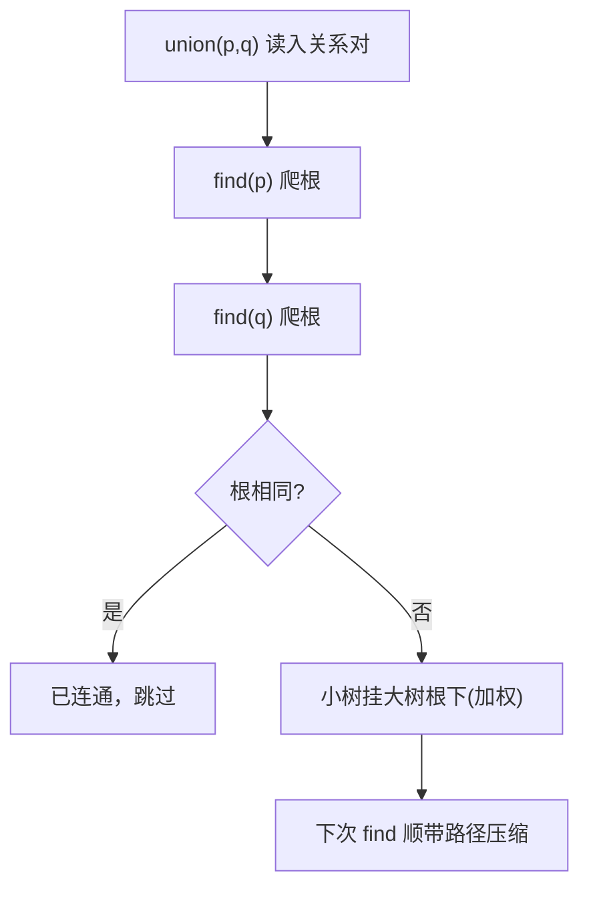

# 第 1 章（1.5）：案例研究——并查集（union-find）

- **难度**：★★☆ | **预估学时**：3 小时 | **前置**：ch01c、ch01d

## 学习目标
学完本节，你能：
1. 说清**动态连通性**问题和 union-find 要回答的两个操作；
2. 讲出 quick-find → quick-union → **加权 quick-union** → **路径压缩**四步演化，每步改进了什么；
3. 说出最终版本为什么接近"每操作常数时间"。

## 一句话核心
并查集回答"两个点是不是已经连通"，通过"合并小树到大树"（加权）+"顺便把路压短"（路径压缩），把森林操作做到接近常数。

## 零基础讲解

### 概念 1：动态连通性（难度：基础）
**动态连通性（dynamic connectivity）**：有 N 个触点，不断读入"p 和 q 连通"的关系对，要随时回答"p 和 q 现在连通吗？"。**连通分量（connected component）**：互相连通的一群点。两个约定：连通是**等价关系**——自反、对称、传递。

API：`union(p,q)`（连通 p、q）、`find(p)`（p 所在分量标识）、`connected(p,q)`（是否同分量）。

### 概念 2：quick-find（难度：基础）
用数组 `id[]`，`id[i]` 直接存 i 的分量号。`connected(p,q)` 只要比 `id[p]==id[q]`——极快。但 `union(p,q)` 要把所有等于 `id[p]` 的元素全改成 `id[q]`，一次 union 扫整个数组，**O(N)**，N 对操作共 O(N²)。

### 概念 3：quick-union（难度：进阶）
数组 `id[]` 存的是**父指针**：`id[p]` 是 p 的父亲。find(p) 要一路沿着父指针爬到**根**（`id[root]==root` 的节点）。union(p,q) = 把 p 的根挂到 q 的根下，一行 `id[rootP]=rootQ`。

**问题**：树可能退化成一条链（节点按 0→1→2…顺序 union），find 爬 N 步，又退回 O(N)。

### 概念 4：加权 quick-union（难度：进阶）
**加权（weighted）**：不只挂根，而是记录每棵树大小 `sz[]`，**总是把小树挂到大树根下**——保持树矮。

原书命题 H：N 个触点构造的森林中，任意节点深度最多 **lg N**。推论：find/connected/union 最坏 **对数级别**。这是三种朴素算法里唯一"能用"的。

```java
// 核心：union 时比大小
if (sz[i] < sz[j]) { id[i]=j; sz[j]+=sz[i]; }
else               { id[j]=i; sz[i]+=sz[j]; }
```

### 概念 5：路径压缩（难度：高难）
**路径压缩（path compression）**：find 爬到根之后，顺便把一路上经过的节点直接指向根——下次再找它们一步到位。加了路径压缩的加权 quick-union，任意操作序列**均摊成本接近常数**（反阿克曼函数级别，工程上视为常数）。

## 图示

**看图说明**：每一步 union 都先找两边的根，再把矮树接高树。两个优化叠加：树天然矮（加权）+ 被走过的路变短（压缩）。

## 类比与实例
- **类比**：氏族族谱。每个村记自己的族长（根）；合并两族时，小族并入大族（加权），避免大族被小族拖长；年轻人每去族长那报到一次，就直接把自己户口本上写族长名（路径压缩）。*失效边界*：连通必须可传递——若 p-q、q-r 连通却不算 p-r 连通，这套模型就不成立。
- **实例**：触点 0~9，依次 union(4,3)、union(3,8)、union(6,5)… 加权后树高始终 ≤ lg10≈3.3。

## 常见误解
- **别以为** quick-find 的 `connected` 快就整体快——实际上它的 union 是 O(N)，整体 O(N²)，对大规模输入不可用。
- **别以为**加权 quick-union 就是"最快"——它只是对数级；路径压缩才把它推到近似常数。
- **别以为**并查集存的是"图"——实际上它故意**不存边的顺序信息**，只维护连通关系，这是它轻量的原因。

## 自测题（答案）
1. quick-find 的 union 为什么慢？（答案：要扫描整个 id[] 把 p 分量全部改成 q 分量，O(N)；解析。）
2. 加权 quick-union 中"加权"指什么？（答案：记录树大小，把小树挂到大树根下；解析：防止树退化成链。）
3. 加权 quick-union 保证任意节点深度不超过？（答案：lg N；解析：命题 H。）
4. 路径压缩在哪一步"顺便"做？（答案：find 爬到根后把路径上节点直接指向根；解析：不改算法骨架，只加优化。）

## 复习锚点
- 动态连通性：union / find / connected 三操作。
- 演化链：quick-find(N²) → quick-union(可能链) → 加权 QU(lg N) → +路径压缩（近似常数）。
- 两个优化口诀：小树挂大树、路过压平。
