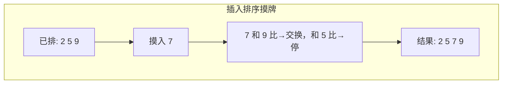
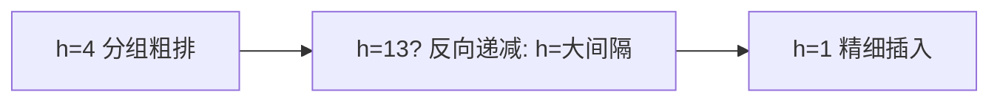

# 第 2 章（2.1）：初级排序算法——选择、插入、希尔

- **难度**：★☆☆ | **预估学时**：2.5 小时 | **前置**：ch01d

## 学习目标
学完本节，你能：
1. 说出排序的"游戏规则"（可比较、不可交换性、排序成本=比较+交换）；
2. 手推**选择排序**、**插入排序**的过程与成本；
3. 说清**希尔排序**用 h 间隔分组为什么能突破平方级。

## 一句话核心
选择排序"每轮挑最小的放前面"，插入排序"像打扑克牌摸牌一张张插对位置"，希尔排序让插入排序先远距离粗调再近距离细调。

## 零基础讲解

### 概念 1：排序的游戏规则（难度：基础）
- **比较（compare）**：两个元素比大小；**交换（exchange）**：互换两个位置。排序总成本 = 比较次数 + 交换次数。
- **倒置（inversion）**：数组中一对顺序反了的元素。插入排序的交换次数正好等于倒置数量——这是本章最有用的等式。

### 概念 2：选择排序（selection sort，难度：基础）
每轮从剩余未排部分里**选最小**，换到最前面。N 个元素要 N-1 轮，每轮扫一遍剩余元素。

**成本**：比较 `~N²/2` 次，交换 `N-1` 次（原书结论）。交换最少，但比较省不掉——无论输入如何都是平方级。

### 概念 3：插入排序（insertion sort，难度：基础）
像摸扑克牌：左手牌已排好，摸新牌时从右往左找到自己位置插进去。

**成本**（原书命题）：平均（随机数组）比较和交换各 `~N²/4`；**对部分有序的数组近乎线性**——交换次数=倒置数，倒置少就快。这就是"插入排序近乎线性"的由来。

### 概念 4：希尔排序（shellsort，难度：高难）
插入排序的痛点：元素要一步一步挪到远处，倒置距离大时极慢。**希尔排序**先按 **h 间隔**分组（h 取 13, 4, 1…递减），每组内部先做插入排序，让元素**远距离**快速到位；最后 h=1 时数组已基本有序，插入排序接近线性。

原书结论：用递增序列 1, 4, 13, 40, 121… 时，比较次数不超 N 的若干倍（**突破了平方级**），但严格平均次数数学上尚未完全解决。

## 图示

**看图说明**：新牌 7 只需向左比较两次就到位——这就是插入排序"从右往左找位置"的全过程。

**看图说明**：希尔排序 = 大间隔先把远距离乱序治好，小间隔收尾。避免插入排序"一次只能挪一格"。

## 类比与实例
- **类比（插入）**：打扑克牌摸牌，新牌永远插进左手已有序牌堆的正确位置。*失效边界*：当牌堆完全逆序时，每摸一张都要插到最左，退化为 O(N²)。
- **实例**：数组 `[5, 2, 7, 1]`，插入排序过程：5 不动；2 与 5 交换→`[2,5,7,1]`；7 不动；1 依次与 7、5、2 交换→`[1,2,5,7]`。共 4 次交换 = 倒置数（(5,2)(5,1)(2,1)(7,1)）。

## 常见误解
- **别以为**插入排序总是平方级——实际上对**基本有序**的数组它是线性的，所以希尔排序收尾时它飞快。
- **别以为**选择排序"选最小"听起来聪明所以快——实际上它每轮必扫全部剩余元素，比较次数无论输入都 ~N²/2。
- **别以为**希尔排序的复杂度有定论——实际上平均比较次数至今没有简洁准确解，本书只给经验界。

## 自测题（答案）
1. 插入排序的交换次数等于什么？（答案：数组中倒置的数量；解析：每消除一个倒置恰好一次交换。）
2. 选择排序 N 个元素要多少次交换？（答案：N-1 次；解析：每轮最多换一次，共 N-1 轮。）
3. 希尔排序为什么用递减 h 序列？（答案：大间隔让元素远距离快速就位，小间隔收尾时数组已基本有序；解析。）
4. 对"几乎已经有序"的数组，插入排序的成本接近？（答案：线性 O(N)；解析：倒置数少，交换少。）

## 复习锚点
- 选择排序：选最小放前面，比较 ~N²/2。
- 插入排序：摸牌式插入，交换=倒置数，近乎有序时线性。
- 希尔：h 间隔分组插入，突破平方级。
