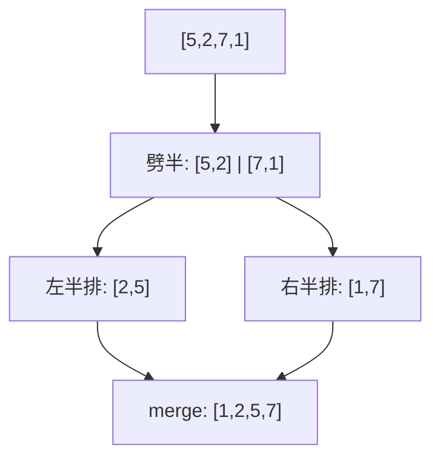

# 第 2 章（2.2）：归并排序——分治的第一次胜利

- **难度**：★★☆ | **预估学时**：3 小时 | **前置**：ch01a（递归）、ch02a

## 学习目标
学完本节，你能：
1. 说清"归并"（merge）操作：两个有序数组合并成一个有序数组；
2. 写出自顶向下归并排序的递归骨架，并推导它的比较次数 ~N lg N；
3. 理解为什么"基于比较的排序"不可能快过 ~N lg N（下界）。

## 一句话核心
归并排序 = 把数组劈成两半各自排序，再把两个有序半场"合并"成一个——用 O(N) 合并换 O(N log N) 的总保证。

## 零基础讲解

### 概念 1：归并（merge，难度：基础）
**归并**：前提是左右两半**已经各自有序**。用三个指针 i、j、k：比 `a[i]` 和 `a[j]`，小的先放进辅助数组，对应指针前进一步，直到半边走完，把另半边尾巴直接接上。

```java
// 原地归并的抽象方法：a[lo..mid] 和 a[mid+1..hi] 已有序
public static void merge(Comparable[] a, int lo, int mid, int hi) {
    int i = lo, j = mid+1;
    for (int k = lo; k <= hi; k++) aux[k] = a[k];   // 复制到辅助数组
    for (int k = lo; k <= hi; k++) {
        if      (i > mid)        a[k] = aux[j++];   // 左半用完，取右半
        else if (j > hi)         a[k] = aux[i++];   // 右半用完，取左半
        else if (less(aux[j], aux[i])) a[k] = aux[j++];
        else                    a[k] = aux[i++];
    }
}
```

### 概念 2：自顶向下归并排序（merge sort，难度：进阶）
递归骨架：
```java
public static void sort(Comparable[] a, int lo, int hi) {
    if (hi <= lo) return;                 // 基准条件：单元素已有序
    int mid = lo + (hi - lo)/2;
    sort(a, lo, mid);                     // 排左半
    sort(a, mid+1, hi);                   // 排右半
    merge(a, lo, mid, hi);                // 合并
}
```

**成本推导（可复核）**：设长度 N=2ⁿ。每层递归合并总共处理 N 个元素，共 lg N 层 → 比较次数 **~N lg N**（原书命题 H：最坏 ~N lg N）。

### 概念 3：下界——为什么不可能更快（难度：高难）
**基于比较的排序**每次比较只有"大/小"两个结果，相当于在一棵二叉决策树上走一条路径。N 个元素有 N! 种排列，决策树至少要 N! 个叶子 → 树高至少 log₂(N!) ~ N lg N。这就是原书命题 I：**任何基于比较的排序，最坏比较次数 ≥ ~N lg N**。归并排序已顶到这个理论天花板。

### 概念 4：自底向上归并（难度：进阶）
不递归：先两两归并（sz=1），再四、再八……直到整体有序。代码更短，结果一样。

### 概念 5：改进（难度：进阶）
- 小数组改用插入排序（递归到 sz<10 时）；
- 若 `a[mid] <= a[mid+1]`，说明两半本已有序，跳过 merge。

## 图示

**看图说明**：分治三步——分（劈半）、治（递归排序两半）、合（归并）。每一层合起来共做 N 次比较，共 lg N 层。

## 类比与实例
- **类比**：整理一摞试卷。先劈成两摞各整理好，再把两摞已排序的试卷从头比、按顺序合成一摞。*失效边界*：归并要求两半各自有序，乱序合并没意义。
- **实例**：`[2,5]` 与 `[1,7]` 归并：比 2 vs 1 → 取 1；比 2 vs 7 → 取 2；比 5 vs 7 → 取 5；左半完，接 7 → `[1,2,5,7]`。

## 常见误解
- **别以为**归并排序是"原地排序"——实际上它需要一个等大的辅助数组 aux[]，空间 O(N)。
- **别以为**快排一定比归并好——实际上归并有最坏 O(N log N) 保证，快排最坏 O(N²)；归并胜在稳定保证，快排胜在常数小。
- **别以为**归并比较次数是 2N lg N——实际上约 N lg N 量级，每合并层最多 N 次比较。

## 自测题（答案）
1. 归并排序为什么需要辅助数组？（答案：合并时要把左右两半按序写回原数组，直接写会覆盖还没读的元素；解析：故先复制到 aux。）
2. N=8 时归并排序大约比较多少次？（答案：~8×3=24 次；解析：lg8=3 层，每层 ~8 次比较。）
3. 基于比较的排序的理论下界是？（答案：~N lg N 次比较；解析：决策树叶子数 ≥ N!，树高 ≥ log₂N! ~ N lg N。）
4. 归并排序最坏时间复杂度是？（答案：O(N log N)；解析：命题 H。）

## 复习锚点
- 归并 = 两个有序半场合并，O(N)。
- 分治：劈半→递归排→合并，总 ~N lg N。
- 比较排序下界 ~N lg N，归并已触顶。
