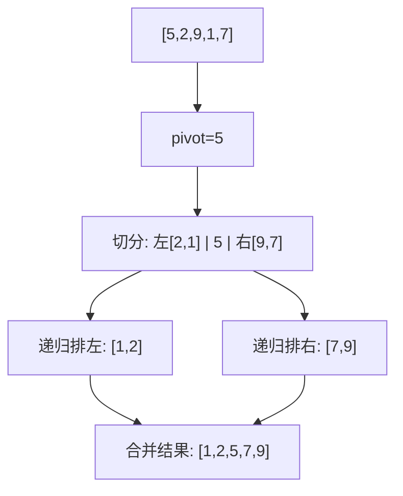

# 第 2 章（2.3）：快速排序——最常用的通用排序

- **难度**：★★☆ | **预估学时**：3 小时 | **前置**：ch02b

## 学习目标
学完本节，你能：
1. 说清**切分（partition）**：选一个基准，把小的扔左边、大的扔右边；
2. 推导快排平均比较次数 ~1.39 N lg N，说出最坏情况为什么是 O(N²)；
3. 讲出两个经典改进：**随机打乱**与**三向切分**。

## 一句话核心
快排 = 选个基准把数组"分两边"（比它小的左、比它大的右），再对两边递归排序；切分是灵魂。

## 零基础讲解

### 概念 1：切分（partition，难度：进阶）
选 `a[lo]` 为基准 pivot。从左向右找第一个 ≥ pivot 的，从右向左找第一个 ≤ pivot 的，两者交换；两指针相遇时，pivot 换到相遇点。切分后：左边全 ≤ pivot，右边全 ≥ pivot，且 pivot 已在**最终位置**上。

```java
private static int partition(Comparable[] a, int lo, int hi) {
    int i = lo, j = hi+1;
    Comparable v = a[lo];              // 基准
    while (true) {
        while (less(a[++i], v)) if (i==hi) break;   // 左找 >=v
        while (less(v, a[--j])) if (j==lo) break;   // 右找 <=v
        if (i >= j) break;
        exch(a, i, j);                 // 交换逆序对
    }
    exch(a, lo, j);                    // 基准归位
    return j;
}
```

### 概念 2：递归骨架与成本（难度：进阶）
```java
public static void sort(Comparable[] a, int lo, int hi) {
    if (hi <= lo) return;
    int j = partition(a, lo, hi);   // 切分点 j 已就位
    sort(a, lo, j-1);              // 排左半（不含 j）
    sort(a, j+1, hi);              // 排右半
}
```

**成本**（原书）：平均比较次数 **~2N ln N ≈ 1.39 N lg N**——只比最好情况多 39%。但**最坏情况**（数组已有序，pivot 永远选到最小/最大）切分极度不均 → O(N²)。

### 概念 3：改进 1——随机打乱（难度：基础）
排序前先把数组随机洗牌。这样"最坏切分"的概率变成像被雷劈，实际等同于概率保证。本书名言：随机化让快排最坏情况概率可忽略。

### 概念 4：改进 2——三向切分（Dijkstra，难度：高难）
大量重复键时普通切分退化。**三向切分**：分三区——`<v`、`=v`、`>v`，等于基准的元素一次归位不再参与递归。原书结论：三向切分在含大量重复键时**比归并快得多**。Java 系统排序对原始类型用的就是三向切分快排。

## 图示

**看图说明**：每次切分把基准放到最终位置，左右两边独立递归。理想切分对半分 → N lg N 层。

## 类比与实例
- **类比**：运动会分组——选一个身高当"门槛"，比他矮的站左、比他高的站右；左右两组再各自选门槛。*失效边界*：如果每次门槛都选到最矮（已有序数组），分组一边空一边长，退化成 O(N²)。
- **实例**：`[5,2,9,1,7]`，pivot=5。切分后 `[2,1 | 5 | 9,7]`，递归左右 → 最终有序。

## 常见误解
- **别以为**快排平均和归并一样快——实际上快排平均 1.39 N lg N，常数比归并小，工程上更快；但它有最坏 O(N²)。
- **别以为**三向切分是为了对付随机数据——实际上它专治**大量重复键**；无重复时优势不明显。
- **别以为**快排是稳定排序——实际上切分交换会跳过相等元素，**不稳定**。

## 自测题（答案）
1. 切分后基准元素处于什么状态？（答案：已位于它在最终排好序数组中的正确位置；解析。）
2. 快排平均比较次数约为？（答案：~1.39 N lg N（即 2N ln N）；解析。）
3. 快排最坏复杂度及诱因？（答案：O(N²)；当输入已有序导致每次切分极度不均；解析：故先随机打乱。）
4. 三向切分把数组分成哪三段？（答案：小于 v、等于 v、大于 v；解析：等于段一次归位。）

## 复习锚点
- 快排灵魂 = partition：小左大右，基准归位。
- 平均 1.39 N lg N；最坏 N²（已序输入）。
- 两味解药：随机洗牌、三向切分。
