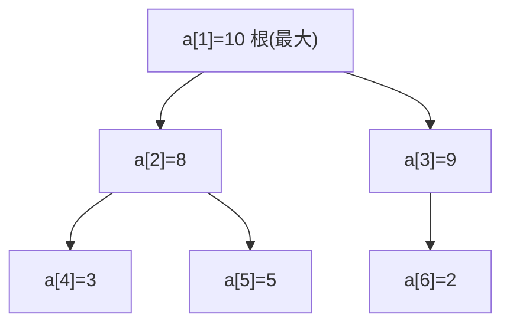

# 第 2 章（2.4）：优先队列与堆排序

- **难度**：★★☆ | **预估学时**：3 小时 | **前置**：ch01c、ch02b

## 学习目标
学完本节，你能：
1. 说清**优先队列**和普通队列的区别（按优先级出队，不是按先后）；
2. 理解**堆（heap）**的数组表示：父下标 i 的孩子是 2i、2i+1；
3. 写出 swim/sink 两个堆操作，并说出堆排序的 O(N log N)。

## 一句话核心
堆是一颗"父总比孩子大"的完全二叉树，存在数组里；优先队列靠它取最值只需 O(log N)，堆排序就是"建堆 + 反复删顶"。

## 零基础讲解

### 概念 1：优先队列（priority queue，难度：基础）
**优先队列**：取出的不是最早入队的，而是**优先级最高（最大或最小）**的元素。API：`insert`（插入）、`delMax`（删去并返回最大）。

类比：医院急诊——不是挂号先后来，而是重伤员先看。*失效边界*：它不支持"按优先级查找任意元素"，只取极值。

### 概念 2：堆的定义（heap，难度：进阶）
**二叉堆（binary heap）**：一颗完全二叉树，每个节点 ≥ 它的两个孩子（**堆有序**）。用数组表示，根在 `a[1]`（下标 0 留空）：
- 节点 i 的父亲：`i/2`；
- 节点 i 的孩子：`2i` 和 `2i+1`。

"完全二叉树"= 每一层都填满，最后一层只靠左填。

### 概念 3：swim 与 sink（难度：进阶）
- **swim（上浮）**：新元素加到末尾，若比父亲大就和父亲交换，一路浮到合适位置。
```java
private void swim(int k) {
    while (k > 1 && less(k/2, k)) { exch(k, k/2); k = k/2; }
}
```
- **sink（下沉）**：若节点比孩子小，和较大的那个孩子交换，一路沉下去。
```java
private void sink(int k) {
    while (2*k <= N) {
        int j = 2*k;
        if (j < N && less(j, j+1)) j++;   // 选较大孩子
        if (!less(k, j)) break;
        exch(k, j); k = j;
    }
}
```
树高 ≤ lg N，所以 swim/sink 都是 O(log N)。

### 概念 4：堆排序（heapsort，难度：高难）
两步：
1. **建堆**：从右半数组开始逐个 sink（`for k=N/2 … 1`），O(N)；
2. **排序**：把堆顶（最大值）`a[1]` 换到末尾 a[N]，缩小堆大小后 sink(1)，重复——像"选择排序的高效版"。

总成本 **O(N log N)**，原地排序（O(1) 额外空间）。

## 图示

**看图说明**：父 ≥ 子。根 10 是全队最大；数组 [_,10,8,9,3,5,2]，下标关系 1→(2,3)、2→(4,5)、3→(6) 一目了然。

## 类比与实例
- **类比**：锦标赛赛制。冠军（根）总是最强；淘汰一个冠军后，让亚军"上浮"补位（swim/sink）。*失效边界*：堆只保证根最大，不保证左右子树之间有大小关系。
- **实例**：插入 3、1、2。swim 后堆 [_,3,1,2]；delMax 取出 3，把末尾 2 换到根后 sink → [_,2,1]。

## 常见误解
- **别以为**堆是"有序数组"——实际上堆只保证根是最值，兄弟之间无序。
- **别以为**优先队列就是排序——实际上它只吐最值，中间元素保持乱序即可，比全排序便宜。
- **别以为**堆排序有 O(N) 可能——实际上建堆 O(N)，但 N 次 delMax 每次 O(log N)，总 O(N log N)。

## 自测题（答案）
1. 下标 5 的节点，它的父亲和两个孩子下标是？（答案：父亲 2，孩子 10、11；解析：父=i/2，孩子=2i、2i+1。）
2. swim 和 sink 各是什么作用？（答案：swim 把过大的叶子上浮到合规位置；sink 把过小的根下沉；解析。）
3. 堆排序总时间复杂度？（答案：O(N log N)；解析：N 次 delMax 各 O(log N)。）
4. 堆是稳定排序吗？（答案：不稳定；解析：交换跨节点会破坏相等元素顺序。）

## 复习锚点
- 优先队列：按最值出队；堆 = 父 ≥ 子的完全二叉树。
- swim/sink：对数级维护堆有序。
- 堆排序：建堆 O(N) + N 次删顶 O(N log N)，原地。
