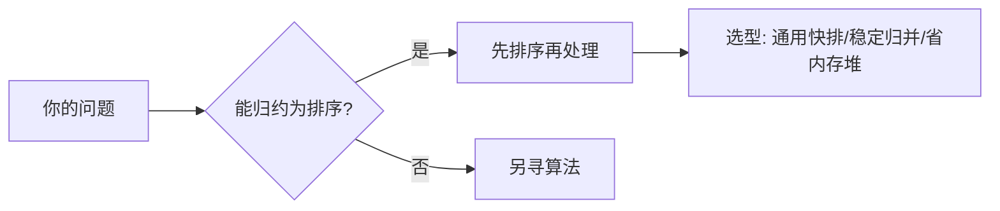

# 第 2 章（2.5）：排序应用与"我该用哪种排序"

- **难度**：★☆☆ | **预估学时**：1.5 小时 | **前置**：ch02a~ch02d

## 学习目标
学完本节，你能：
1. 说清**Comparable 接口**与多种数据排序的方式；
2. 根据场景选择排序算法（原书 2.5.2 的选型表）；
3. 理解**问题归约（reduction）**思想：把新问题翻译成已解决的问题。

## 一句话核心
排序不是目的而是工具——求中位数、去重、二分查找全都先排序；选型口诀：通用快排，稳定用归并，内存紧用堆。

## 零基础讲解

### 概念 1：排序任意数据类型（难度：基础）
让类实现 `Comparable` 接口的 `compareTo` 方法，排序函数就能对该类数组排序。关键抽象：排序只依赖"能比大小"，与具体数据无关。

### 概念 2：选型表（原书 2.5.2，难度：基础）
| 算法 | 平均 | 最坏 | 额外空间 | 稳定？ | 一句话 |
|---|---|---|---|---|---|
| 选择排序 | N²/2 | N²/2 | 1 | 否 | 交换最少，但无论输入都慢 |
| 插入排序 | N²/4 | N² | 1 | 是 | 基本有序时线性 |
| 希尔排序 | N^{?}（突破平方） | ？ | 1 | 否 | 中等规模实用 |
| 归并排序 | N lg N | N lg N | N | 是 | 有保证、稳定，代价是空间 |
| 快速排序 | 1.39 N lg N | N² | lg N | 否 | 通用最快，需随机化 |
| 三向快排 | N（大量重复键） | N² | lg N | 否 | Java 原始类型系统排序 |
| 堆排序 | 2N lg N | 2N lg N | 1 | 否 | 原地 + 最坏保证 |

**Java 库的选择**（原书）：对原始数据类型用三向切分快排，对引用类型用归并排序（因为引用排序要稳定）。

### 概念 3：问题归约（reduction，难度：进阶）
**归约**：把问题 A 翻译成已有解的问题 B。例：
- 找中位数 → 排序后取中间；
- 去重 → 排序后扫一遍删相邻重复；
- 二分查找 → 先排序再查找。
原书强调：归约是算法设计最重要的通用工具之一。

## 图示

**看图说明**：遇到新问题先问"能不能变成排序问题"——这是全书反复出现的思维路径。

## 类比与实例
- **类比**：把"算平均工资"归约为"先按工号排序工资表再求均值"——排序是预处理工序。*失效边界*：归约后的解法必须真能反解原问题，不能丢信息。
- **实例**：一组成绩求前 K 名——排序取前 K（O(N log N)），或用大小 K 的优先队列（O(N log K)）。后者在 K≪N 时更优。

## 常见误解
- **别以为**Java 内部排序对所有类型都用同一种——实际上原始类型用三向快排、引用类型用归并，差别就在稳定性需求。
- **别以为**堆排序没用——实际上它是唯一"原地 + O(N log N) 最坏保证"的排序，对实时系统（不能容忍偶发慢）不可替代。
- **别以为**归约只是"偷懒"——实际上它让一个问题的算法进展自动惠及一类问题，是算法理论的核心方法。

## 自测题（答案）
1. Java 对 `int[]` 和 `String[]` 分别默认用什么排序？（答案：原始类型 int 用三向快排；引用类型 String 用归并；解析：引用排序要稳定。）
2. 内存极度紧张且要 O(N log N) 最坏保证，选？（答案：堆排序；解析：原地 O(1) 额外空间。）
3. "求数组中第 K 大的数"如何归约？（答案：排序后取倒数第 K 个；解析：或用大小 K 的优先队列更优。）
4. 哪种排序是稳定的？（答案：插入排序、归并排序；解析：选择、希尔、快排、堆排序不稳定。）

## 复习锚点
- 选型：通用快排；稳定归并；内存紧堆；近乎有序插排。
- 问题归约 = 把新问题翻译成排序问题。
- Java：原始类型三向快排，引用类型归并。
