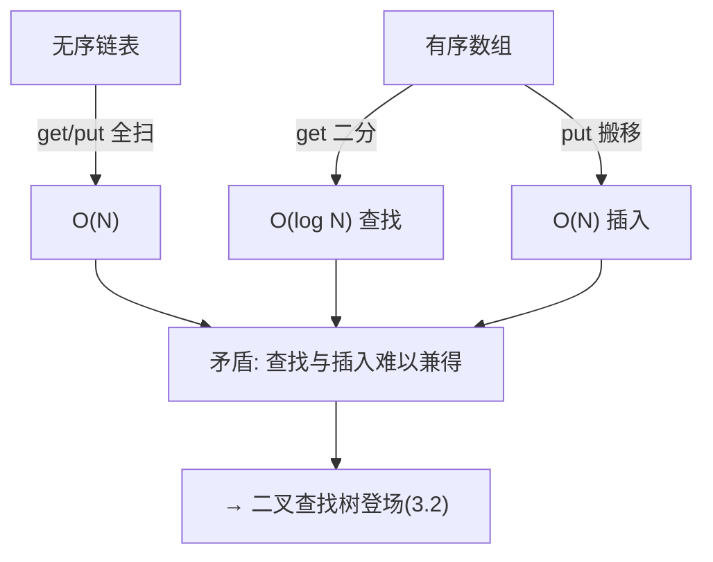

# 第 3 章（3.1）：符号表——查找问题的接口与朴素实现

- **难度**：★☆☆ | **预估学时**：2 小时 | **前置**：ch01a（二分查找）、ch01c

## 学习目标
学完本节，你能：
1. 说清**符号表（symbol table）**的 API：put/get/delete/contains/size/keys；
2. 区分有序与无序符号表；
3. 用链表顺序查找和有序数组二分查找两种朴素实现，知道它们的成本。

## 一句话核心
符号表就是"键值对字典"：给个 key 取回 value；最朴素的两版是无序链表（O(N)）和有序数组（O(log N) 查找但插入慢）。

## 零基础讲解

### 概念 1：符号表 API（难度：基础）
**符号表**：存储一组键值对 (key, value) 的 ADT。核心操作：
- `put(key, value)`：存入/更新；
- `get(key)`：取值，不存在返回 null；
- `delete(key)`、`contains(key)`、`size()`、`keys()`（所有键）。

**约定**：键不重复（同键后值覆盖前值）；null 不许作键。

### 概念 2：有序 vs 无序（难度：基础）
- **无序符号表**：键不排序，只支持最基本 get/put。
- **有序符号表**：键保持有序，额外支持 `min/max`（最小/最大键）、`floor`（≤ key 的最大键）、`rank`（小于 key 的键数）、`select(k)`（第 k 小）、`deleteMin/deleteMax`、范围查询 `keys(lo,hi)`。

### 概念 3：无序链表顺序查找（难度：基础）
链表存键值对，get 从头逐个比，找到才停；put 也得先扫一遍看键是否已存在。**查找和插入都 O(N)**——N 条条目最坏扫到底。

### 概念 4：有序数组 + 二分查找（难度：进阶）
两个平行数组：`keys[]` 有序，`vals[]` 对应。get 用第 1 章的二分查找——**O(log N)**。
但 put 要把新键插到正确位置并搬移后面的元素——**O(N)** 搬移。

这组对比暴露核心矛盾：**查找快的结构插入慢，插入快的结构查找慢**。第 3.2 节二叉查找树就是来解这个矛盾的。

## 图示

**看图说明**：朴素实现的两难——这个矛盾正是后面 BST、红黑树、散列表的设计动机。

## 类比与实例
- **类比**：纸质字典（有序数组）查得快（二分），但要插入一个新词得重排页码（贵）；纸条上随手记（链表）插得快，但找一条要翻遍所有纸条。*失效边界*：真实字典既有索引又可加页，比这两种极端都好——BST 就是那个"更好"。
- **实例**：FrequencyCounter 统计文本词频：读入每个词 `put(word, get(word)+1)`，最后遍历 keys 找最高频词。

## 常见误解
- **别以为**符号表就是数组——实际上它是抽象接口，数组/链表/BST/散列都能当它的实现。
- **别以为**有序数组二分查找是免费的——实际上它把 O(N) 成本从查找挪到了插入。
- **别以为**键必须是数字——实际上任何可比较类型都行（字符串、日期……）。

## 自测题（答案）
1. 符号表 put 同一个键两次会怎样？（答案：后值覆盖前值，键仍只有一个；解析。）
2. 有序符号表比无序多出哪类操作？举两个。（答案：min/max、floor、rank、select、范围查询等；解析：依赖键有序。）
3. 有序数组实现符号表，get 和 put 各什么量级？（答案：get O(log N)，put O(N)；解析：二分查找 vs 搬移插入。）
4. 无序链表顺序查找的最坏成本？（答案：O(N)；解析：每次从头扫到尾。）

## 复习锚点
- 符号表 = 键值对字典，核心 put/get。
- 有序额外能力：min/max/floor/rank/select。
- 朴素两难：链表 O(N) 全慢；有序数组查找 log N 但插入 N。
