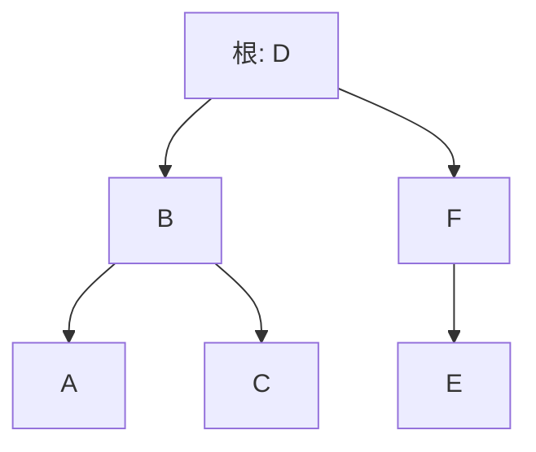
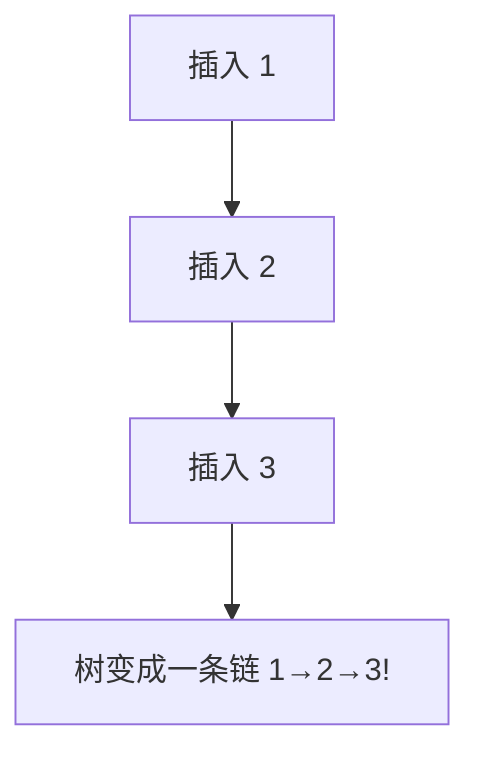

# 第 3 章（3.2）：二叉查找树（BST）

- **难度**：★★☆ | **预估学时**：3 小时 | **前置**：ch03a、ch01a（递归）

## 学习目标
学完本节，你能：
1. 说清**二叉查找树**的定义：左子树键 < 根 < 右子树键；
2. 写出 BST 的 get/put 递归代码，理解为什么它们是树高量级；
3. 说出随机键构造的 BST 平均查找 ~2 ln N ≈ 1.39 lg N，以及它为什么会"长歪"。

## 一句话核心
BST = 每个节点左小右大的二叉树；查找像二分查找，但插入只需挂新叶——两全其美，直到树长歪。

## 零基础讲解

### 概念 1：定义（难度：基础）
**二叉查找树（Binary Search Tree, BST）**：一棵二叉树，每个节点含一个键，且满足——**左子树所有键 < 该节点键 < 右子树所有键**。这一条"中序有序"性质是全部操作的基础。

### 概念 2：get（查找，难度：进阶）
从根开始：key 等于节点键 → 命中；key 更小 → 去左子树找；key 更大 → 去右子树找。到 null 即不存在。和二分查找同构，但走的是树的一条路径。

```java
public Value get(Key key) {
    Node x = root;
    while (x != null) {
        int cmp = key.compareTo(x.key);
        if      (cmp < 0) x = x.left;
        else if (cmp > 0) x = x.right;
        else    return x.val;
    }
    return null;
}
```

### 概念 3：put（插入，难度：进阶）
递归查找空位，在该处挂一个新叶节点。**关键：插入不改已有节点指针，只加叶子**——这就是它比有序数组快的原因。

### 概念 4：分析与"长歪"（难度：高难）
原书命题 C：由 N 个**随机键**构造的 BST，查找命中平均比较次数 **~2 ln N ≈ 1.39 lg N**。

**但是**：若键按顺序插入（1,2,3,…,N），BST 退化成一条链——查找变 O(N)。树高完全取决于插入顺序。这就是 3.3 节**平衡查找树**要解决的问题：保证任何插入顺序下树都不歪。

### 概念 5：有序性方法（难度：进阶）
- `min`：一路向左走到头；
- `floor(key)`：≤ key 的最大键——递归判断；
- `rank(key)`：小于 key 的键数——左子树大小 + 递归；
- 删除：最复杂的是删有两个孩子的节点，用**右子树最小节点**替代。

## 图示

**看图说明**：中序遍历 A B C D E F 严格升序——这就是"左小右大"性质。查找 C：D→B→C 三次比较。


**看图说明**：有序插入让 BST 长歪成链表——这就是 BST 的天生缺陷。

## 类比与实例
- **类比**：家谱式二分——root 是中等人，左边全是更矮的亲戚、右边全是更高的。*失效边界*：如果你按身高顺序一个个加人（从矮到高），树就歪成一队，优势全失。
- **实例**：插入 D、B、F、A、C、E 得到上图平衡树；插入顺序改成 A、B、C、D、E、F 则得右斜链。

## 常见误解
- **别以为** BST 查找是 O(log N) 有保证——实际上平均 1.39 lg N 只在**随机键**下成立，最坏 O(N)。
- **别以为** BST 和二分查找完全一样——二分查找作用于静态有序数组，BST 是动态树、支持插入删除。
- **别以为**删除节点就是直接摘掉——实际上有两个孩子时要用右子树最小节点补位，保持 BST 性质。

## 自测题（答案）
1. BST 的核心性质一句话是什么？（答案：左子树键 < 根键 < 右子树键；解析：中序遍历必升序。）
2. 随机 N 键构造的 BST，平均查找命中约？（答案：~2 ln N ≈ 1.39 lg N；解析：命题 C。）
3. 按 1,2,3,4 顺序插入构造的 BST 长什么样？（答案：一条向右的链；解析：每次新键都比所有旧键大，只能挂最右。）
4. BST 的 min 操作怎么走？（答案：从根一路向左走到无左孩子；解析。）

## 复习锚点
- BST：左小右大；查找=走根到叶的一条路。
- 平均 1.39 lg N，但最坏退化成链。
- 平衡树（3.3）就是为了治"长歪"。
