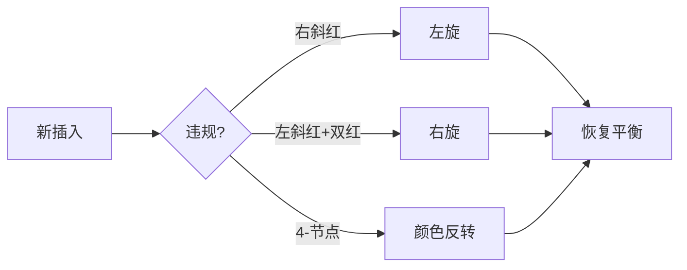

# 第 3 章（3.3）：平衡查找树——2-3 树与红黑树

- **难度**：★★★ | **预估学时**：4 小时 | **前置**：ch03b

## 学习目标
学完本节，你能：
1. 说清**2-3 查找树**为什么天然平衡；
2. 理解**红黑树**是 2-3 树的"二叉树编码"：红链接把 3-节点拉平；
3. 记住关键结论：N 个节点的红黑树高度 ≤ 2 lg N，所有操作对数级。

## 一句话核心
红黑树 = 给 BST 加颜色规则，让树任何插入顺序下都保持"近乎完美平衡"，把最坏查找从 O(N) 救回 O(log N)。

## 零基础讲解

### 概念 1：2-3 查找树（难度：高难）
允许两种节点：
- **2-节点**：一个键，两个孩子（普通 BST 节点）；
- **3-节点**：两个键，三个孩子。

插入时先接到叶子：若临时变成 4-节点，**分裂**成三个 2-节点，中间键上浮给父亲。这个"分裂上浮"一路向上，树始终**完美平衡**——所有叶子等高。

### 概念 2：红黑树的直觉（难度：高难）
直接实现 2-3 树很麻烦。**红黑树（red-black BST）**巧在：用"红链接"把 3-节点画扁——把两个键绑在一起的节点画成一个红链接连接的二叉小结构。于是：
- 红链接连接的两节点"假装"是一个 3-节点；
- 黑链接就是普通 BST 链接。

**规则**：① 红链接左斜；② 从根到叶没有两条连续红链接；③ 树完美黑平衡（任一空链接到根的黑链接数相同）。

### 概念 3：三种平衡操作（难度：高难）
插入后可能违规，用两个手术修：
- **左旋（rotate left）**：右斜红链接掰向左；
- **右旋（rotate right）**：左斜红链接掰向右；
- **颜色反转（flip colors）**：4-节点分裂，两孩子变黑、自己变红——对应 2-3 树的分裂上浮。

### 概念 4：关键结论（难度：进阶）
- 命题 G：N 个节点的红黑树高度 **≤ 2 lg N**；
- 命题 I：查找、插入、删除全在**最坏对数级别**；
- 工程含义：TreeMap/TreeSet、Linux 内核、C++ STL 都用红黑树。

## 图示
```mermaid
flowchart TD
    subgraph 2-节点
        P1["键 K"] --> C1["子1"]
        P1 --> C2["子2"]
    end
    subgraph 3-节点(红黑树中画扁)
        P2["键小"] ==红==> P3["键大"]
        P2 --> D1
        P3 --> D2
    end
```
**看图说明**：红链接（粗红）把 3-节点"压扁"成两个普通节点——红黑树因此长得像 BST，却带着 2-3 树的平衡性。


**看图说明**：每次插入后用旋转/变色三件套修复，保证三条颜色规则永不破。

## 类比与实例
- **类比**：2-3 树像"可合并的车厢"——车厢挤了（4-节点）就拆成两节，中间乘客（键）升往上层；红黑树是把"两节车厢并排画"的工程画法。*失效边界*：红黑树不是完美平衡（高度可到 2 lg N），只是"足够平衡"，换来实现简单。
- **实例**：按 A、C、E、G 顺序插入——普通 BST 会右斜成链，红黑树通过旋转把它掰成矮胖。

## 常见误解
- **别以为**红黑树是完美平衡——实际上高度可达 2 lg N，只是"近似平衡"。
- **别以为**红链接是"数据"——实际上它只是**标记**，不影响中序遍历的键顺序。
- **别以为**学红黑树必须背下全部旋转代码——实际上核心是理解"它是 2-3 树的二叉编码 + 三种修复操作"，代码细节可查。

## 自测题（答案）
1. 红黑树中"红链接"代表什么？（答案：两个节点共同构成一个 3-节点；解析：是 2-3 树的编码标记。）
2. N 节点红黑树的高度上界？（答案：2 lg N；解析：命题 G。）
3. 红黑树插入后修复的三种操作？（答案：左旋、右旋、颜色反转；解析。）
4. 红黑树相对普通 BST 解决了什么致命问题？（答案：有序键插入导致树退化成链、查找 O(N)；解析：红黑树保证对数级。）

## 复习锚点
- 2-3 树：2-节点/3-节点，分裂上浮，完美平衡。
- 红黑树 = 2-3 树的二叉编码：红链接绑 3-节点。
- 高 ≤ 2 lg N，全操作对数级。
